# Module 00: Spring Security Learning Roadmap & Study Strategy

---

## 1. Executive Summary

Spring Security is often perceived as one of the most complex frameworks in the Spring ecosystem. This reputation stems from two main causes:
1. **Abstraction Leaks:** Developers often configure annotations (`@EnableWebSecurity`, `@PreAuthorize`) without understanding the underlying Jakarta Servlet filter lifecycle.
2. **Deprecated Paradigms:** Tutorials written for Spring Security 4/5 heavily rely on `WebSecurityConfigurerAdapter` and method chaining (`.and()`), which were removed in Spring Security 6 (Spring Boot 3).

This roadmap provides a structured, progressive path designed to build a deep, architectural understanding of modern Spring Security.

---

## 2. Learning Progression Matrix

```mermaid
flowchart TD
    subgraph Foundation ["Stage 1: Foundation (Modules 01 - 03)"]
        M1["01. Security Fundamentals"]
        M2["02. Servlet Filter Architecture"]
        M3["03. Spring Security Internal Architecture"]
        M1 --> M2 --> M3
    end

    subgraph Authentication_Core ["Stage 2: Core Authentication (Modules 04 - 08)"]
        M4["04. Authentication Architecture"]
        M5["05. Authorization & Access Control"]
        M6["06. SecurityContext & SecurityContextHolder"]
        M7["07. UserDetails & AuthenticationProvider"]
        M8["08. Password Encoding & Hashing"]
        M3 --> M4
        M4 --> M5 --> M6 --> M7 --> M8
    end

    subgraph Configuration_Web ["Stage 3: Web Security Configuration (Modules 09 - 11)"]
        M9["09. Spring Security Configuration"]
        M10["10. Form Login & HTTP Basic"]
        M11["11. Custom Authentication Providers"]
        M8 --> M9 --> M10 --> M11
    end

    subgraph Advanced_Auth ["Stage 4: Stateless & Distributed Security (Modules 12 - 14)"]
        M12["12. JWT & Stateless Authentication"]
        M13["13. Role-Based Access Control (RBAC)"]
        M14["14. Session Management & Control"]
        M11 --> M12 --> M13 --> M14
    end

    subgraph Exploits_Methods ["Stage 5: Hardening & Granular Security (Modules 15 - 17)"]
        M15["15. CORS & CSRF Deep Dive"]
        M16["16. Exception Handling & Security Events"]
        M17["17. Method-Level Security"]
        M14 --> M15 --> M16 --> M17
    end

    subgraph Enterprise ["Stage 6: Enterprise & Production (Modules 18 - 22)"]
        M18["18. OAuth2 & Resource Server"]
        M19["19. Security Testing"]
        M20["20. Production Security Best Practices"]
        M21["21. Interview Preparation"]
        M22["22. End-to-End Implementation Blueprint"]
        M17 --> M18 --> M19 --> M20 --> M21 --> M22
    end
```

---

## 3. Module Overview & Dependency Graph

| Stage | Module Files | Core Deliverable |
|---|---|---|
| **Stage 1** | `01-spring-security-fundamentals.md` `02-servlet-filter-architecture.md` `03-spring-security-internal-architecture.md` | Master the bridge between Tomcat and Spring: `DelegatingFilterProxy`, `FilterChainProxy`, and `SecurityFilterChain`. |
| **Stage 2** | `04-authentication-architecture.md` `05-authorization-and-access-control.md` `06-security-context-and-context-holder.md` `07-user-details-and-authentication-provider.md` `08-password-encoding.md` | Master the core Java models: `AuthenticationManager`, `ProviderManager`, `SecurityContextHolder`, `PasswordEncoder`. |
| **Stage 3** | `09-spring-security-configuration.md` `10-form-login-and-http-basic.md` `11-custom-authentication.md` | Configure security using Spring Security 6 component-based DSL; build custom authentication tokens. |
| **Stage 4** | `12-jwt-authentication.md` `13-role-based-access-control.md` `14-session-management.md` | Build production stateless JWT architecture with refresh tokens, role hierarchies, and session policies. |
| **Stage 5** | `15-cors-and-csrf.md` `16-exception-handling.md` `17-method-level-security.md` | Defend against browser exploits (CSRF, CORS), customize 401/403 JSON payloads, and apply SpEL method security. |
| **Stage 6** | `18-oauth2-and-resource-server.md` `19-security-testing.md` `20-production-security-best-practices.md` `21-interview-preparation.md` `22-end-to-end-implementation-guide.md` | Deploy OAuth2 Resource Server, write comprehensive MockMvc security tests, review interview Q&A, and run the unified application. |

---

## 4. Practical Implementation Checklist

When implementing the code samples found in each module, verify the following:

- [ ] Use `jakarta.servlet.*` instead of legacy `javax.servlet.*`.
- [ ] Declare `SecurityFilterChain` as a `@Bean`, never extend `WebSecurityConfigurerAdapter`.
- [ ] Use `authorizeHttpRequests(auth -> auth...)`, never `authorizeRequests()`.
- [ ] Use `requestMatchers()`, never `antMatchers()` or `mvcMatchers()`.
- [ ] Always encode passwords using `BCryptPasswordEncoder` or `DelegatingPasswordEncoder`.
- [ ] Never store unhashed passwords in memory or database.
- [ ] Stateless REST APIs must configure `SessionCreationPolicy.STATELESS` and disable CSRF.
