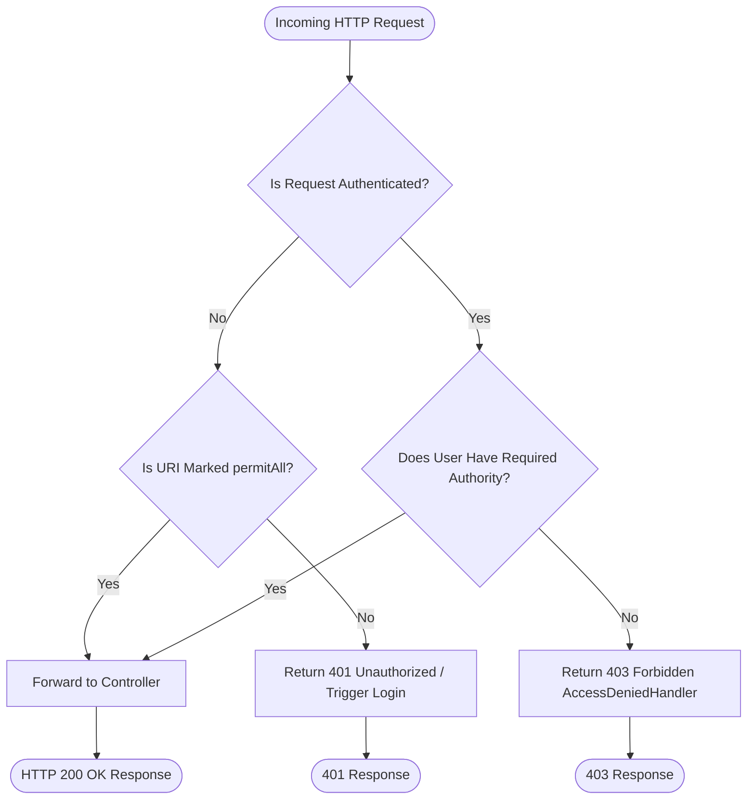

# Module 01: Spring Security Fundamentals

---

## 1. Definition

* [ ] 

At a high level, Spring Security addresses two primary operational concerns:

* **Authentication:** The process of validating the identity of a principal (user, service, or device) seeking access to a system. In plain terms: *"Who are you?"*
* **Authorization (Access Control):** The process of determining whether an authenticated principal has the requisite permissions to perform a specific action on a resource. In plain terms: *"What are you permitted to do?"*

Beyond authentication and authorization, Spring Security provides comprehensive defenses against web security vulnerabilities, including Cross-Site Request Forgery (CSRF), Cross-Site Scripting (XSS) header protections, Session Fixation, and Clickjacking.

---

## 2. Why It Exists

Securing enterprise applications without a dedicated framework introduces major risks:

1. **Security Anti-Patterns:** Homegrown security implementations frequently suffer from timing attacks, hardcoded salts, improper password hashing, or missed URL boundary checks.
2. **Boilerplate Interception:** Writing bespoke servlet filters or interceptors across microservices leads to duplicated code and inconsistent access-control logic.
3. **Defense in Depth:** Modern web security requires more than just login forms. It requires secure HTTP headers (HSTS, CSP, Frame-Options), protection against session hijacking, and standardized token parsing (JWT, OAuth2).
4. **Separation of Concerns:** Spring Security abstracts security concerns away from business logic, allowing controllers and services to focus purely on business operations.

---

## 3. Internal Working

Spring Security does not rewrite the HTTP transport layer. Instead, it relies on the **Jakarta Servlet Filter specification**.

```
[ HTTP Client ] 
       │ (Raw HTTP Request)
       ▼
[ Servlet Container (Tomcat/Jetty) ]
       │
       ▼
[ Spring Security Filter Chain ]  <─── (Authentication & Access Control Gate)
       │ (If Authorized)
       ▼
[ DispatcherServlet (Spring MVC) ]
       │
       ▼
[ Controller (@RestController) ]
```

When an HTTP request enters the web container:

1. It is intercepted by Spring Security's filter infrastructure **before** it can touch Spring MVC's `DispatcherServlet`.
2. The security layer extracts credentials (from headers, request body, or cookies) and builds an `Authentication` object.
3. The framework queries configured authentication providers to validate the identity.
4. If valid, an authenticated `Authentication` token is stored in the current thread's `SecurityContext`.
5. Authorization filters verify whether the authenticated identity possesses the necessary roles or authorities to access the requested URI.
6. If both checks pass, the request continues down the chain to the `DispatcherServlet`. If either check fails, the request is terminated immediately with an HTTP 401 (Unauthorized) or HTTP 403 (Forbidden) response.

---

## 4. Architecture and Flow Diagram

### The Core Security Decision Flow



---

## 5. Important Classes and Interfaces

| Component                 | Type      | Responsibility                                                                                                   |
| ------------------------- | --------- | ---------------------------------------------------------------------------------------------------------------- |
| `Authentication`        | Interface | Represents the principal, credentials, and granted authorities of a request.                                     |
| `SecurityContext`       | Interface | Holds the current `Authentication` instance for the thread.                                                    |
| `SecurityContextHolder` | Class     | ThreadLocal-based utility providing static access to the `SecurityContext`.                                    |
| `GrantedAuthority`      | Interface | Represents an individual permission or role granted to the principal (e.g., `ROLE_ADMIN`, `READ_PRIVILEGE`). |
| `UserDetails`           | Interface | Core user representation used across Spring Security.                                                            |
| `UserDetailsService`    | Interface | Data access strategy used to retrieve user records by username.                                                  |

---

## 6. Practical Code Examples

### Minimal Spring Boot 3 Security Setup

To enable Spring Security in a Spring Boot application, add the starter dependency to `pom.xml`:

```xml
<dependency>
    <groupId>org.springframework.boot</groupId>
    <artifactId>spring-boot-starter-security</artifactId>
</dependency>
```

By default, adding this dependency locks down **every single endpoint** in your application, generates a default password in the console output, and creates a form-based login page at `/login`.

### Demonstrating Authentication & Authorization in Controller

```java
package com.example.security.controller;

import org.springframework.security.core.Authentication;
import org.springframework.security.core.GrantedAuthority;
import org.springframework.security.core.context.SecurityContextHolder;
import org.springframework.web.bind.annotation.GetMapping;
import org.springframework.web.bind.annotation.RequestMapping;
import org.springframework.web.bind.annotation.RestController;

import java.util.HashMap;
import java.util.Map;
import java.util.stream.Collectors;

@RestController
@RequestMapping("/api/v1")
public class SecurityDemoController {

    @GetMapping("/public/ping")
    public Map<String, String> publicPing() {
        Map<String, String> response = new HashMap<>();
        response.put("status", "UP");
        response.put("message", "This endpoint does not require authentication.");
        return response;
    }

    @GetMapping("/user/me")
    public Map<String, Object> getCurrentUser() {
        // Retrieve the authenticated principal from the thread-local SecurityContext
        Authentication authentication = SecurityContextHolder.getContext().getAuthentication();

        Map<String, Object> details = new HashMap<>();
        details.put("username", authentication.getName());
        details.put("authenticated", authentication.isAuthenticated());
        details.put("authorities", authentication.getAuthorities().stream()
                .map(GrantedAuthority::getAuthority)
                .collect(Collectors.toList()));

        return details;
    }
}
```

---

## 7. Line-by-Line Explanation

1. `Authentication authentication = SecurityContextHolder.getContext().getAuthentication();`:
   * `SecurityContextHolder` accesses the context associated with the current execution thread (`ThreadLocal`).
   * `getContext()` returns the active `SecurityContext`.
   * `getAuthentication()` returns the verified token representing the caller.
2. `authentication.getName()`:
   * Returns the principal identifier (typically the username or subject ID).
3. `authentication.getAuthorities()`:
   * Returns a collection of `GrantedAuthority` objects reflecting the permissions or roles assigned to the user.

---

## 8. Real-World Use Cases

* **Multi-Tier Authorization:** Allowing public users to view product catalogs (`GET /api/products`), registered users to place orders (`POST /api/orders`), and administrators to modify prices (`PUT /api/admin/products`).
* **Zero-Trust Microservices:** Intercepting internal inter-service requests via bearer tokens to ensure services cannot impersonate arbitrary tenants.
* **Audit Logging:** Accessing `SecurityContextHolder` within transactional services to record exact username metadata for compliance and mutation histories.

---

## 9. Common Mistakes

1. **Confusing Authentication with Authorization:** Attempting to assign access rights before verifying the caller's identity, or treating 401 (Unauthorized) and 403 (Forbidden) interchangeably.
2. **Assuming Spring Security works via AOP on Controllers:** Believing requests reach controller interceptors before being rejected. They do not; rejection happens in the Servlet Filter chain.
3. **Leaking SecurityContext in Asynchronous Tasks:** Using `@Async` without configuring security context propagation, causing background threads to see an empty or anonymous context.

---

## 10. Interview Questions & Detailed Answers

### Q1: What is the fundamental difference between Authentication and Authorization?

**Answer:**

* **Authentication** is the validation of credentials to prove identity (e.g., verifying that a username matches a hashed password or validating a cryptographic signature on a JWT). The result is an authenticated principal.
* **Authorization** is the evaluation of an authenticated principal against permission rules governing access to a target resource (e.g., checking if user `alice` has `ROLE_ADMIN` to execute `DELETE /users/42`).
* In HTTP status terms: Authentication failure produces `401 Unauthorized` (the client must authenticate), while Authorization failure produces `403 Forbidden` (the server understands who you are, but you lack permissions).

### Q2: What happens automatically when you add `spring-boot-starter-security` to a Spring Boot project?

**Answer:**
Spring Boot's auto-configuration (`SecurityAutoConfiguration`) executes:

1. It registers a `SecurityFilterChain` bean securing all endpoints (`anyRequest().authenticated()`).
2. It generates a default user in-memory with username `user` and prints a generated UUID password to the startup console.
3. It enables Form Login at `/login` and HTTP Basic authentication.
4. It registers security response headers (e.g., Cache-Control, X-Content-Type-Options, X-Frame-Options).
5. It enables CSRF protection for all state-modifying HTTP methods.

---

## 11. Quick Revision Notes

* **Security occurs at the Filter level:** Never inside controllers.
* **Authentication precedes Authorization:** Identity must be established before permissions can be evaluated.
* **The Holy Trinity:** `Authentication` (who), `GrantedAuthority` (what rights), `SecurityContext` (where it is kept during request execution).
* **HTTP Codes:** `401 Unauthorized` = Unauthenticated caller; `403 Forbidden` = Authenticated caller lacking authorization.
