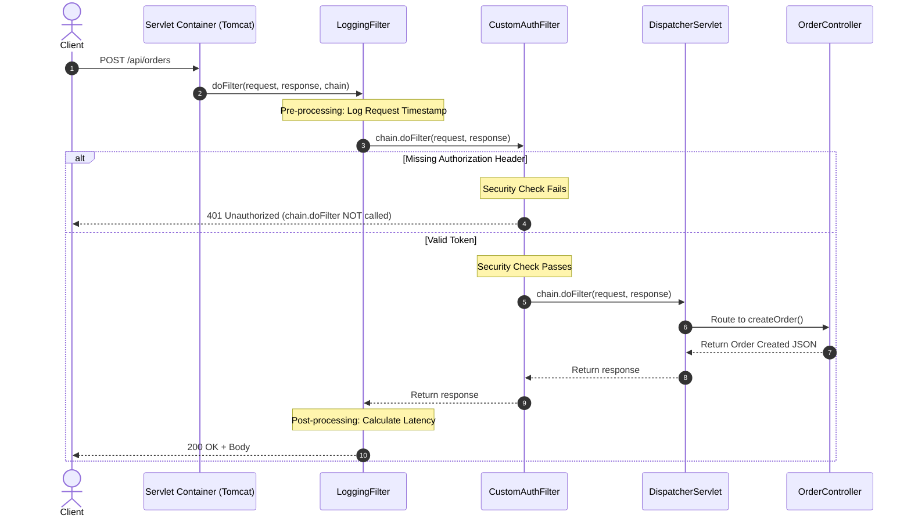

# Module 02: Servlet Filter Architecture

---

## 1. Definition

A **Servlet Filter** is a Jakarta EE (`jakarta.servlet.Filter`) object that intercepts incoming HTTP requests and outgoing HTTP responses. It performs filtering tasks such as logging, encryption, authentication, input validation, and character encoding before the request reaches the target Servlet (`DispatcherServlet`).

Spring Security is completely grounded in the Servlet Filter architecture.

---

## 2. Why It Exists

In web containers like Apache Tomcat, Jetty, or Undertow, an incoming socket connection is converted into an `HttpServletRequest` and passed through a chain of filters.

```
Incoming Request
      │
      ▼
┌───────────────┐
│   Filter 1    │ (e.g., CorsFilter)
└───────┬───────┘
        ▼
┌───────────────┐
│   Filter 2    │ (e.g., CharacterEncodingFilter)
└───────┬───────┘
        ▼
┌───────────────┐
│   Filter 3    │ (e.g., Security Filter)
└───────┬───────┘
        ▼
┌──────────────────┐
│ DispatcherServlet│ ──> Controllers (@RestController)
└──────────────────┘
```

Using filters for security provides three decisive advantages:
1. **Pre-Processing Protection:** Security checks execute before resource-intensive operations like JSON deserialization, multipart file uploads, or database queries.
2. **Request / Response Transformation:** Filters can wrap request objects (e.g., `HttpServletRequestWrapper`) to add headers, sanitize inputs, or intercept response streams.
3. **Decoupled Architecture:** Business controllers have zero dependency on the underlying transport-level security protocols.

---

## 3. Internal Working

The core Jakarta Servlet Filter API consists of three methods:

```java
package jakarta.servlet;

public interface Filter {
    default void init(FilterConfig filterConfig) throws ServletException {}
    
    void doFilter(ServletRequest request, ServletResponse response, FilterChain chain) 
        throws IOException, ServletException;
        
    default void destroy() {}
}
```

### The `FilterChain` Pipeline
The `FilterChain` object coordinates execution. When a filter finishes its pre-processing logic, it calls:
```java
chain.doFilter(request, response);
```
This causes the container to invoke the next filter in sequence. 

If a filter decides to **abort** the request (for example, if authentication fails):
1. It does **not** call `chain.doFilter(...)`.
2. It writes directly to the `HttpServletResponse` (e.g., `response.setStatus(401)`).
3. The execution halts, bypassing all downstream filters and the `DispatcherServlet`.

---

## 4. Architecture and Flow Diagram

### Servlet Filter Execution Lifecycle



---

## 5. Important Classes and Interfaces

| Class / Interface | Package | Role |
|---|---|---|
| `Filter` | `jakarta.servlet` | Base interface implemented by all servlet filters. |
| `FilterChain` | `jakarta.servlet` | Represents the execution chain; controls the invocation of subsequent filters. |
| `OncePerRequestFilter` | `org.springframework.web.filter` | Spring's abstract base filter ensuring execution occurs exactly **once per request dispatch** (crucial for async/forward scenarios). |
| `HttpServletRequestWrapper` | `jakarta.servlet.http` | Decorator pattern allowing modification or augmentation of HTTP request properties. |

---

## 6. Practical Code Examples

### Implementing a Low-Level Custom Servlet Filter
To illustrate the filter mechanics, here is a custom filter measuring request execution latency and verifying custom request headers:

```java
package com.example.security.filter;

import jakarta.servlet.*;
import jakarta.servlet.http.HttpServletRequest;
import jakarta.servlet.http.HttpServletResponse;
import org.slf4j.Logger;
import org.slf4j.LoggerFactory;
import org.springframework.stereotype.Component;

import java.io.IOException;

@Component
public class RequestPerformanceFilter implements Filter {

    private static final Logger log = LoggerFactory.getLogger(RequestPerformanceFilter.class);

    @Override
    public void init(FilterConfig filterConfig) {
        log.info("RequestPerformanceFilter initialized.");
    }

    @Override
    public void doFilter(ServletRequest request, ServletResponse response, FilterChain chain)
            throws IOException, ServletException {
        
        HttpServletRequest httpRequest = (HttpServletRequest) request;
        HttpServletResponse httpResponse = (HttpServletResponse) response;

        long startTime = System.currentTimeMillis();
        String path = httpRequest.getRequestURI();

        log.debug("Entering filter for URI: {}", path);

        try {
            // Forward request down the chain to the next filter or DispatcherServlet
            chain.doFilter(request, response);
        } finally {
            // Post-processing logic runs on the return path after controller executes
            long duration = System.currentTimeMillis() - startTime;
            log.info("URI: {} took {} ms to process with status: {}", 
                     path, duration, httpResponse.getStatus());
        }
    }

    @Override
    public void destroy() {
        log.info("RequestPerformanceFilter destroyed.");
    }
}
```

### Implementing a Spring `OncePerRequestFilter`
In production Spring Security components, you should extend `OncePerRequestFilter` instead of implementing `Filter` directly. This guarantees the filter is not re-invoked during internal Servlet error-forwards or async dispatches:

```java
package com.example.security.filter;

import jakarta.servlet.FilterChain;
import jakarta.servlet.ServletException;
import jakarta.servlet.http.HttpServletRequest;
import jakarta.servlet.http.HttpServletResponse;
import org.springframework.web.filter.OncePerRequestFilter;

import java.io.IOException;

public class CustomHeaderValidationFilter extends OncePerRequestFilter {

    @Override
    protected void doFilterInternal(HttpServletRequest request,
                                    HttpServletResponse response,
                                    FilterChain filterChain) throws ServletException, IOException {
        
        String customHeader = request.getHeader("X-Custom-Client-Id");

        // Conditional path matching: only inspect /api/** paths
        if (request.getRequestURI().startsWith("/api/") && (customHeader == null || customHeader.isBlank())) {
            response.setStatus(HttpServletResponse.SC_BAD_REQUEST);
            response.setContentType("application/json");
            response.getWriter().write("{\"error\": \"Missing required header: X-Custom-Client-Id\"}");
            return; // Terminate execution; do NOT invoke filterChain.doFilter()
        }

        // Continue processing
        filterChain.doFilter(request, response);
    }
}
```

---

## 7. Line-by-Line Explanation

1. `public class CustomHeaderValidationFilter extends OncePerRequestFilter`:
   * Provides a framework guarantee that `doFilterInternal` will be invoked at most once per request thread.
2. `String customHeader = request.getHeader("X-Custom-Client-Id");`:
   * Reads raw HTTP headers directly from the incoming Servlet request.
3. `response.setStatus(HttpServletResponse.SC_BAD_REQUEST);`:
   * Immediately assigns HTTP 400 status.
4. `response.getWriter().write(...);`:
   * Flushes the response payload directly back to the client socket.
5. `return;`:
   * Stops execution. By omitting `filterChain.doFilter(request, response)`, the downstream security filters and `DispatcherServlet` are completely bypassed.

---

## 8. Real-World Use Cases

* **Tenant Resolution Filter:** Extracting tenant IDs from subdomain URLs (`tenant1.api.com`) and binding the tenant context before security authentication evaluates user credentials.
* **Request Correlation Filter:** Reading or generating an `X-Correlation-ID` header and injecting it into SLF4J MDC for distributed tracing across microservices.
* **IP Whitelisting Filter:** Rejecting connections from non-whitelisted IP addresses before any database or cryptographic operations occur.

---

## 9. Common Mistakes

1. **Forgetting to call `chain.doFilter()`:** If validation succeeds but you forget to call `chain.doFilter(request, response)`, the request hangs or returns an empty 200 OK without executing downstream controllers.
2. **Calling `chain.doFilter()` after writing to the response:** If you write error JSON to `HttpServletResponse` and still invoke `chain.doFilter()`, you will trigger `IllegalStateException: Cannot call sendError() after the response has been committed`.
3. **Registering Security Filters as standard `@Component` beans:** If a custom security filter is declared as a generic `@Component`, Spring Boot may register it **twice**: once in the standard Servlet Container filter chain and again inside Spring Security's `SecurityFilterChain`.

---

## 10. Interview Questions & Detailed Answers

### Q1: What is the architectural difference between a Servlet Filter and a Spring MVC HandlerInterceptor?
**Answer:**
* **Servlet Filter (`jakarta.servlet.Filter`):** Operates at the Servlet container layer before the request reaches `DispatcherServlet`. It can inspect, alter, or terminate requests before any Spring MVC routing, data binding, or JSON conversion happens.
* **HandlerInterceptor (`org.springframework.web.servlet.HandlerInterceptor`):** Operates inside `DispatcherServlet`. It has access to the target Spring Controller method handler (`HandlerMethod`) and model/view metadata, but cannot prevent `DispatcherServlet` from parsing multipart uploads or binding request parameters.
* **Why Security uses Filters:** Security must enforce access boundaries at the outer network perimeter before any internal processing occurs.

### Q2: Why does Spring provide `OncePerRequestFilter`?
**Answer:**
In standard Servlet specifications, a request can be dispatched multiple times within a single HTTP interaction (e.g., `REQUEST`, `FORWARD`, `INCLUDE`, `ASYNC`, `ERROR`). Standard filters can unintentionally execute multiple times for a single user action. `OncePerRequestFilter` ensures that the filtering logic runs **strictly once per user request** by tracking an internal request attribute flag.

---

## 11. Quick Revision Notes

* **Servlet Filters execute first:** Before `DispatcherServlet`, Spring Controllers, and HandlerInterceptors.
* **Terminating a request:** Writing to `HttpServletResponse` without calling `chain.doFilter()` aborts the pipeline immediately.
* **Always extend `OncePerRequestFilter`:** When building custom security filters to prevent double execution on forwards and async requests.
* **Double Registration Trap:** Avoid annotating custom security filters with `@Component` if they will also be added to `SecurityFilterChain` via `addFilterBefore`/`addFilterAfter`.
