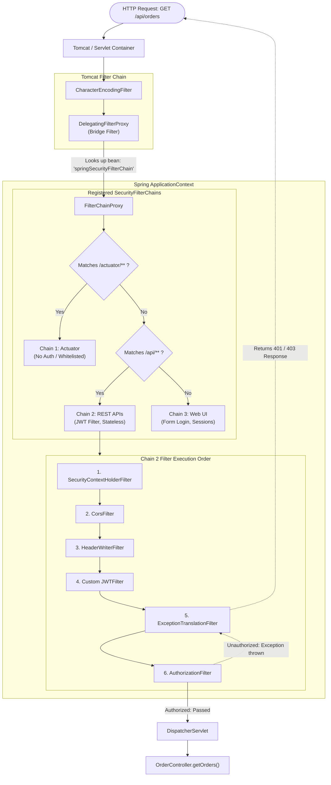

# Module 03: Spring Security Internal Architecture

---

## 1. Definition

The internal architecture of Spring Security represents the architectural bridge connecting the **Servlet Container (Tomcat)** to the **Spring ApplicationContext (IoC Container)**.

The framework is organized around three foundational constructs:
1. **`DelegatingFilterProxy`**: A standard Servlet Filter registered in Tomcat that acts as a proxy bridge into the Spring ApplicationContext.
2. **`FilterChainProxy`**: The Spring Bean (named `springSecurityFilterChain`) that acts as the master coordinator of all security logic.
3. **`SecurityFilterChain`**: A matched collection of individual security filters that execute in an exact, deterministic order for a given HTTP request.

---

## 2. Why It Exists

Servlet containers like Tomcat initialize their filters using standard Servlet specs. Tomcat **does not know about Spring beans**, dependency injection, `@Autowired`, or Spring's lifecycle.

If Spring Security filters were registered directly into Tomcat:
* They could not easily inject Spring services, repositories, or configuration properties.
* Every security filter would need to be manually registered in `web.xml` or container initializers.
* You could not easily conditionally apply different chains to different URL paths.

Spring Security solves this via the **Proxy Pattern** with `DelegatingFilterProxy`.

---

## 3. Internal Working

### Step 1: The Bridge (`DelegatingFilterProxy`)
* When your Spring Boot application starts, Spring Boot automatically registers a `DelegatingFilterProxy` with Tomcat.
* `DelegatingFilterProxy` implements standard `jakarta.servlet.Filter`.
* When an HTTP request arrives, `DelegatingFilterProxy.doFilter()` is called.
* It looks up a Spring bean from the `ApplicationContext` named **`springSecurityFilterChain`**.
* It passes the request and response to that bean.

### Step 2: The Master Router (`FilterChainProxy`)
* The bean named `springSecurityFilterChain` is an instance of `org.springframework.security.web.FilterChainProxy`.
* `FilterChainProxy` holds a `List<SecurityFilterChain>`.
* It iterates through the list and invokes `SecurityFilterChain.matches(request)` using an internal `RequestMatcher`.
* As soon as a matching `SecurityFilterChain` is found, `FilterChainProxy` hands the request to the filters in that specific chain.
* Only **one** `SecurityFilterChain` handles any given request.

### Step 3: Inside the `SecurityFilterChain`
Once selected, the request flows sequentially through the chain's filters:

```
 1. SecurityContextHolderFilter       (Restores security context from session or repo)
 2. HeaderWriterFilter                (Applies security headers like HSTS, X-Frame-Options)
 3. CorsFilter                        (Handles CORS preflight and headers)
 4. CsrfFilter                        (Validates CSRF tokens)
 5. LogoutFilter                      (Handles /logout)
 6. UsernamePasswordAuthenticationFilter (Handles /login POST requests)
 7. BasicAuthenticationFilter         (Handles Authorization: Basic headers)
 8. RequestCacheAwareFilter           (Restores saved request after login)
 9. SecurityContextHolderAwareRequestFilter (Wraps request with Servlet3 security methods)
10. AnonymousAuthenticationFilter     (Supplies AnonymousAuthenticationToken if unauthenticated)
11. SessionManagementFilter           (Detects session fixation / concurrent sessions)
12. ExceptionTranslationFilter        (Catches security exceptions, invokes EntryPoints)
13. AuthorizationFilter               (Final gatekeeper evaluating permissions)
```

---

## 4. Architecture and Flow Diagrams

### The Master Request Flow from Tomcat to Controller



---

## 5. Important Classes and Interfaces

| Class / Interface | Responsibility |
|---|---|
| `DelegatingFilterProxy` | Standard Servlet Filter that delegates to a Spring-managed `Filter` bean. |
| `FilterChainProxy` | Master filter bean (`springSecurityFilterChain`) containing security chains and firewall validation. |
| `SecurityFilterChain` | Interface defining a list of filters and a `RequestMatcher` to determine matching URIs. |
| `DefaultSecurityFilterChain` | Standard implementation of `SecurityFilterChain`. |
| `HttpFirewall` / `StrictHttpFirewall` | Rejects malicious requests containing suspicious characters (path traversal `../`, `%2e`, null bytes, semicolons). |

---

## 6. Practical Code Examples

### Inspecting the Filter Chain at Application Startup
You can programmatically print every filter in every `SecurityFilterChain` during startup:

```java
package com.example.security.config;

import jakarta.annotation.PostConstruct;
import org.slf4j.Logger;
import org.slf4j.LoggerFactory;
import org.springframework.context.annotation.Configuration;
import org.springframework.security.web.FilterChainProxy;
import org.springframework.security.web.SecurityFilterChain;

@Configuration
public class SecurityFilterChainDebugger {

    private static final Logger log = LoggerFactory.getLogger(SecurityFilterChainDebugger.class);
    private final FilterChainProxy filterChainProxy;

    public SecurityFilterChainDebugger(FilterChainProxy filterChainProxy) {
        this.filterChainProxy = filterChainProxy;
    }

    @PostConstruct
    public void printFilterChains() {
        log.info("================= ACTIVE SECURITY FILTER CHAINS =================");
        int chainIndex = 1;
        for (SecurityFilterChain chain : filterChainProxy.getFilterChains()) {
            log.info("SecurityFilterChain [#{}] - Matcher: {}", chainIndex++, chain);
            chain.getFilters().forEach(filter -> 
                log.info("    -> Filter: {}", filter.getClass().getName())
            );
        }
        log.info("=================================================================");
    }
}
```

### Configuring Multiple `SecurityFilterChain` Beans
In modern applications, different URL patterns require completely different filter pipelines:

```java
package com.example.security.config;

import org.springframework.context.annotation.Bean;
import org.springframework.context.annotation.Configuration;
import org.springframework.core.annotation.Order;
import org.springframework.security.config.Customizer;
import org.springframework.security.config.annotation.web.builders.HttpSecurity;
import org.springframework.security.config.annotation.web.configuration.EnableWebSecurity;
import org.springframework.security.config.http.SessionCreationPolicy;
import org.springframework.security.web.SecurityFilterChain;

@Configuration
@EnableWebSecurity
public class MultiChainSecurityConfig {

    /**
     * Chain 1: High-priority chain for REST APIs (/api/**)
     * Configured as STATELESS with HTTP Basic (or JWT)
     */
    @Bean
    @Order(1)
    public SecurityFilterChain apiSecurityFilterChain(HttpSecurity http) throws Exception {
        http
            .securityMatcher("/api/**")
            .authorizeHttpRequests(auth -> auth
                .requestMatchers("/api/public/**").permitAll()
                .anyRequest().authenticated()
            )
            .sessionManagement(session -> 
                session.sessionCreationPolicy(SessionCreationPolicy.STATELESS)
            )
            .csrf(csrf -> csrf.disable())
            .httpBasic(Customizer.withDefaults());

        return http.build();
    }

    /**
     * Chain 2: Default catch-all chain for Browser Web UI
     * Configured with Form Login and Stateful Sessions
     */
    @Bean
    @Order(2)
    public SecurityFilterChain webSecurityFilterChain(HttpSecurity http) throws Exception {
        http
            .authorizeHttpRequests(auth -> auth
                .requestMatchers("/login", "/error").permitAll()
                .anyRequest().authenticated()
            )
            .formLogin(Customizer.withDefaults());

        return http.build();
    }
}
```

---

## 7. Line-by-Line Explanation

1. `@Order(1)` vs `@Order(2)`:
   * Controls the evaluation order in `FilterChainProxy`. The API chain (`/api/**`) is evaluated first. If an incoming request matches `/api/users`, Chain 1 executes and Chain 2 is completely ignored.
2. `.securityMatcher("/api/**")`:
   * Defines the scope of this `SecurityFilterChain`. Only requests matching `/api/**` will enter this chain.
3. `sessionCreationPolicy(SessionCreationPolicy.STATELESS)`:
   * Instructs Spring Security to never create an `HttpSession` and never store security context across requests (standard for REST/JWT).
4. `csrf(csrf -> csrf.disable())`:
   * Disables CSRF protection for stateless APIs (safe when authentication relies on non-browser credentials or Authorization headers).

---

## 8. Real-World Use Cases

* **Public Web + Protected REST API:** The root website uses Thymeleaf templates with session cookies and CSRF tokens; `/api/**` uses JWT tokens and stateless security chains.
* **Actuator Isolation:** Directing `/actuator/**` metrics to an isolated chain accessible only by internal network subnets or dedicated monitoring accounts.

---

## 9. Common Mistakes

1. **Missing `@Order` on Multiple Chains:** If you register multiple `SecurityFilterChain` beans without `@Order`, Spring Boot will throw an `AmbiguousBeanException` or default to undefined execution order.
2. **Placing a Generic Matcher Before a Specific Matcher:** If `@Order(1)` has `.securityMatcher("/**")` and `@Order(2)` has `.securityMatcher("/api/**")`, the second chain will **never execute** because the first chain intercepts everything.
3. **Misunderstanding `HttpFirewall` Rejections:** Seeing `StrictHttpFirewall rejected request because the URL contained a reserved character` and blindly disabling the firewall instead of fixing URL encoding issues on the client.

---

## 10. Interview Questions & Detailed Answers

### Q1: What is `FilterChainProxy` and what bean name does it use?
**Answer:**
`FilterChainProxy` is the primary entry point for Spring Security web handling. It is registered in the Spring `ApplicationContext` under the bean name **`springSecurityFilterChain`**. It holds a list of `SecurityFilterChain` instances, checks request matchers to find the first matching chain, and executes the security filters within that chain. It also applies the `HttpFirewall` and ensures security context cleanup after requests finish.

### Q2: What is the purpose of `DelegatingFilterProxy`?
**Answer:**
`DelegatingFilterProxy` is a standard `jakarta.servlet.Filter` registered with Tomcat. Its sole purpose is to act as a bridge. Because Tomcat does not know about Spring beans, `DelegatingFilterProxy` delegates every `doFilter()` call to a Spring-managed filter bean (typically `springSecurityFilterChain`). It decouples Tomcat's lifecycle from the Spring `ApplicationContext` lifecycle.

### Q3: If an incoming request matches two `SecurityFilterChain` beans, how many will execute?
**Answer:**
**Only one.** `FilterChainProxy` evaluates chains sequentially based on their `@Order`. The first `SecurityFilterChain` whose `RequestMatcher` matches the incoming request URL will execute. Processing stops matching further chains once one is selected.

---

## 11. Quick Revision Notes

* **The Bridge:** `Tomcat FilterChain` -> `DelegatingFilterProxy` -> `FilterChainProxy (springSecurityFilterChain)` -> `SecurityFilterChain`.
* **Selection Rule:** First matching `SecurityFilterChain` wins; order matters (`@Order`).
* **StrictHttpFirewall:** Runs first inside `FilterChainProxy` to reject malicious URLs before filters execute.
* **Never Register Security Filters with Tomcat Directly:** Always let them be coordinated through `FilterChainProxy`.
