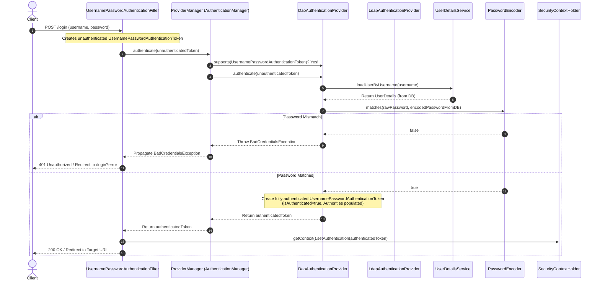

# Module 04: Authentication Architecture

---

## 1. Definition

**Authentication** is the process by which an application establishes the verified identity of a principal (user, service, or system).

In Spring Security, the authentication architecture is a modular, provider-based design centered on four key abstractions:
1. **`Authentication`**: The data token representing identity credentials and granted authorities.
2. **`AuthenticationManager`**: The core API contract defining how authentication is executed.
3. **`ProviderManager`**: The default implementation of `AuthenticationManager`, orchestrating multiple authentication providers.
4. **`AuthenticationProvider`**: The actual verification engine implementing specific credential checking logic (e.g., database, LDAP, OAuth2).

---

## 2. Why It Exists

Enterprise systems rarely use a single authentication mechanism. A production platform might support:
* Username and password for web clients.
* API keys for machine-to-machine integrations.
* LDAP / Active Directory for corporate SSO.
* One-Time Passwords (OTP) / SMS codes for MFA.

If authentication logic were hardcoded inside a monolithic filter or controller, adding a new authentication method would require rewriting existing code. Spring Security's decoupled architecture allows you to plug in multiple authentication strategies without altering the request pipeline.

---

## 3. Internal Working

### Step 1: Request Interception & Token Creation
When an incoming request reaches an authentication filter (e.g., `UsernamePasswordAuthenticationFilter` or a custom filter):
* The filter extracts the unauthenticated credentials (e.g., username and raw password).
* It creates an **unauthenticated** `Authentication` object (typically `UsernamePasswordAuthenticationToken(username, password)`).
* At this stage, `authentication.isAuthenticated()` returns `false`, and `getAuthorities()` is empty.

### Step 2: Delegation to `AuthenticationManager`
The filter calls:
```java
Authentication authResult = authenticationManager.authenticate(unauthenticatedToken);
```

### Step 3: `ProviderManager` Iteration
`ProviderManager` maintains a `List<AuthenticationProvider>`. It iterates through each provider and asks:
```java
if (provider.supports(unauthenticatedToken.getClass())) {
    return provider.authenticate(unauthenticatedToken);
}
```
* If a provider supports the token type, it attempts verification.
* If it succeeds, it returns a **fully authenticated** `Authentication` object (`isAuthenticated() == true`), populated with granted authorities and principal details.
* If it cannot verify, it throws an `AuthenticationException` (e.g., `BadCredentialsException`, `LockedException`).
* If a provider does not support the token or returns `null`, `ProviderManager` moves to the next provider.

### Step 4: Storing in `SecurityContextHolder`
Upon successful authentication, the filter takes the returned authenticated token and stores it in the thread's `SecurityContext`:
```java
SecurityContextHolder.getContext().setAuthentication(authResult);
```

---

## 4. Architecture and Flow Diagram

### End-to-End Authentication Sequence



---

## 5. Important Classes and Interfaces

### 1. `Authentication` Interface
```java
package org.springframework.security.core;

import java.io.Serializable;
import java.security.Principal;
import java.util.Collection;

public interface Authentication extends Principal, Serializable {
    Collection<? extends GrantedAuthority> getAuthorities();
    Object getCredentials(); // e.g. raw password or token (erased after authentication)
    Object getDetails();     // Additional request metadata (IP address, Session ID)
    Object getPrincipal();   // The verified identity (usually UserDetails or username)
    boolean isAuthenticated();
    void setAuthenticated(boolean isAuthenticated) throws IllegalArgumentException;
}
```

### 2. `AuthenticationManager`
```java
public interface AuthenticationManager {
    Authentication authenticate(Authentication authentication) throws AuthenticationException;
}
```

### 3. `AuthenticationProvider`
```java
public interface AuthenticationProvider {
    Authentication authenticate(Authentication authentication) throws AuthenticationException;
    boolean supports(Class<?> authentication);
}
```

---

## 6. Practical Code Examples

### Custom Manual Authentication Service
In RESTful login endpoints (e.g., `POST /api/v1/auth/login`), you often invoke `AuthenticationManager` programmatically:

```java
package com.example.security.service;

import com.example.security.dto.LoginRequest;
import com.example.security.dto.LoginResponse;
import org.springframework.security.authentication.AuthenticationManager;
import org.springframework.security.authentication.BadCredentialsException;
import org.springframework.security.authentication.UsernamePasswordAuthenticationToken;
import org.springframework.security.core.Authentication;
import org.springframework.security.core.GrantedAuthority;
import org.springframework.security.core.context.SecurityContextHolder;
import org.springframework.stereotype.Service;

import java.util.List;
import java.util.stream.Collectors;

@Service
public class AuthService {

    private final AuthenticationManager authenticationManager;

    public AuthService(AuthenticationManager authenticationManager) {
        this.authenticationManager = authenticationManager;
    }

    public LoginResponse login(LoginRequest request) {
        // 1. Wrap raw credentials into an unauthenticated token
        UsernamePasswordAuthenticationToken unauthenticatedToken =
                new UsernamePasswordAuthenticationToken(request.getUsername(), request.getPassword());

        // 2. Delegate to AuthenticationManager (invokes ProviderManager -> DaoAuthenticationProvider)
        Authentication authenticatedToken;
        try {
            authenticatedToken = authenticationManager.authenticate(unauthenticatedToken);
        } catch (BadCredentialsException ex) {
            throw new BadCredentialsException("Invalid username or password supplied");
        }

        // 3. Set the authenticated token into the thread-local SecurityContext
        SecurityContextHolder.getContext().setAuthentication(authenticatedToken);

        // 4. Extract authorities and return response
        List<String> roles = authenticatedToken.getAuthorities().stream()
                .map(GrantedAuthority::getAuthority)
                .collect(Collectors.toList());

        return new LoginResponse(authenticatedToken.getName(), roles, "Authentication successful");
    }
}
```

### Exposing `AuthenticationManager` as a Bean
In Spring Security 6, `AuthenticationManager` is no longer exposed as a Spring Bean by default. You expose it explicitly via `AuthenticationConfiguration`:

```java
package com.example.security.config;

import org.springframework.context.annotation.Bean;
import org.springframework.context.annotation.Configuration;
import org.springframework.security.authentication.AuthenticationManager;
import org.springframework.security.config.annotation.authentication.configuration.AuthenticationConfiguration;

@Configuration
public class AuthenticationConfig {

    @Bean
    public AuthenticationManager authenticationManager(AuthenticationConfiguration config) throws Exception {
        return config.getAuthenticationManager();
    }
}
```

---

## 7. Line-by-Line Explanation

1. `new UsernamePasswordAuthenticationToken(request.getUsername(), request.getPassword())`:
   * Uses the two-argument constructor of `UsernamePasswordAuthenticationToken`. Internally, this sets `setAuthenticated(false)` and leaves authorities empty.
2. `authenticationManager.authenticate(unauthenticatedToken)`:
   * Passes the token through `ProviderManager`. `ProviderManager` finds `DaoAuthenticationProvider`, loads the user from the database, hashes the supplied password, and compares it with the stored hash.
3. `SecurityContextHolder.getContext().setAuthentication(authenticatedToken)`:
   * Stores the returned token (`isAuthenticated() == true`) in the thread context so downstream controllers or filters recognize the caller.

---

## 8. Real-World Use Cases

* **Multi-Factor Authentication (MFA):** Provider 1 validates username and password. If valid, an unauthenticated `MfaToken` is issued. Provider 2 validates the TOTP/SMS code before issuing the final authenticated token.
* **Corporate Hybrid Login:** The application checks LDAP for internal corporate staff, falling back to a local PostgreSQL user table if the user is an external client.

---

## 9. Common Mistakes

1. **Calling `setAuthenticated(true)` manually:** Never invoke `token.setAuthenticated(true)` in your code. Always allow an `AuthenticationProvider` to instantiate a new token using the multi-argument constructor that safely sets `isAuthenticated = true`.
2. **Leaving passwords in memory:** Failing to configure credential erasure. `ProviderManager` automatically sets `credentials = null` on the authenticated token by default to prevent credentials leaking into heap dumps.

---

## 10. Interview Questions & Detailed Answers

### Q1: What is the relationship between `AuthenticationManager`, `ProviderManager`, and `AuthenticationProvider`?
**Answer:**
* `AuthenticationManager` is an **interface** containing a single method: `authenticate(Authentication)`.
* `ProviderManager` is the standard **implementation** of `AuthenticationManager`. It does not perform validation itself; instead, it delegates to a list of configured `AuthenticationProvider` instances.
* `AuthenticationProvider` is the **strategy interface** where actual validation happens. Each provider defines which token type it supports (`supports()`) and implements its verification logic (e.g., `DaoAuthenticationProvider` validates database passwords, `JwtAuthenticationProvider` validates JWT signatures).

### Q2: Why does `Authentication` have both `getPrincipal()` and `getCredentials()`?
**Answer:**
* `getPrincipal()` represents the identity (e.g., the `UserDetails` object or username). It remains populated throughout the user session or request lifecycle.
* `getCredentials()` represents the secret proof of identity (e.g., raw password or raw API secret). Once authentication succeeds, `ProviderManager` wipes this field to `null` to prevent sensitive credentials from remaining in memory.

---

## 11. Quick Revision Notes

* **Unauthenticated Token:** 2-parameter constructor -> `isAuthenticated = false`.
* **Authenticated Token:** 3-parameter constructor (with Authorities) -> `isAuthenticated = true`.
* **Delegation Hierarchy:** `Filter` -> `AuthenticationManager` (`ProviderManager`) -> `AuthenticationProvider` -> `UserDetailsService` + `PasswordEncoder`.
* **Exposing the Manager:** In Spring Security 6, inject `AuthenticationConfiguration` and call `getAuthenticationManager()`.
