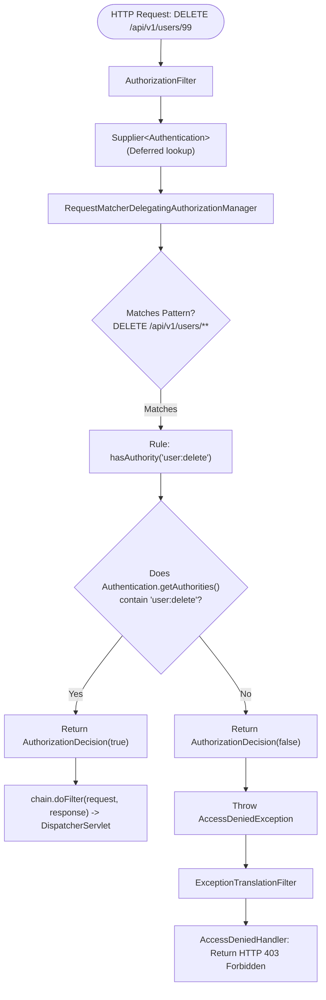

# Module 05: Authorization & Access Control

---

## 1. Definition

**Authorization** (Access Control) is the process of deciding whether an authenticated identity has the required permissions to access a specific resource or perform an action.

In Spring Security 6+, authorization has been unified around the **`AuthorizationManager`** architecture, replacing the legacy `AccessDecisionManager` and `AccessDecisionVoter` components used in Spring Security 5 and earlier.

---

## 2. Why It Exists

Authentication proves *who* a user is; Authorization determines *what* they can execute. 

Without a clean authorization architecture:
* Security checks become intermingled with business code (`if (user.getRole().equals("ADMIN"))`).
* Granular permissions (e.g., read vs write) become difficult to audit.
* URL pattern changes require updates in multiple controllers.

Spring Security centralizes access control rules directly in the filter chain, evaluating rules before controller methods run.

---

## 3. Internal Working

### The Modern `AuthorizationFilter`
In Spring Security 6, the final gatekeeper in the `SecurityFilterChain` is the **`AuthorizationFilter`**.

```
Incoming Request
      │
      ▼
[ SecurityFilterChain ]
      │
      ▼
[ AuthorizationFilter ] ──> Evaluates AuthorizationManager.check(supplier, request)
      │
      ├─────────────────► [ Access Granted ]  ──> chain.doFilter() (Pass to Controller)
      │
      └─────────────────► [ Access Denied ]   ──> Throws AccessDeniedException
                                                      │
                                                      ▼
                                           [ ExceptionTranslationFilter ]
                                                      │
                                                      ▼
                                           [ AccessDeniedHandler (HTTP 403) ]
```

### The `AuthorizationManager` Interface
```java
package org.springframework.security.authorization;

import java.util.function.Supplier;
import org.springframework.security.core.Authentication;

@FunctionalInterface
public interface AuthorizationManager<T> {
    AuthorizationDecision check(Supplier<Authentication> authentication, T object);
}
```

1. `AuthorizationFilter` wraps the current `Authentication` inside a `Supplier<Authentication>`. (This defers resolving the user from `SecurityContextHolder` until authorization is actually required, saving CPU cycles).
2. It calls `check(authenticationSupplier, request)`.
3. The manager inspects the principal's `GrantedAuthority` collection.
4. It returns an `AuthorizationDecision(true)` or `AuthorizationDecision(false)`.
5. If denied, `AuthorizationFilter` throws an `AccessDeniedException`.

---

## 4. Architecture and Flow Diagram

### URL Authorization Decision Flow



---

## 5. Important Classes and Interfaces

| Class / Interface | Role |
|---|---|
| `AuthorizationManager<T>` | Core functional interface that evaluates access control decisions. |
| `AuthorizationFilter` | The security filter that intercepts HTTP requests and invokes the `AuthorizationManager`. |
| `AuthorizationDecision` | Immutable object wrapping a `boolean` (isGranted). |
| `GrantedAuthority` | Represents an individual authority or role granted to the principal. |
| `SimpleGrantedAuthority` | Default string-based implementation of `GrantedAuthority`. |
| `AccessDeniedHandler` | Handles responses when an authenticated user attempts to access a forbidden resource (HTTP 403). |

---

## 6. Practical Code Examples

### Configuring Granular URL Authorization Rules
```java
package com.example.security.config;

import org.springframework.context.annotation.Bean;
import org.springframework.context.annotation.Configuration;
import org.springframework.http.HttpMethod;
import org.springframework.security.config.Customizer;
import org.springframework.security.config.annotation.web.builders.HttpSecurity;
import org.springframework.security.config.annotation.web.configuration.EnableWebSecurity;
import org.springframework.security.web.SecurityFilterChain;

@Configuration
@EnableWebSecurity
public class GranularAuthorizationConfig {

    @Bean
    public SecurityFilterChain securityFilterChain(HttpSecurity http) throws Exception {
        http
            .csrf(csrf -> csrf.disable())
            .authorizeHttpRequests(authorize -> authorize
                // 1. Completely public endpoints
                .requestMatchers("/api/v1/auth/**", "/public/**").permitAll()

                // 2. HTTP Method-specific restrictions
                .requestMatchers(HttpMethod.GET, "/api/v1/products/**").permitAll()
                .requestMatchers(HttpMethod.POST, "/api/v1/products/**").hasAuthority("product:write")
                .requestMatchers(HttpMethod.DELETE, "/api/v1/products/**").hasRole("ADMIN")

                // 3. Role-based prefix checks
                .requestMatchers("/api/v1/management/**").hasAnyRole("MANAGER", "ADMIN")

                // 4. Any other request requires at least authentication
                .anyRequest().authenticated()
            )
            .httpBasic(Customizer.withDefaults());

        return http.build();
    }
}
```

---

## 7. Line-by-Line Explanation

1. `.requestMatchers(HttpMethod.GET, "/api/v1/products/**").permitAll()`:
   * Allows anyone to read product data without sending credentials.
2. `.requestMatchers(HttpMethod.POST, "/api/v1/products/**").hasAuthority("product:write")`:
   * Checks for the exact authority string `product:write`.
3. `.requestMatchers(HttpMethod.DELETE, "/api/v1/products/**").hasRole("ADMIN")`:
   * Checks for `ROLE_ADMIN`. In Spring Security, `hasRole("X")` automatically prefixes `ROLE_` behind the scenes, looking for `ROLE_ADMIN` in the authorities list.
4. `.anyRequest().authenticated()`:
   * Catch-all safeguard. Any endpoint not explicitly matched previously requires a valid authenticated user.

---

## 8. Real-World Use Cases

* **Public Read, Protected Write (REST APIs):** Standard ecommerce or blog architectures where browsing items is open (`GET` is `permitAll()`), but mutations (`POST`, `PUT`, `DELETE`) require staff authorities.
* **Separation of Duties:** Enforcing that financial payout endpoints (`/api/v1/finance/**`) can only be invoked by callers possessing the `finance:disburse` authority.

---

## 9. Common Mistakes

1. **Rule Ordering Pitfall:** Spring Security evaluates URL matching rules in **first-match order**. If you place a broad pattern before a specific pattern:
   ```java
   // BUG! The broad rule matches first, so the /admin rule is NEVER evaluated!
   .requestMatchers("/**").authenticated()
   .requestMatchers("/admin/**").hasRole("ADMIN")
   ```
   **Fix:** Always declare rules from **most specific to most general**.
2. **Double `ROLE_` Prefix:** Calling `hasRole("ROLE_ADMIN")`. Spring Security prepends `ROLE_` automatically, resulting in an internal check for `ROLE_ROLE_ADMIN`. Use `hasRole("ADMIN")` or `hasAuthority("ROLE_ADMIN")`.

---

## 10. Interview Questions & Detailed Answers

### Q1: What is the architectural difference between `hasRole()` and `hasAuthority()`?
**Answer:**
* `hasAuthority("XYZ")` checks for the exact authority name string `"XYZ"`.
* `hasRole("XYZ")` automatically prepends the default role prefix `ROLE_` and checks for `"ROLE_XYZ"`.
* In Spring Security, a "Role" is simply an authority with a `ROLE_` prefix. Under the hood, both call `GrantedAuthority.getAuthority()`.

### Q2: What major architectural change happened to Authorization in Spring Security 6?
**Answer:**
Spring Security 6 completely removed the legacy `AccessDecisionManager`, `AccessDecisionVoter`, and `FilterSecurityInterceptor`. They were replaced by the lightweight **`AuthorizationManager`** and **`AuthorizationFilter`**. This eliminated complex voting logic (AffirmativeBased, ConsensusBased) in favor of a single functional interface (`check()`) and enabled deferred `Supplier<Authentication>` evaluation.

---

## 11. Quick Revision Notes

* **Specific Rules First:** Always configure specific paths before wildcards (`/admin/**` before `/**`).
* **`hasRole("ADMIN")` == `hasAuthority("ROLE_ADMIN")`**.
* **Modern Gatekeeper:** `AuthorizationFilter` replaces `FilterSecurityInterceptor`.
* **Deferred Authentication:** `AuthorizationFilter` resolves `Authentication` lazily using a `Supplier`.
