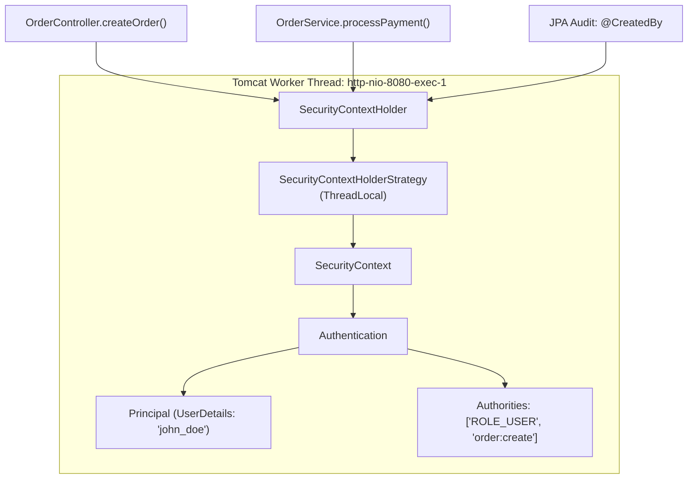

# Module 06: SecurityContext & SecurityContextHolder

---

## 1. Definition

The **`SecurityContextHolder`** is the central repository where Spring Security stores the details of the currently authenticated principal. 

It contains the **`SecurityContext`**, which in turn holds the **`Authentication`** object.

```
SecurityContextHolder ──> SecurityContext ──> Authentication ──> Principal & Authorities
```

---

## 2. Why It Exists

In a web application, an incoming request is assigned to an execution thread from the web server's worker pool. Throughout the execution of that request, various components (filters, controllers, service beans, repositories) need access to:
* The current user's ID or username.
* The user's granted roles.
* Whether the request is authenticated.

Passing the `Authentication` object as an explicit method parameter across every service and repository layer would pollute application signatures. `SecurityContextHolder` uses a **`ThreadLocal`** strategy by default, making the current user's security context globally available anywhere within the executing thread.

---

## 3. Internal Working

### Storage Strategies (`SecurityContextHolderStrategy`)
`SecurityContextHolder` delegates storage to a strategy interface. Three strategies are supported:

| Strategy Constant | Underlying Mechanism | Typical Use Case |
|---|---|---|
| `MODE_THREADLOCAL` *(Default)* | `ThreadLocal<SecurityContext>` | Traditional Servlet applications (one thread per HTTP request). |
| `MODE_INHERITABLETHREADLOCAL` | `InheritableThreadLocal<SecurityContext>` | Applications where spawned child threads need access to the parent thread's security context. |
| `MODE_GLOBAL` | Static field across JVM | Standalone desktop (Swing/JavaFX) or single-user CLI applications. |

### The Lifecycle of `SecurityContext` in a Request
In modern Spring Security (Spring Boot 3+), context lifecycle is managed by **`SecurityContextHolderFilter`**:

```
1. Request Enters:
   SecurityContextHolderFilter reads the SecurityContext from SecurityContextRepository 
   (e.g., HttpSession or Request Attributes) and installs it into SecurityContextHolder.

2. Application Code Executes:
   Any method calls SecurityContextHolder.getContext().getAuthentication().

3. Request Completes (finally block):
   SecurityContextHolder.clearContext() is called.
```

> [!CAUTION]
> In web containers (like Tomcat), worker threads are reused via thread pools. If `SecurityContextHolder.clearContext()` is not invoked at the end of the request, credentials from Request A can leak into Request B running on the same recycled thread!

---

## 4. Architecture and Flow Diagram

### ThreadLocal SecurityContext Storage & Propagation



---

## 5. Important Classes and Interfaces

| Class / Interface | Responsibility |
|---|---|
| `SecurityContextHolder` | Provides static utility access to the current security context. |
| `SecurityContext` | Holds the `Authentication` instance; created via `SecurityContextHolder.createEmptyContext()`. |
| `SecurityContextHolderStrategy` | Pluggable interface defining how contexts are stored (`ThreadLocal`, etc.). |
| `SecurityContextRepository` | Strategy for persisting the context across requests (e.g., `HttpSessionSecurityContextRepository`). |
| `DelegatingSecurityContextExecutor` | A wrapper for thread pools (`ExecutorService`) that propagates the context to asynchronous tasks. |

---

## 6. Practical Code Examples

### 1. Correct Idiom for Setting and Clearing SecurityContext
```java
package com.example.security.util;

import org.springframework.security.authentication.UsernamePasswordAuthenticationToken;
import org.springframework.security.core.Authentication;
import org.springframework.security.core.authority.SimpleGrantedAuthority;
import org.springframework.security.core.context.SecurityContext;
import org.springframework.security.core.context.SecurityContextHolder;

import java.util.List;

public class SecurityContextManualManager {

    public void establishSystemAuthentication() {
        // ALWAYS create a brand-new empty context instance to avoid race conditions!
        SecurityContext context = SecurityContextHolder.createEmptyContext();

        List<SimpleGrantedAuthority> authorities = List.of(new SimpleGrantedAuthority("ROLE_SYSTEM_TASK"));
        Authentication systemAuth = new UsernamePasswordAuthenticationToken("system-daemon", null, authorities);

        context.setAuthentication(systemAuth);
        SecurityContextHolder.setContext(context);
    }

    public void cleanup() {
        // Essential in thread pools to prevent memory and identity leaks
        SecurityContextHolder.clearContext();
    }
}
```

### 2. Propagating SecurityContext to Asynchronous Threads (`@Async`)
By default, `@Async` methods execute in a separate thread, causing `SecurityContextHolder.getContext().getAuthentication()` to return `null`. Configure a `DelegatingSecurityContextAsyncTaskExecutor`:

```java
package com.example.security.config;

import org.springframework.context.annotation.Configuration;
import org.springframework.scheduling.annotation.AsyncConfigurer;
import org.springframework.scheduling.annotation.EnableAsync;
import org.springframework.scheduling.concurrent.ThreadPoolTaskExecutor;
import org.springframework.security.task.DelegatingSecurityContextAsyncTaskExecutor;

import java.util.concurrent.Executor;

@Configuration
@EnableAsync
public class AsyncSecurityConfig implements AsyncConfigurer {

    @Override
    public Executor getAsyncExecutor() {
        ThreadPoolTaskExecutor executor = new ThreadPoolTaskExecutor();
        executor.setCorePoolSize(5);
        executor.setMaxPoolSize(10);
        executor.setQueueCapacity(25);
        executor.setThreadNamePrefix("async-sec-");
        executor.initialize();

        // Wrap the executor so the calling thread's SecurityContext propagates to async worker threads
        return new DelegatingSecurityContextAsyncTaskExecutor(executor);
    }
}
```

---

## 7. Line-by-Line Explanation

1. `SecurityContext context = SecurityContextHolder.createEmptyContext();`:
   * Never do `SecurityContextHolder.getContext().setAuthentication(auth)`. If another thread shares that context object in multi-threaded environments, race conditions occur. Always construct a fresh context via `createEmptyContext()`.
2. `SecurityContextHolder.clearContext();`:
   * Empties the `ThreadLocal` variable on the active thread, ensuring that Tomcat worker threads return cleanly to the connection pool.
3. `new DelegatingSecurityContextAsyncTaskExecutor(executor)`:
   * Captures the `SecurityContext` from the initiating thread and automatically installs it into the background worker thread before task execution, clearing it upon task completion.

---

## 8. Real-World Use Cases

* **Auditing (Spring Data JPA):** `@CreatedBy` and `@LastModifiedBy` automatically query `SecurityContextHolder.getContext().getAuthentication().getName()` to stamp entity records.
* **Background Report Generation:** Propagating caller permissions to an asynchronous batch job calculating payroll.

---

## 9. Common Mistakes

1. **Directly mutating `SecurityContextHolder.getContext()`:**
   ```java
   // WRONG - May introduce race conditions across threads
   SecurityContextHolder.getContext().setAuthentication(auth);

   // RIGHT
   SecurityContext context = SecurityContextHolder.createEmptyContext();
   context.setAuthentication(auth);
   SecurityContextHolder.setContext(context);
   ```
2. **Forgetting to clear context in tests or scheduled tasks:**
   Leads to test pollution where Test B inadvertently runs with Test A's credentials.

---

## 10. Interview Questions & Detailed Answers

### Q1: Why is `createEmptyContext()` preferred over `getContext()` when manually setting authentication?
**Answer:**
`SecurityContextHolder.getContext()` may return a context reference shared across concurrent threads depending on the configured strategy. Mutating it in place can introduce severe concurrency race conditions. Calling `createEmptyContext()` instantiates a fresh `SecurityContextImpl` instance, eliminating cross-thread race conditions.

### Q2: What happens if `clearContext()` is never called in a Tomcat-based application?
**Answer:**
Tomcat uses a thread pool (`http-nio-exec-*`) to serve incoming HTTP connections. When Request A completes, its thread returns to the pool without dying. If `clearContext()` was not called, Request B (which may be unauthenticated) might reuse that exact thread and inherit Request A's authenticated identity, causing an identity leak vulnerability.

---

## 11. Quick Revision Notes

* **Default Store:** `ThreadLocal` via `MODE_THREADLOCAL`.
* **Creation Best Practice:** Always use `SecurityContextHolder.createEmptyContext()`.
* **Async Boundary:** Standard `ThreadLocal` does not cross thread pools; use `DelegatingSecurityContextAsyncTaskExecutor`.
* **Crucial Cleanup:** `SecurityContextHolder.clearContext()` must run on thread completion.
