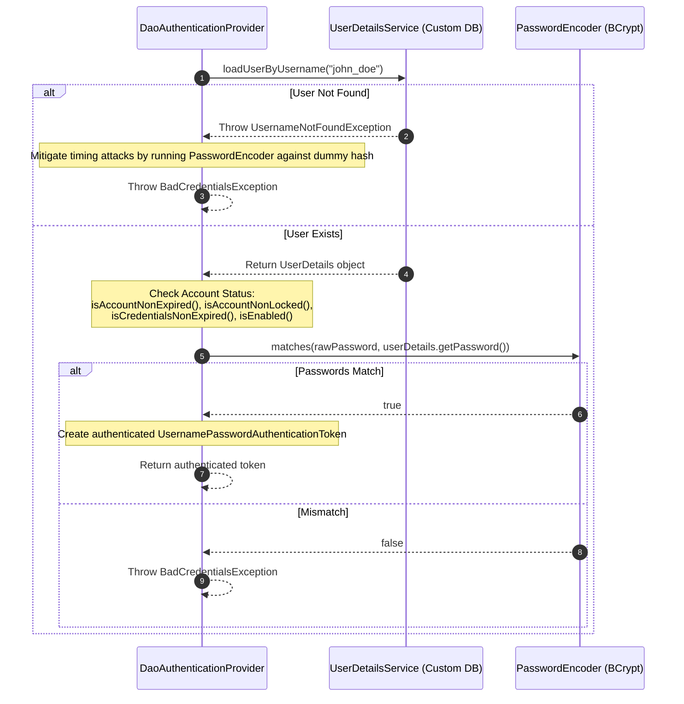
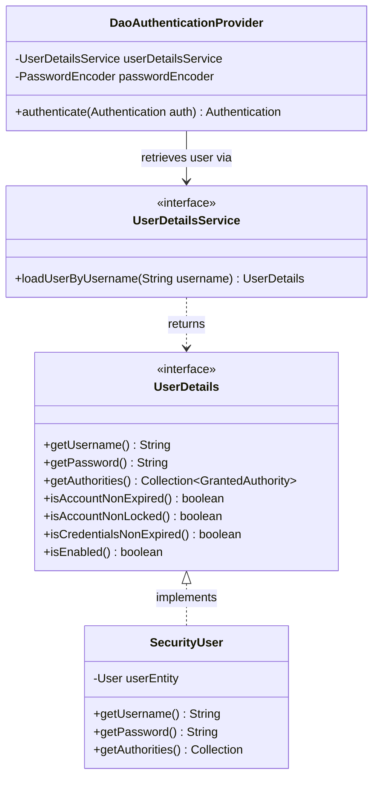

# Module 07: UserDetails & AuthenticationProvider

---

## 1. Definition

The **`UserDetails`** and **`UserDetailsService`** interfaces form Spring Security's standard bridge to user identity data.

* **`UserDetails`**: An interface providing core user information (username, password, authorities, account status).
* **`UserDetailsService`**: A functional data access strategy used to retrieve a `UserDetails` object by its username.
* **`DaoAuthenticationProvider`**: The built-in `AuthenticationProvider` that uses a `UserDetailsService` and a `PasswordEncoder` to validate username and password credentials.

---

## 2. Why It Exists

Applications store user profiles in diverse persistence layers: PostgreSQL, MongoDB, LDAP, or third-party identity APIs.

Spring Security does not force you to use a specific database schema or entity structure. Instead, it provides the `UserDetails` contract: as long as your application can adapt its internal user records into `UserDetails` and retrieve them via `loadUserByUsername()`, Spring Security can authenticate users against any datastore.

---

## 3. Internal Working

### How `DaoAuthenticationProvider` Authenticates
When an unauthenticated `UsernamePasswordAuthenticationToken` is processed by `DaoAuthenticationProvider`:



### Preventing Username Enumeration Timing Attacks
Notice an internal detail of `DaoAuthenticationProvider`: if a user is **not found**, it still executes `passwordEncoder.matches()` against a dummy secret hash! 
* Why? To prevent **Timing Attacks** where an attacker measures server response latency to deduce whether a username exists in your database.

---

## 4. Architecture and Flow Diagram

### Object Relationship Diagram



---

## 5. Important Classes and Interfaces

| Class / Interface | Responsibility |
|---|---|
| `UserDetails` | Represents the security principal stored in `Authentication`. |
| `UserDetailsService` | Functional interface with single method `loadUserByUsername(String)`. |
| `User` (`org.springframework.security.core.userdetails.User`) | Built-in immutable implementation of `UserDetails` with a fluent builder. |
| `InMemoryUserDetailsManager` | Ready-to-use in-memory implementation for testing or simple demos. |
| `JdbcUserDetailsManager` | Standard JDBC implementation querying default Spring Security database tables. |
| `DaoAuthenticationProvider` | The default provider combining `UserDetailsService` and `PasswordEncoder`. |

---

## 6. Practical Code Examples

### 1. The Domain Entity & Custom `UserDetails` Adapter
```java
package com.example.security.domain;

import jakarta.persistence.*;
import org.springframework.security.core.GrantedAuthority;
import org.springframework.security.core.authority.SimpleGrantedAuthority;
import org.springframework.security.core.userdetails.UserDetails;

import java.util.Collection;
import java.util.Set;
import java.util.stream.Collectors;

@Entity
@Table(name = "users")
public class AppUser implements UserDetails {

    @Id
    @GeneratedValue(strategy = GenerationType.IDENTITY)
    private Long id;

    @Column(unique = true, nullable = false)
    private String username;

    @Column(nullable = false)
    private String password;

    private boolean enabled = true;
    private boolean accountNonLocked = true;

    @ElementCollection(fetch = FetchType.EAGER)
    @CollectionTable(name = "user_roles", joinColumns = @JoinColumn(name = "user_id"))
    @Column(name = "role")
    private Set<String> roles;

    public AppUser() {}

    public AppUser(String username, String password, Set<String> roles) {
        this.username = username;
        this.password = password;
        this.roles = roles;
    }

    @Override
    public Collection<? extends GrantedAuthority> getAuthorities() {
        return roles.stream()
                .map(SimpleGrantedAuthority::new)
                .collect(Collectors.toSet());
    }

    @Override
    public String getPassword() { return this.password; }

    @Override
    public String getUsername() { return this.username; }

    @Override
    public boolean isAccountNonExpired() { return true; }

    @Override
    public boolean isAccountNonLocked() { return this.accountNonLocked; }

    @Override
    public boolean isCredentialsNonExpired() { return true; }

    @Override
    public boolean isEnabled() { return this.enabled; }
}
```

### 2. Implementing `UserDetailsService`
```java
package com.example.security.service;

import com.example.security.repository.UserRepository;
import org.springframework.security.core.userdetails.UserDetails;
import org.springframework.security.core.userdetails.UserDetailsService;
import org.springframework.security.core.userdetails.UsernameNotFoundException;
import org.springframework.stereotype.Service;
import org.springframework.transaction.annotation.Transactional;

@Service
public class JpaUserDetailsService implements UserDetailsService {

    private final UserRepository userRepository;

    public JpaUserDetailsService(UserRepository userRepository) {
        this.userRepository = userRepository;
    }

    @Override
    @Transactional(readOnly = true)
    public UserDetails loadUserByUsername(String username) throws UsernameNotFoundException {
        return userRepository.findByUsername(username)
                .orElseThrow(() -> new UsernameNotFoundException("User not found with username: " + username));
    }
}
```

### 3. Wiring into `DaoAuthenticationProvider`
In Spring Boot 3+, defining a `@Bean` of type `UserDetailsService` and `PasswordEncoder` causes Spring Boot to configure `DaoAuthenticationProvider` automatically. However, explicit registration is recommended for clarity:

```java
package com.example.security.config;

import com.example.security.service.JpaUserDetailsService;
import org.springframework.context.annotation.Bean;
import org.springframework.context.annotation.Configuration;
import org.springframework.security.authentication.dao.DaoAuthenticationProvider;
import org.springframework.security.crypto.password.PasswordEncoder;

@Configuration
public class DaoAuthenticationConfig {

    @Bean
    public DaoAuthenticationProvider daoAuthenticationProvider(
            JpaUserDetailsService userDetailsService,
            PasswordEncoder passwordEncoder) {
        
        DaoAuthenticationProvider provider = new DaoAuthenticationProvider();
        provider.setUserDetailsService(userDetailsService);
        provider.setPasswordEncoder(passwordEncoder);
        // Prevents hiding UsernameNotFoundException if you need custom exception logging
        provider.setHideUserNotFoundExceptions(false);
        return provider;
    }
}
```

---

## 7. Line-by-Line Explanation

1. `public class AppUser implements UserDetails`:
   * By implementing `UserDetails` directly on your entity (or wrapping it via the Adapter pattern), Spring Security seamlessly reads properties (`password`, `authorities`, account flags).
2. `getAuthorities()`:
   * Maps internal role strings (e.g., `"ROLE_USER"`, `"ROLE_ADMIN"`) to `SimpleGrantedAuthority` instances.
3. `provider.setHideUserNotFoundExceptions(false)`:
   * By default, Spring Security re-throws `UsernameNotFoundException` as `BadCredentialsException` to prevent user enumeration. Setting this to `false` is useful in internal debugging.

---

## 8. Real-World Use Cases

* **Database-Driven User Management:** Backing enterprise user repositories with PostgreSQL/MySQL while maintaining strict audit flags (`isAccountNonLocked`, `isEnabled`).
* **Multi-Database Authentication:** Falling back to an archive user database if the active user table does not contain the username.

---

## 9. Common Mistakes

1. **Returning `null` in `loadUserByUsername()`:** Never return `null` if the user is missing. Always throw `UsernameNotFoundException`.
2. **Lazy Initialization Exceptions:** Accessing `@ManyToMany` or `@ElementCollection` roles inside `getAuthorities()` without `@Transactional` or eager fetching, triggering `LazyInitializationException` during filter execution.
3. **Encoding passwords inside `UserDetails.getPassword()`:** `getPassword()` must return the **already encoded** hash from the database, never raw passwords.

---

## 10. Interview Questions & Detailed Answers

### Q1: What is the difference between `UserDetails` and `UserDetailsService`?
**Answer:**
* `UserDetails` is an **information model** representing a user account (username, hashed password, granted authorities, and four boolean account status flags).
* `UserDetailsService` is a **data-access service interface** containing one method: `UserDetails loadUserByUsername(String username)`. It is responsible for fetching that model from a database, LDAP, or API.

### Q2: Why does `DaoAuthenticationProvider` convert `UsernameNotFoundException` to `BadCredentialsException` by default?
**Answer:**
To prevent **User Enumeration Attacks**. If the system returned "User does not exist" when an invalid username was entered, and "Invalid password" when a valid username was entered, attackers could scan the endpoint to discover which email addresses or usernames are registered. Both conditions return generic "Bad credentials".

---

## 11. Quick Revision Notes

* **Model vs Service:** `UserDetails` is the data holder; `UserDetailsService` is the fetcher.
* **Never return `null`:** Throw `UsernameNotFoundException` when a user is not found.
* **Automatic Integration:** Providing a `UserDetailsService` and `PasswordEncoder` bean auto-configures `DaoAuthenticationProvider`.
* **Account Flags:** Four flags must return `true` for a successful login: `isAccountNonExpired`, `isAccountNonLocked`, `isCredentialsNonExpired`, and `isEnabled`.
