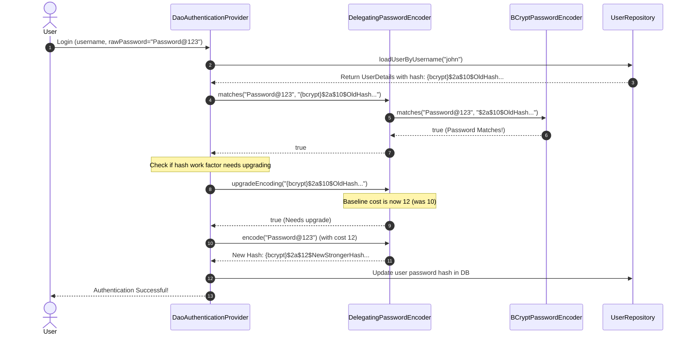

# Module 08: Password Encoding & Hashing

---

## 1. Definition

A **`PasswordEncoder`** is Spring Security's service interface for performing one-way password transformations (hashing) and verifying raw candidate passwords against stored hashes.

Spring Security enforces strong, salted, adaptive one-way hashing algorithms (such as **BCrypt**, **Argon2**, and **SCrypt**) and completely rejects storing plain-text passwords.

---

## 2. Why It Exists

Storing passwords in plain text or using outdated hash functions (like MD5 or SHA-1/SHA-256) is catastrophic:
1. **Rainbow Table Attacks:** Precomputed tables of unsalted hashes allow attackers to reverse passwords in milliseconds.
2. **Hardware Acceleration:** Modern GPUs can compute billions of SHA-256 hashes per second.
3. **Adaptive Work Factors:** Modern hashing algorithms must be **computationally expensive**. They include a work factor (iteration count or memory cost) that can be increased as hardware becomes faster.

Spring Security's `PasswordEncoder` enforces:
* Cryptographically secure random **salting** per password.
* Adaptive CPU/memory consumption.
* Seamless credential migration via `DelegatingPasswordEncoder`.

---

## 3. Internal Working

### The `PasswordEncoder` Contract
```java
package org.springframework.security.crypto.password;

public interface PasswordEncoder {
    String encode(CharSequence rawPassword);
    boolean matches(CharSequence rawPassword, String encodedPassword);
    default boolean upgradeEncoding(String encodedPassword) { return false; }
}
```

* `encode()`: Hashes a raw password, generating a unique salt and embedding the algorithm parameters, salt, and hash into a single output string.
* `matches()`: Extracts the salt and algorithm parameters from the stored hash, applies them to the supplied `rawPassword`, and performs a **constant-time equals** comparison.
* `upgradeEncoding()`: Checks if the stored hash's work factor is outdated compared to the application's current security baseline.

### Anatomy of a BCrypt Hash
A standard BCrypt hash looks like this:
```
$2a$10$N9qo8uLOickgx2ZMRZoMyeIjZAgcfl7p92ldGxad68LJZdL17lhWy
│   │  │                      │
│   │  │                      └─ 31 Characters of Salt + Hash
│   │  └─ 22 Characters of Radix-64 Salt
│   └─ Cost factor (2^10 = 1,024 iterations)
└─ Algorithm identifier ($2a$, $2b$, or $2y$)
```

### The `DelegatingPasswordEncoder`
Production systems often need to support multiple hashing algorithms (e.g., migrating legacy SHA-256 hashes to BCrypt or Argon2).

Spring Security uses `DelegatingPasswordEncoder`, which prefixes hashes with an algorithm identifier:
* `{bcrypt}$2a$10$...`
* `{argon2}$argon2id$v=19$...`
* `{noop}secret` *(plain text, strictly for testing; never production)*

When `matches()` is called, it extracts the prefix `{id}` to determine which encoder to invoke.

---

## 4. Architecture and Flow Diagram

### Password Verification & Transparent Upgrade Flow



---

## 5. Important Classes and Interfaces

| Class | Algorithm | Recommendations |
|---|---|---|
| `PasswordEncoderFactories` | Factory | Creates a `DelegatingPasswordEncoder` with `bcrypt` as the default. |
| `BCryptPasswordEncoder` | BCrypt | Industry standard; recommended for general production use. Default strength: 10 (range: 4–31). |
| `Argon2PasswordEncoder` | Argon2id | Password Hashing Competition winner; memory-hard, optimal defense against GPU/ASIC attacks. |
| `Pbkdf2PasswordEncoder` | PBKDF2 | FIPS-compliant standard often required in government/financial environments. |
| `NoOpPasswordEncoder` | None | Deprecated plain-text encoder. Do not use. |

---

## 6. Practical Code Examples

### 1. Recommending the Standard `PasswordEncoder` Bean
```java
package com.example.security.config;

import org.springframework.context.annotation.Bean;
import org.springframework.context.annotation.Configuration;
import org.springframework.security.crypto.factory.PasswordEncoderFactories;
import org.springframework.security.crypto.password.PasswordEncoder;

@Configuration
public class PasswordEncoderConfig {

    /**
     * Recommended Spring Security standard:
     * Creates a DelegatingPasswordEncoder with BCrypt as the current default.
     * Supports prefixes: {bcrypt}, {argon2}, {pbkdf2}, {scrypt}
     */
    @Bean
    public PasswordEncoder passwordEncoder() {
        return PasswordEncoderFactories.createDelegatingPasswordEncoder();
    }
}
```

### 2. Custom BCrypt Work Factor Tuning
If you wish to enforce custom BCrypt parameters (e.g., strength factor 12):

```java
package com.example.security.config;

import org.springframework.context.annotation.Bean;
import org.springframework.context.annotation.Configuration;
import org.springframework.security.crypto.bcrypt.BCryptPasswordEncoder;
import org.springframework.security.crypto.password.PasswordEncoder;

import java.security.SecureRandom;

@Configuration
public class CustomBCryptConfig {

    @Bean
    public PasswordEncoder bcryptPasswordEncoder() {
        // Strength: 12 (2^12 = 4,096 rounds). SecureRandom ensures high-entropy salting.
        return new BCryptPasswordEncoder(12, new SecureRandom());
    }
}
```

### 3. Password Verification Utility Demo
```java
package com.example.security.util;

import org.slf4j.Logger;
import org.slf4j.LoggerFactory;
import org.springframework.security.crypto.password.PasswordEncoder;
import org.springframework.stereotype.Component;

@Component
public class PasswordBenchmark {

    private static final Logger log = LoggerFactory.getLogger(PasswordBenchmark.class);
    private final PasswordEncoder passwordEncoder;

    public PasswordBenchmark(PasswordEncoder passwordEncoder) {
        this.passwordEncoder = passwordEncoder;
    }

    public void benchmark() {
        String raw = "SuperSecretPassword#2026";

        long start = System.currentTimeMillis();
        String hash = passwordEncoder.encode(raw);
        long encodeDuration = System.currentTimeMillis() - start;

        start = System.currentTimeMillis();
        boolean matches = passwordEncoder.matches(raw, hash);
        long verifyDuration = System.currentTimeMillis() - start;

        log.info("Encoded hash: {}", hash);
        log.info("Encode duration: {} ms | Verify duration: {} ms | Matches: {}", 
                 encodeDuration, verifyDuration, matches);
    }
}
```

---

## 7. Line-by-Line Explanation

1. `PasswordEncoderFactories.createDelegatingPasswordEncoder()`:
   * Returns a `DelegatingPasswordEncoder` configured with all modern safe encoders, defaulting to BCrypt with work factor 10.
2. `new BCryptPasswordEncoder(12, new SecureRandom())`:
   * 12 represents $2^{12} = 4096$ hashing rounds. On modern server CPUs, this takes roughly 200–300 milliseconds per hash—an ideal balance between defense against brute force and server throughput.
3. `passwordEncoder.matches(raw, hash)`:
   * Uses `MessageDigest.isEqual()` internally to prevent **Timing Attacks** during byte comparisons.

---

## 8. Real-World Use Cases

* **Zero-Downtime Algorithm Migration:** Upgrading an existing database containing MD5 or SHA-256 hashes to BCrypt. By using `DelegatingPasswordEncoder`, existing users can log in with `{sha256}hash`; upon successful login, the application upgrades their hash to `{bcrypt}...` without forcing a password reset.

---

## 9. Common Mistakes

1. **Double Encoding:** Passing an already encoded hash back into `encode()`, producing a hash of a hash.
2. **Work Factor Set Too High:** Setting BCrypt strength to 16 or 18. Each increment doubles execution time. A cost of 18 could take 10+ seconds per login, easily creating Denial of Service (DoS) vulnerabilities under normal load.
3. **Hardcoding Plain Text:** Prefixing passwords with `{noop}` in production code.

---

## 10. Interview Questions & Detailed Answers

### Q1: Why can't we use standard SHA-256 with a salt for password storage?
**Answer:**
SHA-256 is a **cryptographic message digest**, designed to be fast and compute megabytes per second. Modern GPUs can compute billions of SHA-256 hashes per second, making brute-force and dictionary attacks easy. In contrast, password hashing algorithms like **BCrypt** and **Argon2** are **slow, adaptive key-derivation functions** with configurable work factors that require significant CPU time and memory, neutralizing GPU acceleration.

### Q2: How does BCrypt verify a password if it generates a different hash every time `encode()` is called?
**Answer:**
Every call to `encode()` generates a brand-new random salt. However, BCrypt formats the final output string to include:
1. The algorithm version.
2. The cost factor.
3. The exact salt used (first 22 characters).
4. The resulting hash (remaining 31 characters).

When `matches(rawPassword, storedHash)` is called, BCrypt extracts the salt and cost factor directly from `storedHash`, hashes the candidate password using that exact salt, and checks if the output matches.

---

## 11. Quick Revision Notes

* **Always Use DelegatingPasswordEncoder:** `PasswordEncoderFactories.createDelegatingPasswordEncoder()`.
* **Standard Work Factor:** BCrypt strength 10–12 (around 200–300ms per verification).
* **Salt Included:** Salt is embedded directly in the output string; no separate database salt column is needed.
* **Timing Attack Resistant:** `matches()` uses constant-time byte comparisons (`MessageDigest.isEqual`).
