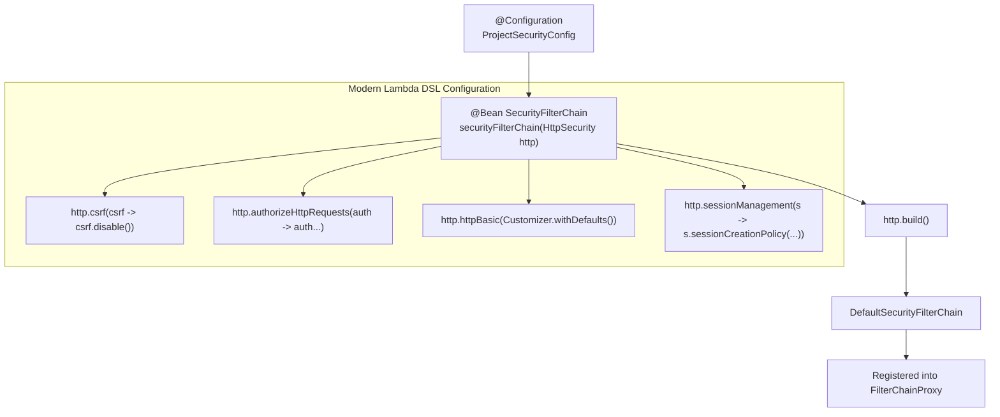

# Module 09: Spring Security Configuration

---

## 1. Definition

Spring Security configuration is the mechanism by which developers declare security policies, define filter chains, configure authentication providers, and govern HTTP resource protection.

In **Spring Security 6+ (Spring Boot 3+)**, the configuration model has moved completely to a **component-based, Lambda DSL design**. The legacy approach of subclassing `WebSecurityConfigurerAdapter` and using `.and()` method chaining has been removed.

---

## 2. Why It Exists

In older iterations of Spring Security (v4 and v5):
* Developers extended `WebSecurityConfigurerAdapter` and overrode `configure(HttpSecurity http)`.
* This tightly coupled security rules to a rigid class hierarchy and hindered modular, multi-tenant configurations.
* Fluctuating indentation and the overuse of `.and()` caused syntax confusion and made it difficult to determine which builder scope was being configured.

The modern component-based Lambda DSL:
1. Replaces class inheritance with standard `@Bean` declarations.
2. Isolates sub-system configurations into explicit lambda blocks (`csrf(...)`, `authorizeHttpRequests(...)`).
3. Supports clean, priority-based multiple filter chains using `@Order`.

---

## 3. Internal Working

### The `HttpSecurity` Builder
When Spring Boot starts:
1. It injects a prototype instance of `HttpSecurity` into your configuration bean method.
2. `HttpSecurity` acts as a specialized builder implementing `SecurityBuilder<DefaultSecurityFilterChain>`.
3. Every Lambda method (e.g., `http.csrf(...)`, `http.authorizeHttpRequests(...)`) populates an internal registry of `SecurityConfigurer` instances.
4. Calling `http.build()` executes `performBuild()`, which iterates over all configurers, instantiates the corresponding Servlet filters, and packages them into a `DefaultSecurityFilterChain`.

```
HttpSecurity Builder
    │
    ├──> csrf(...)                  ──> CsrfConfigurer
    ├──> authorizeHttpRequests(...) ──> AuthorizeHttpRequestsConfigurer
    ├──> formLogin(...)             ──> FormLoginConfigurer
    ├──> httpBasic(...)             ──> HttpBasicConfigurer
    │
    ▼ Calling http.build()
DefaultSecurityFilterChain (RequestMatcher + Ordered List of Filters)
```

---

## 4. Architecture and Flow Diagram

### Configuration Assembly to Filter Chain



---

## 5. Important Classes and Interfaces

| Class / Interface | Role |
|---|---|
| `HttpSecurity` | Builder for configuring web-based security for specific HTTP requests. |
| `SecurityFilterChain` | The resulting bean returned by configuration, composed of a `RequestMatcher` and a list of filters. |
| `Customizer<T>` | Functional callback interface (`T -> void`) used across all Lambda DSL methods. |
| `Customizer.withDefaults()` | Standard utility that enables a subsystem with its default settings. |
| `@EnableWebSecurity` | Activates Spring Security web support (imported automatically by Spring Boot). |

---

## 6. Practical Code Examples

### Modern Comprehensive Spring Security 6 Configuration
```java
package com.example.security.config;

import org.springframework.context.annotation.Bean;
import org.springframework.context.annotation.Configuration;
import org.springframework.http.HttpMethod;
import org.springframework.security.config.Customizer;
import org.springframework.security.config.annotation.web.builders.HttpSecurity;
import org.springframework.security.config.annotation.web.configuration.EnableWebSecurity;
import org.springframework.security.config.http.SessionCreationPolicy;
import org.springframework.security.web.SecurityFilterChain;

@Configuration
@EnableWebSecurity
public class ModernSecurityConfig {

    @Bean
    public SecurityFilterChain securityFilterChain(HttpSecurity http) throws Exception {
        http
            // 1. Configure CSRF (Disabled for stateless REST APIs, enabled for Form login)
            .csrf(csrf -> csrf.disable())

            // 2. Configure URL authorization rules via Lambda DSL
            .authorizeHttpRequests(auth -> auth
                .requestMatchers("/api/v1/public/**", "/swagger-ui/**", "/v3/api-docs/**").permitAll()
                .requestMatchers(HttpMethod.GET, "/api/v1/items/**").permitAll()
                .requestMatchers("/api/v1/admin/**").hasRole("ADMIN")
                .anyRequest().authenticated()
            )

            // 3. Configure Session Management (Stateless for REST/JWT)
            .sessionManagement(session -> session
                .sessionCreationPolicy(SessionCreationPolicy.STATELESS)
            )

            // 4. Configure Authentication Mechanisms
            .httpBasic(Customizer.withDefaults());

        // 5. Finalize and build the DefaultSecurityFilterChain
        return http.build();
    }
}
```

---

## 7. Line-by-Line Explanation

1. `@Configuration` + `@EnableWebSecurity`:
   * `@Configuration` enables Spring bean processing.
   * `@EnableWebSecurity` provides the foundational security beans, including `FilterChainProxy` and firewall bindings.
2. `public SecurityFilterChain securityFilterChain(HttpSecurity http) throws Exception`:
   * Declares the modern `@Bean` replacement for `WebSecurityConfigurerAdapter`.
3. `auth.requestMatchers(...)`:
   * Uses `requestMatchers()` (standard in Spring Security 6) rather than deprecated `antMatchers()` or `mvcMatchers()`.
4. `sessionManagement(session -> session.sessionCreationPolicy(SessionCreationPolicy.STATELESS))`:
   * Prevents Spring Security from creating or inspecting `HttpSession` instances.

---

## 8. Real-World Use Cases

* **Microservices Gateway Security:** Configuring high-speed stateless filter chains that validate incoming bearer tokens without creating sessions.
* **Hybrid Monoliths:** Defining two `@Bean SecurityFilterChain` instances: one for REST endpoints (`/api/**`) using token auth, and another for Thymeleaf web pages (`/web/**`) using form login.

---

## 9. Common Mistakes

1. **Reverting to Deprecated Methods:** Attempting to use `antMatchers()` or `authorizeRequests()`. These methods were removed in Spring Security 6.
2. **Missing `http.build()`:** Forgetting to return `http.build()`, causing compile errors or missing bean declarations.
3. **Overusing `permitAll()` on Catch-All Patterns:** Placing `.requestMatchers("/**").permitAll()` at the top, accidentally exposing all admin endpoints.

---

## 10. Interview Questions & Detailed Answers

### Q1: Why was `WebSecurityConfigurerAdapter` deprecated and removed?
**Answer:**
`WebSecurityConfigurerAdapter` enforced a rigid inheritance-based configuration model. It forced developers to override methods on a single class, making it difficult to define multiple, independent security filter chains and encouraging monolithic configurations. Replacing it with `@Bean SecurityFilterChain` promotes component-based composition, makes testing individual security components easier, and integrates cleanly with Spring Boot's modular architecture.

### Q2: What is the purpose of `Customizer.withDefaults()` in the modern Lambda DSL?
**Answer:**
`Customizer.withDefaults()` is a convenience method that applies Spring Security's default configuration conventions for a given subsystem without requiring empty lambda expressions (like `httpBasic(basic -> {})`). It makes intent explicit and avoids boilerplate.

---

## 11. Quick Revision Notes

* **No More Inheritance:** Define `@Bean SecurityFilterChain` instead of extending `WebSecurityConfigurerAdapter`.
* **No More `.and()`:** Use scoped Lambda expressions (`authorizeHttpRequests(auth -> auth...)`).
* **Modern Matcher:** Always use `requestMatchers()`, never `antMatchers()`.
* **Execution:** `http.build()` must be returned to construct the `DefaultSecurityFilterChain`.
