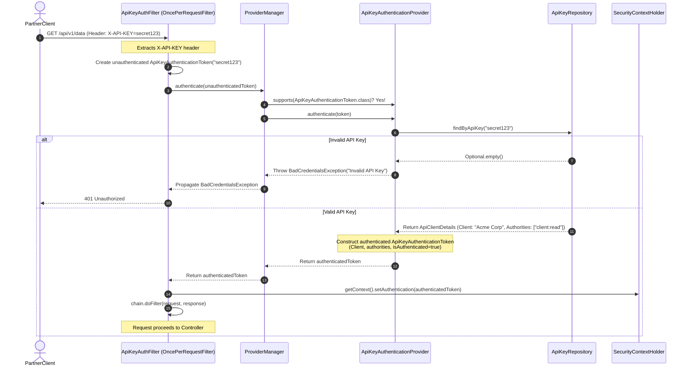

# Module 11: Custom Authentication

---

## 1. Definition

**Custom Authentication** refers to designing and implementing proprietary authentication mechanisms that go beyond username/password combinations.

This involves:
* Creating custom `Authentication` token classes.
* Implementing custom `AuthenticationProvider` components.
* Building custom filters that intercept unique credentials (e.g., API Keys, One-Time Passwords (OTP), Multi-Factor Authentication (MFA), or hardware tokens).

---

## 2. Why It Exists

Real-world enterprise applications frequently require non-standard authentication schemes:
* **API Key Authentication:** Third-party partners sending requests with `X-API-KEY: secret-key-xyz`.
* **Two-Factor / OTP Flow:** Validating a username/password in step 1 and an SMS/TOTP code in step 2 before granting full authorities.
* **Biometric or Hardware Tokens:** Authenticating via signed digital signatures from hardware security keys.

Spring Security's modular design allows you to add custom providers alongside existing ones without modifying the rest of your security configuration.

---

## 3. Internal Working

### Implementing Custom API Key Authentication
To implement an API Key authentication mechanism:
1. **Custom Token:** Implement `AbstractAuthenticationToken` (e.g., `ApiKeyAuthenticationToken`).
2. **Custom Filter:** Extend `OncePerRequestFilter`. Read the `X-API-KEY` header from the request. Wrap it into an unauthenticated `ApiKeyAuthenticationToken`.
3. **Dispatch to `AuthenticationManager`:** Pass the unauthenticated token to `AuthenticationManager.authenticate(token)`.
4. **Custom `AuthenticationProvider`:** Implement `AuthenticationProvider`:
   * `supports()`: Returns `true` only for `ApiKeyAuthenticationToken`.
   * `authenticate()`: Looks up the API key in the database or cache. If valid, returns an authenticated `ApiKeyAuthenticationToken` with assigned authorities.
5. **Install Filter in Chain:** Add the custom filter into `SecurityFilterChain` using `http.addFilterBefore(...)`.

---

## 4. Architecture and Flow Diagram

### Custom API Key Authentication Architecture



---

## 5. Important Classes and Interfaces

| Class / Interface | Responsibility |
|---|---|
| `AbstractAuthenticationToken` | Base class for custom authentication token implementations. |
| `AuthenticationProvider` | Verifies the custom token; contains the core verification logic. |
| `OncePerRequestFilter` | Intercepts HTTP requests to extract custom headers or payloads. |
| `BadCredentialsException` | Standard exception thrown when custom credentials fail verification. |

---

## 6. Practical Code Examples

### 1. The Custom Authentication Token
```java
package com.example.security.custom;

import org.springframework.security.authentication.AbstractAuthenticationToken;
import org.springframework.security.core.GrantedAuthority;

import java.util.Collection;

public class ApiKeyAuthenticationToken extends AbstractAuthenticationToken {

    private final String apiKey;
    private final Object principal;

    // Unauthenticated Constructor
    public ApiKeyAuthenticationToken(String apiKey) {
        super(null);
        this.apiKey = apiKey;
        this.principal = null;
        setAuthenticated(false);
    }

    // Authenticated Constructor
    public ApiKeyAuthenticationToken(Object principal, String apiKey, Collection<? extends GrantedAuthority> authorities) {
        super(authorities);
        this.apiKey = apiKey;
        this.principal = principal;
        super.setAuthenticated(true);
    }

    @Override
    public Object getCredentials() {
        return this.apiKey;
    }

    @Override
    public Object getPrincipal() {
        return this.principal;
    }
}
```

### 2. The Custom `AuthenticationProvider`
```java
package com.example.security.custom;

import org.springframework.security.authentication.AuthenticationProvider;
import org.springframework.security.authentication.BadCredentialsException;
import org.springframework.security.core.Authentication;
import org.springframework.security.core.AuthenticationException;
import org.springframework.security.core.authority.SimpleGrantedAuthority;
import org.springframework.stereotype.Component;

import java.util.List;
import java.util.Map;

@Component
public class ApiKeyAuthenticationProvider implements AuthenticationProvider {

    // Simulated database/vault of valid API keys and partner identities
    private static final Map<String, String> API_KEY_STORE = Map.of(
            "partner-key-alpha-123", "Partner_Alpha_Service",
            "partner-key-beta-456", "Partner_Beta_Analytics"
    );

    @Override
    public Authentication authenticate(Authentication authentication) throws AuthenticationException {
        String apiKey = (String) authentication.getCredentials();

        if (apiKey == null || !API_KEY_STORE.containsKey(apiKey)) {
            throw new BadCredentialsException("Invalid or inactive API Key provided");
        }

        String clientName = API_KEY_STORE.get(apiKey);
        List<SimpleGrantedAuthority> authorities = List.of(
                new SimpleGrantedAuthority("ROLE_API_CLIENT"),
                new SimpleGrantedAuthority("api:read")
        );

        // Return fully authenticated token
        return new ApiKeyAuthenticationToken(clientName, apiKey, authorities);
    }

    @Override
    public boolean supports(Class<?> authentication) {
        return ApiKeyAuthenticationToken.class.isAssignableFrom(authentication);
    }
}
```

### 3. The Custom Filter
```java
package com.example.security.custom;

import jakarta.servlet.FilterChain;
import jakarta.servlet.ServletException;
import jakarta.servlet.http.HttpServletRequest;
import jakarta.servlet.http.HttpServletResponse;
import org.springframework.security.authentication.AuthenticationManager;
import org.springframework.security.core.Authentication;
import org.springframework.security.core.context.SecurityContext;
import org.springframework.security.core.context.SecurityContextHolder;
import org.springframework.web.filter.OncePerRequestFilter;

import java.io.IOException;

public class ApiKeyAuthenticationFilter extends OncePerRequestFilter {

    private static final String HEADER_NAME = "X-API-KEY";
    private final AuthenticationManager authenticationManager;

    public ApiKeyAuthenticationFilter(AuthenticationManager authenticationManager) {
        this.authenticationManager = authenticationManager;
    }

    @Override
    protected void doFilterInternal(HttpServletRequest request,
                                    HttpServletResponse response,
                                    FilterChain filterChain) throws ServletException, IOException {
        
        String apiKey = request.getHeader(HEADER_NAME);

        // If header is absent, pass down the chain (downstream filters or AuthorizationFilter will decide)
        if (apiKey == null || apiKey.isBlank()) {
            filterChain.doFilter(request, response);
            return;
        }

        try {
            ApiKeyAuthenticationToken unauthenticatedToken = new ApiKeyAuthenticationToken(apiKey);
            Authentication authenticatedToken = authenticationManager.authenticate(unauthenticatedToken);

            SecurityContext context = SecurityContextHolder.createEmptyContext();
            context.setAuthentication(authenticatedToken);
            SecurityContextHolder.setContext(context);

            filterChain.doFilter(request, response);
        } catch (Exception ex) {
            SecurityContextHolder.clearContext();
            response.setStatus(HttpServletResponse.SC_UNAUTHORIZED);
            response.setContentType("application/json");
            response.getWriter().write("{\"error\": \"Unauthorized\", \"message\": \"" + ex.getMessage() + "\"}");
        }
    }
}
```

### 4. Registering in `SecurityFilterChain`
```java
package com.example.security.config;

import com.example.security.custom.ApiKeyAuthenticationFilter;
import com.example.security.custom.ApiKeyAuthenticationProvider;
import org.springframework.context.annotation.Bean;
import org.springframework.context.annotation.Configuration;
import org.springframework.security.authentication.AuthenticationManager;
import org.springframework.security.authentication.ProviderManager;
import org.springframework.security.config.annotation.web.builders.HttpSecurity;
import org.springframework.security.config.annotation.web.configuration.EnableWebSecurity;
import org.springframework.security.config.http.SessionCreationPolicy;
import org.springframework.security.web.SecurityFilterChain;
import org.springframework.security.web.authentication.UsernamePasswordAuthenticationFilter;

import java.util.List;

@Configuration
@EnableWebSecurity
public class ApiKeySecurityConfig {

    private final ApiKeyAuthenticationProvider apiKeyAuthenticationProvider;

    public ApiKeySecurityConfig(ApiKeyAuthenticationProvider apiKeyAuthenticationProvider) {
        this.apiKeyAuthenticationProvider = apiKeyAuthenticationProvider;
    }

    @Bean
    public SecurityFilterChain apiKeyFilterChain(HttpSecurity http) throws Exception {
        // Build a dedicated AuthenticationManager with our custom provider
        AuthenticationManager authenticationManager = new ProviderManager(List.of(apiKeyAuthenticationProvider));

        ApiKeyAuthenticationFilter apiKeyFilter = new ApiKeyAuthenticationFilter(authenticationManager);

        http
            .securityMatcher("/api/partner/**")
            .csrf(csrf -> csrf.disable())
            .sessionManagement(s -> s.sessionCreationPolicy(SessionCreationPolicy.STATELESS))
            .authorizeHttpRequests(auth -> auth
                .anyRequest().hasRole("API_CLIENT")
            )
            // Insert our custom filter into the chain before standard username/password processing
            .addFilterBefore(apiKeyFilter, UsernamePasswordAuthenticationFilter.class);

        return http.build();
    }
}
```

---

## 7. Line-by-Line Explanation

1. `ApiKeyAuthenticationToken extends AbstractAuthenticationToken`:
   * Adheres to the framework's token contract. The 1-arg constructor creates an unauthenticated token; the 3-arg constructor sets `authenticated = true` with granted authorities.
2. `supports(Class<?> authentication)`:
   * Tells `ProviderManager` to route only `ApiKeyAuthenticationToken` instances to this provider.
3. `addFilterBefore(apiKeyFilter, UsernamePasswordAuthenticationFilter.class)`:
   * Positions our custom filter in front of the default password filter, ensuring the API key is verified before form login logic runs.

---

## 8. Real-World Use Cases

* **B2B Integration Gateways:** Enabling third-party clients to access webhook APIs securely using API keys without needing an interactive browser session.
* **Hardware Security Integration:** Verifying client-side mutual TLS (mTLS) certificates or asymmetric cryptographic signatures.

---

## 9. Common Mistakes

1. **Bypassing `AuthenticationManager`:** Manually populating `SecurityContextHolder` inside the filter without using `AuthenticationProvider`. This bypasses Spring Security's exception handling, auditing, and multi-provider architecture.
2. **Missing `supports()` validation:** Returning `true` unconditionally in `supports()`, causing your custom provider to accidentally intercept standard username/password tokens.

---

## 10. Interview Questions & Detailed Answers

### Q1: Why should custom authentication use an `AuthenticationProvider` rather than handling everything inside a Filter?
**Answer:**
Delegating verification to an `AuthenticationProvider` preserves Spring Security's separation of concerns:
* **The Filter's role** is purely transport-oriented: extracting credentials from HTTP requests and formatting the HTTP error response.
* **The Provider's role** is purely authentication logic: querying databases, validating tokens, checking expirations, and hashing credentials.
This allows the same authentication provider to be reused across different transports (e.g., JMS, WebSocket, gRPC, or CLI) without coupling it to `HttpServletRequest`.

### Q2: What happens if an `AuthenticationProvider` returns `null` from `authenticate()`?
**Answer:**
Returning `null` signals to `ProviderManager` that this provider **abstains** from making a decision. `ProviderManager` will proceed to evaluate the next configured `AuthenticationProvider` in its list. Only throwing an `AuthenticationException` halts provider iteration immediately.

---

## 11. Quick Revision Notes

* **Custom Token:** Extend `AbstractAuthenticationToken`.
* **Custom Provider:** Implement `AuthenticationProvider` (`authenticate()` + `supports()`).
* **Custom Filter:** Extend `OncePerRequestFilter`, extract credentials, call `AuthenticationManager`.
* **Registration:** Place in filter chain via `.addFilterBefore(...)` or `.addFilterAfter(...)`.
