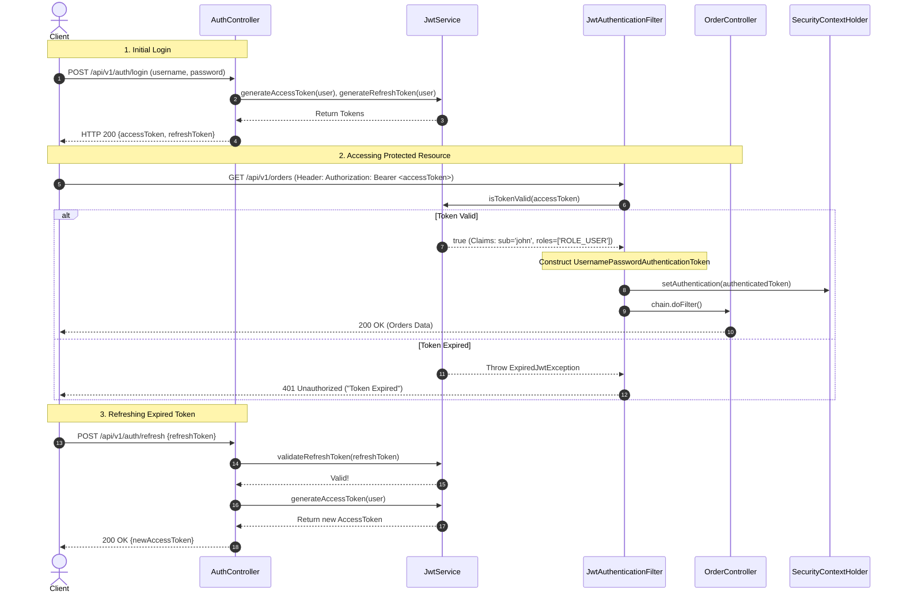

# Module 12: JWT Authentication & Refresh Tokens

---

## 1. Definition

A **JSON Web Token (JWT)** is an open standard (RFC 7519) that defines a compact, self-contained way for securely transmitting information between parties as a JSON object.

In Spring Security, JWTs are commonly used for **stateless authentication** in RESTful microservices and Single Page Applications (SPAs). Instead of storing a session on the server (`HttpSession`), the client transmits a signed token in every request's `Authorization: Bearer <token>` header.

---

## 2. Why It Exists

In distributed microservices architectures:
* **Server-Side Sessions Don't Scale Easily:** If a user logs into Service A, Service B and Service C cannot authenticate the user without a centralized distributed cache (e.g., Redis Session Store) or sticky load-balancer sessions.
* **Stateless Scalability:** A JWT is **self-contained**. It holds the user's ID, username, roles, and expiration timestamp. Any service possessing the shared secret or public key can cryptographically verify the token without querying a database or session store.

---

## 3. Internal Working

### Anatomy of a JWT
A JWT consists of three parts separated by dots (`.`):
```
header.payload.signature
```
1. **Header:** Algorithm and token type (e.g., `{"alg": "HS256", "typ": "JWT"}`).
2. **Payload (Claims):** Statements about an entity (e.g., `sub` (subject), `iat` (issued at), `exp` (expiration), and custom claims like `roles`).
3. **Signature:** Cryptographic hash verifying that the sender is who it says it is and ensuring the message was not altered in transit:
   $$\text{Signature} = \text{HMACSHA256}(\text{base64UrlEncode}(\text{header}) + "." + \text{base64UrlEncode}(\text{payload}), \text{secret})$$

### The Stateless Request Flow
1. Client logs in with credentials via `POST /api/v1/auth/login`.
2. Server validates credentials and returns two tokens:
   * **Access Token (Short-lived, e.g., 15 minutes):** Carried in `Authorization: Bearer <access_token>`.
   * **Refresh Token (Long-lived, e.g., 7 days):** Stored in a secure `HttpOnly` cookie or dedicated database table.
3. For protected endpoints, a custom **`JwtAuthenticationFilter`** intercepts the request:
   * Extracts the bearer token.
   * Validates the cryptographic signature and checks `exp > currentTime`.
   * Extracts username and authorities.
   * Populates `SecurityContextHolder.getContext().setAuthentication(...)`.
4. If the access token expires, the client calls `POST /api/v1/auth/refresh` using the refresh token to obtain a new access token.

---

## 4. Architecture and Flow Diagram

### JWT Authentication & Refresh Lifecycle



---

## 5. Important Classes and Interfaces

| Class / Library | Role |
|---|---|
| `jjwt` (`io.jsonwebtoken`) | Industry-standard Java library for creating, signing, and parsing JWTs. |
| `OncePerRequestFilter` | Base class used to implement `JwtAuthenticationFilter`. |
| `Claims` | Map-like structure containing token subject, expiration, and custom claims. |
| `SecretKey` / `Keys.hmacShaKeyFor()` | Cryptographic key generator used to sign tokens with HMAC-SHA. |

---

## 6. Practical Code Examples

### 1. Maven Dependency (`pom.xml`)
```xml
<!-- JJWT Library for Java 17+ / Spring Boot 3+ -->
<dependency>
    <groupId>io.jsonwebtoken</groupId>
    <artifactId>jjwt-api</artifactId>
    <version>0.12.6</version>
</dependency>
<dependency>
    <groupId>io.jsonwebtoken</groupId>
    <artifactId>jjwt-impl</artifactId>
    <version>0.12.6</version>
    <scope>runtime</scope>
</dependency>
<dependency>
    <groupId>io.jsonwebtoken</groupId>
    <artifactId>jjwt-jackson</artifactId>
    <version>0.12.6</version>
    <scope>runtime</scope>
</dependency>
```

### 2. The `JwtService` Utility
```java
package com.example.security.jwt;

import io.jsonwebtoken.Claims;
import io.jsonwebtoken.JwtException;
import io.jsonwebtoken.Jwts;
import io.jsonwebtoken.security.Keys;
import org.springframework.security.core.GrantedAuthority;
import org.springframework.security.core.userdetails.UserDetails;
import org.springframework.stereotype.Service;

import javax.crypto.SecretKey;
import java.nio.charset.StandardCharsets;
import java.util.Date;
import java.util.List;
import java.util.function.Function;
import java.util.stream.Collectors;

@Service
public class JwtService {

    // Minimum 256-bit secure secret key
    private static final String SECRET_KEY = "mySuperSecretKeyForJwtSigningThatMustBeAtLeast256BitsLong!";
    private static final long ACCESS_TOKEN_VALIDITY_MS = 15 * 60 * 1000; // 15 Minutes
    private static final long REFRESH_TOKEN_VALIDITY_MS = 7 * 24 * 60 * 60 * 1000; // 7 Days

    private SecretKey getSigningKey() {
        return Keys.hmacShaKeyFor(SECRET_KEY.getBytes(StandardCharsets.UTF_8));
    }

    public String generateAccessToken(UserDetails userDetails) {
        List<String> roles = userDetails.getAuthorities().stream()
                .map(GrantedAuthority::getAuthority)
                .collect(Collectors.toList());

        return Jwts.builder()
                .subject(userDetails.getUsername())
                .claim("roles", roles)
                .issuedAt(new Date(System.currentTimeMillis()))
                .expiration(new Date(System.currentTimeMillis() + ACCESS_TOKEN_VALIDITY_MS))
                .signWith(getSigningKey())
                .compact();
    }

    public String generateRefreshToken(UserDetails userDetails) {
        return Jwts.builder()
                .subject(userDetails.getUsername())
                .issuedAt(new Date(System.currentTimeMillis()))
                .expiration(new Date(System.currentTimeMillis() + REFRESH_TOKEN_VALIDITY_MS))
                .signWith(getSigningKey())
                .compact();
    }

    public String extractUsername(String token) {
        return extractClaim(token, Claims::getSubject);
    }

    public <T> T extractClaim(String token, Function<Claims, T> claimsResolver) {
        Claims claims = extractAllClaims(token);
        return claimsResolver.apply(claims);
    }

    public boolean isTokenValid(String token, UserDetails userDetails) {
        final String username = extractUsername(token);
        return (username.equals(userDetails.getUsername()) && !isTokenExpired(token));
    }

    private boolean isTokenExpired(String token) {
        return extractClaim(token, Claims::getExpiration).before(new Date());
    }

    private Claims extractAllClaims(String token) {
        try {
            return Jwts.parser()
                    .verifyWith(getSigningKey())
                    .build()
                    .parseSignedClaims(token)
                    .getPayload();
        } catch (JwtException ex) {
            throw new IllegalArgumentException("Invalid or expired JWT token: " + ex.getMessage());
        }
    }
}
```

### 3. The `JwtAuthenticationFilter`
```java
package com.example.security.jwt;

import jakarta.servlet.FilterChain;
import jakarta.servlet.ServletException;
import jakarta.servlet.http.HttpServletRequest;
import jakarta.servlet.http.HttpServletResponse;
import org.springframework.security.authentication.UsernamePasswordAuthenticationToken;
import org.springframework.security.core.context.SecurityContext;
import org.springframework.security.core.context.SecurityContextHolder;
import org.springframework.security.core.userdetails.UserDetails;
import org.springframework.security.core.userdetails.UserDetailsService;
import org.springframework.security.web.authentication.WebAuthenticationDetailsSource;
import org.springframework.stereotype.Component;
import org.springframework.web.filter.OncePerRequestFilter;

import java.io.IOException;

@Component
public class JwtAuthenticationFilter extends OncePerRequestFilter {

    private final JwtService jwtService;
    private final UserDetailsService userDetailsService;

    public JwtAuthenticationFilter(JwtService jwtService, UserDetailsService userDetailsService) {
        this.jwtService = jwtService;
        this.userDetailsService = userDetailsService;
    }

    @Override
    protected void doFilterInternal(HttpServletRequest request,
                                    HttpServletResponse response,
                                    FilterChain filterChain) throws ServletException, IOException {
        
        final String authHeader = request.getHeader("Authorization");

        // 1. Check if Authorization header contains a Bearer token
        if (authHeader == null || !authHeader.startsWith("Bearer ")) {
            filterChain.doFilter(request, response);
            return;
        }

        final String jwt = authHeader.substring(7);
        final String username;

        try {
            username = jwtService.extractUsername(jwt);
        } catch (Exception ex) {
            // Malformed token; allow downstream AuthorizationFilter to reject
            filterChain.doFilter(request, response);
            return;
        }

        // 2. Validate token only if user is not already authenticated in this thread
        if (username != null && SecurityContextHolder.getContext().getAuthentication() == null) {
            UserDetails userDetails = this.userDetailsService.loadUserByUsername(username);

            if (jwtService.isTokenValid(jwt, userDetails)) {
                UsernamePasswordAuthenticationToken authToken = new UsernamePasswordAuthenticationToken(
                        userDetails,
                        null,
                        userDetails.getAuthorities()
                );
                authToken.setDetails(new WebAuthenticationDetailsSource().buildDetails(request));

                // 3. Install authenticated token into SecurityContext
                SecurityContext context = SecurityContextHolder.createEmptyContext();
                context.setAuthentication(authToken);
                SecurityContextHolder.setContext(context);
            }
        }

        // 4. Continue filter execution
        filterChain.doFilter(request, response);
    }
}
```

### 4. Registering `JwtAuthenticationFilter` in `SecurityFilterChain`
```java
package com.example.security.config;

import com.example.security.jwt.JwtAuthenticationFilter;
import org.springframework.context.annotation.Bean;
import org.springframework.context.annotation.Configuration;
import org.springframework.security.config.annotation.web.builders.HttpSecurity;
import org.springframework.security.config.annotation.web.configuration.EnableWebSecurity;
import org.springframework.security.config.http.SessionCreationPolicy;
import org.springframework.security.web.SecurityFilterChain;
import org.springframework.security.web.authentication.UsernamePasswordAuthenticationFilter;

@Configuration
@EnableWebSecurity
public class JwtSecurityConfig {

    private final JwtAuthenticationFilter jwtAuthenticationFilter;

    public JwtSecurityConfig(JwtAuthenticationFilter jwtAuthenticationFilter) {
        this.jwtAuthenticationFilter = jwtAuthenticationFilter;
    }

    @Bean
    public SecurityFilterChain securityFilterChain(HttpSecurity http) throws Exception {
        http
            .csrf(csrf -> csrf.disable()) // Safe to disable in stateless Bearer token APIs
            .sessionManagement(session -> session
                .sessionCreationPolicy(SessionCreationPolicy.STATELESS)
            )
            .authorizeHttpRequests(auth -> auth
                .requestMatchers("/api/v1/auth/**", "/public/**").permitAll()
                .anyRequest().authenticated()
            )
            // Add JWT filter before UsernamePasswordAuthenticationFilter
            .addFilterBefore(jwtAuthenticationFilter, UsernamePasswordAuthenticationFilter.class);

        return http.build();
    }
}
```

---

## 7. Line-by-Line Explanation

1. `authHeader.startsWith("Bearer ")`:
   * Complies with the OAuth2 / Bearer Token RFC specification. Tokens are extracted from index 7 onwards.
2. `SecurityContextHolder.getContext().getAuthentication() == null`:
   * Guard clause. If another filter earlier in the chain already authenticated this user, we avoid redundant database lookups.
3. `sessionCreationPolicy(SessionCreationPolicy.STATELESS)`:
   * Explicitly tells Spring Security **never** to store or retrieve `SecurityContext` from `HttpSession`. Every incoming request must provide a valid JWT.

---

## 8. Real-World Use Cases

* **Cross-Service Authentication:** A microservice frontend signs in through an Identity Service, receives a JWT, and sends it directly to Payment, Order, and Inventory services without requiring any service-to-service session replication.

---

## 9. Common Mistakes

1. **Using Short / Weak HMAC Secret Keys:** Using a simple passphrase like `secret`. HS256 requires at least 256 bits (32 bytes) of cryptographic entropy, or JJWT throws a `WeakKeyException`.
2. **Storing Sensitive Data in Claims:** Placing plain-text passwords, Social Security Numbers, or credit card details into JWT claims. JWT payloads are only Base64Url-encoded, **not encrypted**; anyone who intercepts the token can read the claims.
3. **Omitting Token Revocation Strategy:** Failing to implement a blacklist (via Redis or database) for revoked or stolen JWTs before their natural expiration.

---

## 10. Interview Questions & Detailed Answers

### Q1: How do you invalidate or revoke a stateless JWT before its expiration date?
**Answer:**
Because JWTs are stateless and self-contained, standard verification will consider them valid until `exp` passes. To revoke a token:
1. **Short Lifespans:** Make access tokens short-lived (e.g., 5–15 minutes) and rely on refresh token invalidation.
2. **Redis Blacklist:** When a user logs out, store the JWT ID (`jti`) or token string in a Redis cache with a Time-To-Live (TTL) equal to the remaining expiration time. The `JwtAuthenticationFilter` checks Redis; if the token is blacklisted, it rejects the request.
3. **Token Versioning:** Store an incremental `token_version` on the user entity in the database. Include `token_version` in the JWT claims. If the user logs out or changes passwords, increment the database version. Any token containing an older version is rejected.

### Q2: What is the purpose of a Refresh Token?
**Answer:**
If an access token is valid for 30 days and gets stolen, the attacker has access for 30 days. To mitigate this:
* **Access Tokens** are given very short lifespans (e.g., 10 minutes) to minimize the damage of token theft.
* **Refresh Tokens** have longer lifespans (e.g., 7 days) and are stored securely. When the access token expires, the client uses the refresh token to obtain a new access token without requiring the user to re-type their password. Refresh tokens can be revoked immediately in the database if suspicious activity is detected.

---

## 11. Quick Revision Notes

* **Structure:** `Header.Payload.Signature`.
* **Signature Prevents Tampering:** Changing 1 byte in the payload invalidates the signature.
* **Payload is Readable:** Base64Url decoded, never store secrets in claims.
* **Stateless Policy:** Always set `SessionCreationPolicy.STATELESS` in the security configuration.
* **Placement:** Add `JwtAuthenticationFilter` before `UsernamePasswordAuthenticationFilter`.
