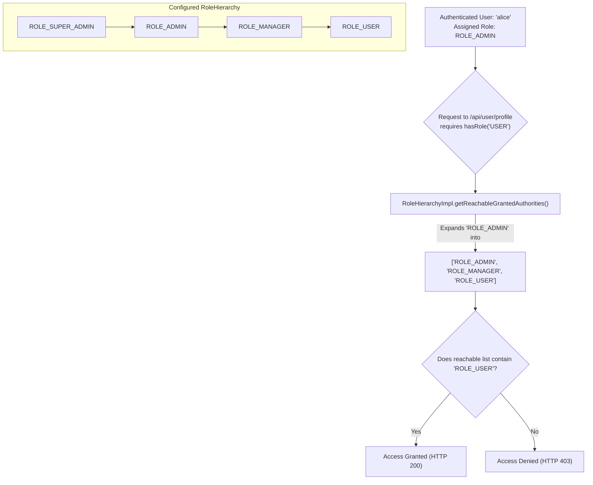

# Module 13: Role-Based Access Control (RBAC)

---

## 1. Definition

**Role-Based Access Control (RBAC)** is an authorization model in which user permissions are grouped into **Roles** (e.g., `ROLE_ADMIN`, `ROLE_CUSTOMER`), and system resources or operations are restricted based on those roles.

In Spring Security, RBAC builds on the **`GrantedAuthority`** interface, using either coarse-grained **Roles** or fine-grained **Authorities (Privileges/Permissions)**.

---

## 2. Why It Exists

In small applications, assigning permissions directly to users leads to administrative overhead:
* If 500 users need permission to edit invoices, updating that permission requires altering 500 individual records.
* RBAC introduces an abstraction layer: **Users $\rightarrow$ Roles $\rightarrow$ Permissions**.
* Users are assigned roles (e.g., `ROLE_ACCOUNTANT`), and roles are mapped to specific actions (`invoice:create`, `invoice:read`, `invoice:delete`).

---

## 3. Internal Working

### Roles vs Authorities: The `ROLE_` Prefix Convention
In Spring Security, there is an important technical distinction between a **Role** and an **Authority**:

| Concept | Declaration in Code | Stored Representation in `GrantedAuthority` |
|---|---|---|
| **Authority (Permission)** | `hasAuthority("order:write")` | `"order:write"` (exact match) |
| **Role** | `hasRole("ADMIN")` | `"ROLE_ADMIN"` (automatically prefixes `ROLE_`) |

When you invoke `.hasRole("MANAGER")`:
1. Spring Security calls `hasAuthority("ROLE_MANAGER")`.
2. It evaluates `authentication.getAuthorities()`.
3. If any authority exactly equals `"ROLE_MANAGER"`, access is granted.

### Hierarchical Roles (`RoleHierarchy`)
In real enterprises, permissions are hierarchical: an `ADMIN` should automatically possess all permissions of a `MANAGER`, and a `MANAGER` should inherit all permissions of a `USER`.

Without a role hierarchy, you would have to write:
```java
.requestMatchers("/reports").hasAnyRole("USER", "MANAGER", "ADMIN", "SUPER_ADMIN")
```
With Spring Security's **`RoleHierarchy`**, declaring `hasRole("USER")` automatically grants access to higher-ranking roles.

---

## 4. Architecture and Flow Diagram

### Role Hierarchy & Authority Evaluation



---

## 5. Important Classes and Interfaces

| Class / Interface | Responsibility |
|---|---|
| `GrantedAuthority` | Represents a permission or role granted to an `Authentication`. |
| `SimpleGrantedAuthority` | Basic string-based implementation of `GrantedAuthority`. |
| `RoleHierarchy` | Interface defining how authorities are inherited across ranks. |
| `RoleHierarchyImpl` | Standard implementation parsing role definition strings (e.g., `ROLE_ADMIN > ROLE_USER`). |

---

## 6. Practical Code Examples

### 1. Fine-Grained Role and Authority Mapping in Entity
```java
package com.example.security.domain;

import org.springframework.security.core.GrantedAuthority;
import org.springframework.security.core.authority.SimpleGrantedAuthority;

import java.util.ArrayList;
import java.util.Collection;
import java.util.List;
import java.util.Set;

public enum AppRole {
    USER(Set.of("product:read")),
    MANAGER(Set.of("product:read", "product:write")),
    ADMIN(Set.of("product:read", "product:write", "product:delete", "user:manage"));

    private final Set<String> permissions;

    AppRole(Set<String> permissions) {
        this.permissions = permissions;
    }

    public List<GrantedAuthority> getAuthorities() {
        List<GrantedAuthority> authorities = new ArrayList<>();
        // 1. Add the role name with ROLE_ prefix
        authorities.add(new SimpleGrantedAuthority("ROLE_" + this.name()));
        // 2. Add all granular permissions
        this.permissions.forEach(p -> authorities.add(new SimpleGrantedAuthority(p)));
        return authorities;
    }
}
```

### 2. Configuring `RoleHierarchy` in Spring Boot 3+
```java
package com.example.security.config;

import org.springframework.context.annotation.Bean;
import org.springframework.context.annotation.Configuration;
import org.springframework.security.access.hierarchicalroles.RoleHierarchy;
import org.springframework.security.access.hierarchicalroles.RoleHierarchyImpl;
import org.springframework.security.config.Customizer;
import org.springframework.security.config.annotation.web.builders.HttpSecurity;
import org.springframework.security.config.annotation.web.configuration.EnableWebSecurity;
import org.springframework.security.web.SecurityFilterChain;

@Configuration
@EnableWebSecurity
public class RbacSecurityConfig {

    /**
     * Defines role hierarchy:
     * ROLE_ADMIN inherits all permissions of ROLE_MANAGER
     * ROLE_MANAGER inherits all permissions of ROLE_USER
     */
    @Bean
    public RoleHierarchy roleHierarchy() {
        return RoleHierarchyImpl.fromHierarchy(
                "ROLE_ADMIN > ROLE_MANAGER \n" +
                "ROLE_MANAGER > ROLE_USER"
        );
    }

    @Bean
    public SecurityFilterChain rbacFilterChain(HttpSecurity http) throws Exception {
        http
            .csrf(csrf -> csrf.disable())
            .authorizeHttpRequests(auth -> auth
                .requestMatchers("/api/admin/**").hasRole("ADMIN")
                .requestMatchers("/api/management/**").hasRole("MANAGER")
                // Because of RoleHierarchy, ADMIN and MANAGER can also access /api/user/**
                .requestMatchers("/api/user/**").hasRole("USER")
                .requestMatchers("/api/products/delete/**").hasAuthority("product:delete")
                .anyRequest().authenticated()
            )
            .httpBasic(Customizer.withDefaults());

        return http.build();
    }
}
```

---

## 7. Line-by-Line Explanation

1. `RoleHierarchyImpl.fromHierarchy(...)`:
   * Uses modern builder syntax to define role inheritance. The `>` symbol specifies that the left-hand role inherits all permissions granted to the right-hand role.
2. `.requestMatchers("/api/user/**").hasRole("USER")`:
   * With the hierarchy in place, a user with `ROLE_ADMIN` will succeed when accessing `/api/user/**` because `ROLE_ADMIN` inherits `ROLE_USER`.
3. `.hasAuthority("product:delete")`:
   * Verifies fine-grained permissions, decoupling the endpoint rule from specific role titles.

---

## 8. Real-World Use Cases

* **SaaS Multi-Tier Subscriptions:** Basic tier users have `ROLE_BRONZE`, premium users have `ROLE_GOLD`. Using `RoleHierarchy`, `GOLD > SILVER > BRONZE`, allowing premium users access to all entry-tier features automatically.
* **Granular API Action Permissions:** Instead of locking `/api/users/export` to `ROLE_ADMIN`, protect it with `hasAuthority("user:export")`. This allows granting export rights to external auditors without promoting them to full administrators.

---

## 9. Common Mistakes

1. **Adding `ROLE_` inside `hasRole()`:** Writing `.hasRole("ROLE_ADMIN")`. Spring Security evaluates this as `"ROLE_ROLE_ADMIN"` and denies access.
2. **Missing `ROLE_` Prefix in Database Records:** Storing `"ADMIN"` in the database but using `hasRole("ADMIN")`. The database value must be `"ROLE_ADMIN"` when using standard `SimpleGrantedAuthority`.
3. **Hardcoding Broad Roles on Data Mutations:** Restricting dangerous actions (`DELETE /api/database/purge`) to a generic role rather than an explicit authority like `database:purge`.

---

## 10. Interview Questions & Detailed Answers

### Q1: What is the difference between Role-Based Access Control (RBAC) and Attribute-Based Access Control (ABAC)?
**Answer:**
* **RBAC:** Access decisions are made strictly based on the user's assigned roles (e.g., "Is user an ADMIN?"). It is static and context-free.
* **ABAC:** Access decisions evaluate attributes of the user, the resource, and the environment (e.g., "Can user edit this document if user is the OWNER, the document is in DRAFT state, and access is requested during BUSINESS_HOURS?"). In Spring Security, ABAC is implemented using method security SpEL expressions (`@PreAuthorize`) or custom `AuthorizationManager` beans.

### Q2: How does `RoleHierarchy` affect performance?
**Answer:**
`RoleHierarchyImpl` precomputes reachable authorities using a directed graph at application startup. When a request is evaluated, `getReachableGrantedAuthorities()` performs a set lookup against the pre-compiled graph, introducing virtually zero runtime overhead while eliminating boilerplate in security configuration rules.

---

## 11. Quick Revision Notes

* **`hasRole("X")`** $\rightarrow$ checks for `"ROLE_X"`.
* **`hasAuthority("X")`** $\rightarrow$ checks for `"X"`.
* **Hierarchies Eliminate Duplication:** Configure `RoleHierarchy` to let higher roles inherit lower-level rights.
* **Best Practice:** Use Roles for macro boundaries (`/admin/**`) and Authorities for micro actions (`product:delete`).
