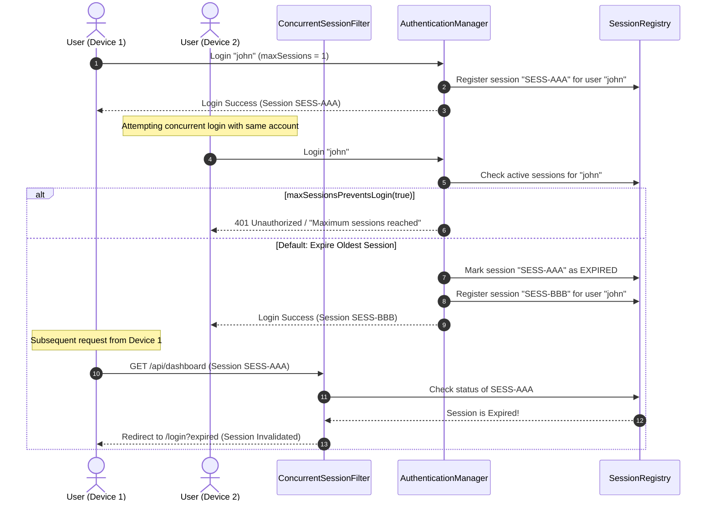

# Module 14: Session Management & Control

---

## 1. Definition

**Session Management** in Spring Security governs the creation, lifecycle, concurrency, and security of user sessions (`HttpSession`) in stateful web applications.

It provides protections against:
* **Session Fixation Attacks:** Malicious actors pre-creating sessions to hijack user identities upon authentication.
* **Concurrent Logins:** Limiting the number of simultaneous active sessions a single user account can hold.
* **Session Hijacking / Invalidation:** Handling session timeouts and clean session destruction upon logout.

---

## 2. Why It Exists

HTTP is inherently stateless. Stateful applications bridge this by creating an in-memory session on the server and passing a cookie (`JSESSIONID`) to the browser.

However, sessions introduce critical security vulnerabilities:
1. **Session Fixation:** An attacker tricks a victim into using a known session ID. If the server does not change the session ID upon login, the attacker gains authenticated access.
2. **Account Sharing / Credential Abuse:** Without concurrency limits, a single compromised set of credentials can be used simultaneously by hundreds of unauthorized users.
3. **Session Leaks:** Uncontrolled session creation consumes server memory, creating vulnerability to memory exhaustion DoS attacks.

---

## 3. Internal Working

### Session Creation Policies (`SessionCreationPolicy`)
Spring Security provides four session creation policies:

| Policy | Behavior | Typical Architecture |
|---|---|---|
| `ALWAYS` | Spring Security always creates an `HttpSession` if one does not exist. | Legacy stateful web apps. |
| `IF_REQUIRED` *(Default)* | Creates an `HttpSession` only if required (e.g., form login or storing security context). | Standard server-side web applications (Thymeleaf/JSP). |
| `NEVER` | Spring Security will never create an `HttpSession`, but will use one if it already exists. | Hybrid legacy integrations. |
| `STATELESS` | Spring Security will never create or use an `HttpSession`. Context is never stored in session. | RESTful APIs, JWT, OAuth2 Bearer token services. |

### Session Fixation Protection
When a user authenticates, Spring Security automatically applies session fixation protection strategies:
* **`changeSessionId`** *(Default in Servlet 3.1+)*: Keeps the session attributes intact but changes the underlying `JSESSIONID` cookie value in the Servlet container.
* **`migrateSession`**: Creates a brand-new `HttpSession`, copies all existing session attributes over, and invalidates the old session.
* **`newSession`**: Creates a brand-new `HttpSession` without copying any existing attributes.
* **`none`**: Disables protection (not recommended).

### Concurrent Session Control
To limit active sessions per user:
1. Spring Security registers an `HttpSessionEventPublisher` to track session creation and destruction events.
2. A `SessionRegistry` tracks which `Principal` owns which active session IDs.
3. When a user exceeds the maximum allowed sessions (e.g., `maxSessionsPreventsLogin(true)`), either new logins are blocked or the oldest session is expired.

---

## 4. Architecture and Flow Diagram

### Concurrent Session Control Flow



---

## 5. Important Classes and Interfaces

| Class / Interface | Responsibility |
|---|---|
| `SessionCreationPolicy` | Enum defining session creation rules (`STATELESS`, `IF_REQUIRED`, etc.). |
| `SessionRegistry` | Tracks active principals and their associated session IDs. |
| `SessionRegistryImpl` | In-memory implementation of `SessionRegistry`. |
| `HttpSessionEventPublisher` | Servlet listener bridging container HTTP session lifecycle events into Spring events. |
| `ConcurrentSessionFilter` | Filter verifying whether an incoming session has been marked as expired. |

---

## 6. Practical Code Examples

### 1. Registering `HttpSessionEventPublisher`
To enable session tracking in Spring Boot, declare the `HttpSessionEventPublisher` bean:

```java
package com.example.security.config;

import org.springframework.context.annotation.Bean;
import org.springframework.context.annotation.Configuration;
import org.springframework.security.web.session.HttpSessionEventPublisher;

@Configuration
public class SessionListenerConfig {

    /**
     * Publishes HttpSessionCreatedEvent and HttpSessionDestroyedEvent to Spring context.
     * Crucial for SessionRegistry to clean up expired sessions from memory!
     */
    @Bean
    public HttpSessionEventPublisher httpSessionEventPublisher() {
        return new HttpSessionEventPublisher();
    }
}
```

### 2. Full Session Management Security Configuration
```java
package com.example.security.config;

import org.springframework.context.annotation.Bean;
import org.springframework.context.annotation.Configuration;
import org.springframework.security.config.Customizer;
import org.springframework.security.config.annotation.web.builders.HttpSecurity;
import org.springframework.security.config.annotation.web.configuration.EnableWebSecurity;
import org.springframework.security.core.session.SessionRegistry;
import org.springframework.security.core.session.SessionRegistryImpl;
import org.springframework.security.web.SecurityFilterChain;

@Configuration
@EnableWebSecurity
public class SessionSecurityConfig {

    @Bean
    public SessionRegistry sessionRegistry() {
        return new SessionRegistryImpl();
    }

    @Bean
    public SecurityFilterChain sessionFilterChain(HttpSecurity http) throws Exception {
        http
            .authorizeHttpRequests(auth -> auth
                .requestMatchers("/login", "/session-expired", "/public/**").permitAll()
                .anyRequest().authenticated()
            )
            .formLogin(Customizer.withDefaults())

            // Configure Session Management
            .sessionManagement(session -> session
                // 1. Session Fixation Defense: change JSESSIONID on login
                .sessionFixation(fixation -> fixation.changeSessionId())

                // 2. Maximum Concurrent Sessions
                .maximumSessions(1) // Only 1 active session per user account
                .maxSessionsPreventsLogin(true) // Block second login instead of expiring first
                .expiredUrl("/session-expired") // Where to redirect if session is invalidated
                .sessionRegistry(sessionRegistry())
            );

        return http.build();
    }
}
```

---

## 7. Line-by-Line Explanation

1. `sessionFixation(fixation -> fixation.changeSessionId())`:
   * Uses Servlet 3.1 `HttpServletRequest.changeSessionId()` to assign a fresh session identifier upon login, completely defeating session fixation attacks while preserving user cart/preference attributes.
2. `maximumSessions(1)`:
   * Enforces that each user principal can only have one active session registered in `SessionRegistry`.
3. `maxSessionsPreventsLogin(true)`:
   * If `true`, a second login attempt fails with an authentication error. If `false` (default), the second login succeeds and the first session is invalidated.
4. `httpSessionEventPublisher()`:
   * Essential listener. Without it, when an `HttpSession` times out in Tomcat, `SessionRegistry` is never notified, causing the user to be permanently locked out if `maxSessionsPreventsLogin(true)` is enabled.

---

## 8. Real-World Use Cases

* **Banking & Fintech Applications:** Strictly enforcing `maximumSessions(1)` with `maxSessionsPreventsLogin(true)` to ensure that customers cannot be logged in from multiple devices simultaneously.
* **Media Streaming Services:** Enforcing concurrent screen limits (e.g., maximum 2 or 4 simultaneous streams per subscriber account).

---

## 9. Common Mistakes

1. **Forgetting `HttpSessionEventPublisher`:** Enabling `maximumSessions` without declaring `HttpSessionEventPublisher`. When a user closes their browser and the session expires, the session remains registered in memory, preventing the user from ever logging back in.
2. **Using Stateful Policies for REST APIs:** Leaving `SessionCreationPolicy` on default (`IF_REQUIRED`) for JWT-based REST endpoints. Spring Security will create sessions, consuming server RAM and invalidating stateless scalability.

---

## 10. Interview Questions & Detailed Answers

### Q1: What is a Session Fixation attack and how does Spring Security prevent it?
**Answer:**
In a **Session Fixation** attack, an attacker obtains a valid session ID from the web application (e.g., by visiting the site) and tricks a victim into authenticating with that pre-allocated session ID (e.g., via a malicious link or cookie injection). If the server preserves the same session ID post-authentication, the attacker now shares the victim's authenticated session.
Spring Security prevents this by altering the session ID upon authentication (`changeSessionId()` or `migrateSession()`). The old session identifier is discarded, neutralizing the attacker's pre-allocated ID.

### Q2: What is the difference between `SessionCreationPolicy.NEVER` and `SessionCreationPolicy.STATELESS`?
**Answer:**
* **`NEVER`**: Spring Security will never create an `HttpSession` itself. However, if another component in the application (or a legacy servlet) has already created one, Spring Security will gladly read and use it.
* **`STATELESS`**: Spring Security will **never** create an `HttpSession` and will **never** read or store the `SecurityContext` in an `HttpSession`. It forces every single request to independently provide credentials (e.g., JWT).

---

## 11. Quick Revision Notes

* **Stateless APIs:** Always use `SessionCreationPolicy.STATELESS`.
* **Stateful Web Apps:** Use `SessionCreationPolicy.IF_REQUIRED`.
* **Session Fixation Defense:** Enabled by default (`changeSessionId`).
* **Concurrent Sessions:** Requires `HttpSessionEventPublisher` bean to clean up destroyed sessions.
* **`maxSessionsPreventsLogin`:** `true` = reject new login; `false` = kick out old session.
