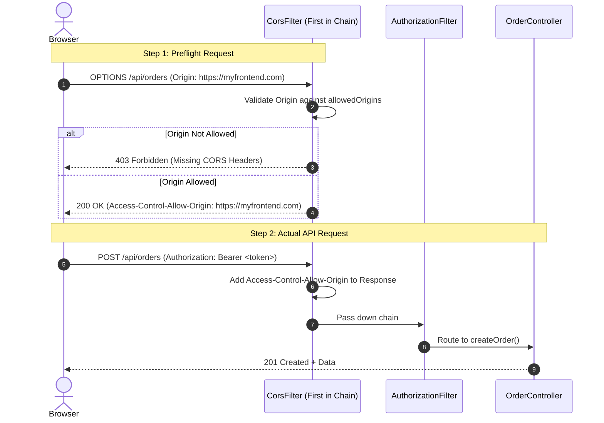

# Module 15: CORS & CSRF Deep Dive

---

## 1. Definition

**CORS (Cross-Origin Resource Sharing)** and **CSRF (Cross-Site Request Forgery)** are two of the most critical browser-level security mechanisms handled by Spring Security:

* **CORS:** A W3C standard that allows a web browser to make HTTP requests across different origins (domain, protocol, or port), relaxing the default **Same-Origin Policy (SOP)** under strict server-governed rules.
* **CSRF:** An attack where a malicious site tricks a victim's browser into executing unwanted actions on a trusted web application where the victim is currently authenticated (typically via ambient session cookies).

---

## 2. Why It Exists

### Why CORS Exists
Under the browser's Same-Origin Policy, JavaScript running on `https://frontend.app.com` cannot read responses from `https://api.backend.com` unless the backend explicitly emits CORS headers (e.g., `Access-Control-Allow-Origin`). 

Without proper CORS configuration in Spring Security, browser single-page applications (React, Angular, Vue) fail with network errors.

### Why CSRF Protection Exists
When a browser makes a request to `https://bank.com/transfer`, it **automatically attaches all cookies** associated with `bank.com` (including `JSESSIONID`), even if the request was initiated from an image tag or script on `https://evil-site.com`.

If an application relies on session cookies for authentication and does not validate a unique, secret, anti-forgery token, the attacker can execute unauthorized fund transfers or password resets using the victim's active session.

---

## 3. Internal Working

### How Spring Security Defends Against CSRF
Spring Security includes the **`CsrfFilter`** in the filter chain:
1. For safe, read-only HTTP methods (`GET`, `HEAD`, `TRACE`, `OPTIONS`), `CsrfFilter` allows requests through without token verification.
2. For state-changing methods (`POST`, `PUT`, `PATCH`, `DELETE`), `CsrfFilter` requires a valid **`CsrfToken`**.
3. It compares the token submitted in the request (via header `X-CSRF-TOKEN` or form field `_csrf`) against the token stored in the user's session or cookie.
4. If the tokens do not match or the token is missing, `CsrfFilter` rejects the request with an HTTP **403 Forbidden** (`InvalidCsrfTokenException`).

### When to Disable CSRF
* **Stateful Web Apps (Thymeleaf/JSP/Sessions):** **NEVER** disable CSRF.
* **Stateless REST APIs (JWT/Bearer Tokens):** **SAFE TO DISABLE**. Because bearer tokens are stored in memory/local storage and explicitly passed via `Authorization: Bearer <token>`, browsers do **not** automatically attach them on cross-site requests. Therefore, CSRF attacks are physically impossible against purely stateless token APIs.

### How CORS Works with Preflight (`OPTIONS`)
When a browser sends a non-simple request (e.g., contains custom headers like `Authorization` or uses methods like `PUT`/`DELETE`):
1. The browser sends an HTTP **`OPTIONS`** preflight request first.
2. The preflight contains headers like `Origin`, `Access-Control-Request-Method`, and `Access-Control-Request-Headers`.
3. Spring Security's **`CorsFilter`** must intercept the preflight request **before** authentication filters run, validate the origin, and return appropriate `Access-Control-Allow-*` headers.

---

## 4. Architecture and Flow Diagram

### CORS Preflight & Request Pipeline



---

## 5. Important Classes and Interfaces

| Class / Interface | Responsibility |
|---|---|
| `CsrfFilter` | Intercepts state-modifying HTTP requests to validate CSRF tokens. |
| `CsrfToken` | Contract representing the CSRF token (value, header name, parameter name). |
| `CsrfTokenRepository` | Strategy interface for persisting tokens (`HttpSessionCsrfTokenRepository`, `CookieCsrfTokenRepository`). |
| `CorsFilter` | Processes CORS requests and assigns response headers. |
| `CorsConfigurationSource` | Defines global CORS rules (allowed origins, methods, headers, credentials). |

---

## 6. Practical Code Examples

### 1. Robust CORS Configuration for Single Page Applications (SPAs)
```java
package com.example.security.config;

import org.springframework.context.annotation.Bean;
import org.springframework.context.annotation.Configuration;
import org.springframework.security.config.Customizer;
import org.springframework.security.config.annotation.web.builders.HttpSecurity;
import org.springframework.security.config.annotation.web.configuration.EnableWebSecurity;
import org.springframework.security.web.SecurityFilterChain;
import org.springframework.web.cors.CorsConfiguration;
import org.springframework.web.cors.CorsConfigurationSource;
import org.springframework.web.cors.UrlBasedCorsConfigurationSource;

import java.util.List;

@Configuration
@EnableWebSecurity
public class CorsAndCsrfSecurityConfig {

    @Bean
    public SecurityFilterChain securityFilterChain(HttpSecurity http) throws Exception {
        http
            // 1. Enable CORS using the CorsConfigurationSource bean below
            .cors(cors -> cors.configurationSource(corsConfigurationSource()))

            // 2. Disable CSRF for stateless REST endpoints
            .csrf(csrf -> csrf.disable())

            .authorizeHttpRequests(auth -> auth
                .requestMatchers("/api/public/**").permitAll()
                .anyRequest().authenticated()
            )
            .httpBasic(Customizer.withDefaults());

        return http.build();
    }

    @Bean
    public CorsConfigurationSource corsConfigurationSource() {
        CorsConfiguration configuration = new CorsConfiguration();
        
        // Specify allowed origin domains (Avoid using wildcard "*" with allowCredentials)
        configuration.setAllowedOrigins(List.of("https://myfrontend.app.com", "http://localhost:3000"));
        
        // Allowed HTTP methods
        configuration.setAllowedMethods(List.of("GET", "POST", "PUT", "DELETE", "OPTIONS", "PATCH"));
        
        // Allowed HTTP request headers
        configuration.setAllowedHeaders(List.of("Authorization", "Content-Type", "X-Requested-With", "Accept"));
        
        // Allow cookies / credentials to be transmitted across origins
        configuration.setAllowCredentials(true);
        
        // How long (in seconds) the preflight response should be cached by the browser
        configuration.setMaxAge(3600L);

        UrlBasedCorsConfigurationSource source = new UrlBasedCorsConfigurationSource();
        source.registerCorsConfiguration("/**", configuration);
        return source;
    }
}
```

### 2. Cookie-Based CSRF Configuration for SPAs with Sessions
If your React or Angular frontend uses session cookies (`JSESSIONID`) rather than JWTs, configure `CookieCsrfTokenRepository`:

```java
package com.example.security.config;

import org.springframework.context.annotation.Bean;
import org.springframework.context.annotation.Configuration;
import org.springframework.security.config.annotation.web.builders.HttpSecurity;
import org.springframework.security.web.SecurityFilterChain;
import org.springframework.security.web.csrf.CookieCsrfTokenRepository;
import org.springframework.security.web.csrf.CsrfTokenRequestAttributeHandler;

@Configuration
public class StatefulCsrfConfig {

    @Bean
    public SecurityFilterChain statefulFilterChain(HttpSecurity http) throws Exception {
        // Required for Spring Security 6+ deferred CSRF token resolution
        CsrfTokenRequestAttributeHandler requestHandler = new CsrfTokenRequestAttributeHandler();
        requestHandler.setCsrfRequestAttributeName(null);

        http
            .csrf(csrf -> csrf
                .csrfTokenRepository(CookieCsrfTokenRepository.withHttpOnlyFalse())
                .csrfTokenRequestHandler(requestHandler)
            )
            .authorizeHttpRequests(auth -> auth
                .anyRequest().authenticated()
            );

        return http.build();
    }
}
```

---

## 7. Line-by-Line Explanation

1. `configuration.setAllowCredentials(true)`:
   * Enables sending cookies and authorization headers in cross-origin requests.
   * **Rule:** If `allowCredentials(true)` is set, `allowedOrigins` **cannot** be `*` (wildcard). Browsers strictly reject wildcards with credentials for security.
2. `CookieCsrfTokenRepository.withHttpOnlyFalse()`:
   * Writes the CSRF token into a cookie named `XSRF-TOKEN` with `HttpOnly = false`. This allows client-side JavaScript (Angular, React, Axios) to read the cookie value and copy it into the `X-XSRF-TOKEN` request header on subsequent `POST` requests.
3. `csrf(csrf -> csrf.disable())`:
   * Eliminates CSRF filter checks for stateless architectures where attacks are physically impossible due to non-ambient token transport.

---

## 8. Real-World Use Cases

* **Decoupled Frontend Architectures:** A React SPA hosted on AWS CloudFront (`app.company.com`) communicating with a Spring Boot REST API hosted on an ECS cluster (`api.company.com`). CORS configuration permits the frontend origin while shielding all other origins.
* **Banking Web Portals:** Generating dynamic per-request CSRF tokens to ensure external phishing sites cannot forge fund transfer requests.

---

## 9. Common Mistakes

1. **Configuring CORS only in Spring MVC:** Adding `@CrossOrigin` to controllers or configuring `WebMvcConfigurer` while ignoring Spring Security. Spring Security's filters execute **before** Spring MVC, rejecting preflight `OPTIONS` requests with a 401/403 before the `@CrossOrigin` annotation is ever seen. Always configure CORS via `http.cors(...)`.
2. **Disabling CSRF in Stateful Web Applications:** Blindly copying `csrf.disable()` into traditional session-based web applications, leaving users vulnerable to session hijacking and forged requests.

---

## 10. Interview Questions & Detailed Answers

### Q1: Why must CORS be handled in Spring Security rather than just in Spring MVC?
**Answer:**
Spring Security filters run in the Servlet container **before** `DispatcherServlet` is reached. When a browser initiates a cross-origin preflight request (`OPTIONS`), it does not contain user credentials. If CORS is not configured in Spring Security, downstream security filters (like `AuthorizationFilter`) will reject the `OPTIONS` request as unauthenticated (returning 401 or 403), preventing the browser from ever sending the actual API request. Configuring `http.cors()` ensures `CorsFilter` runs at the very beginning of the security chain.

### Q2: Why is CSRF protection unnecessary when using pure JWT-based authentication in Authorization headers?
**Answer:**
CSRF exploits **ambient credentials**—credentials that the browser automatically attaches to requests without user or JavaScript intervention (such as session cookies). 
When using stateless JWTs passed via the `Authorization: Bearer <token>` header, the browser does not attach this header automatically. The frontend JavaScript must explicitly read the token from storage and attach the header. Malicious cross-site scripts cannot access the client application's memory or storage to forge this header.

---

## 11. Quick Revision Notes

* **CORS:** Browser restriction; configured via `CorsConfigurationSource` inside `http.cors()`.
* **CORS Preflight:** Uses HTTP `OPTIONS`; must run before security authentication filters.
* **CSRF:** Protects against unauthorized commands from malicious sites using session cookies.
* **Disable CSRF:** When using stateless authentication (JWT Bearer tokens).
* **Enable CSRF:** When using session cookies (`JSESSIONID`) and browser form submissions.
