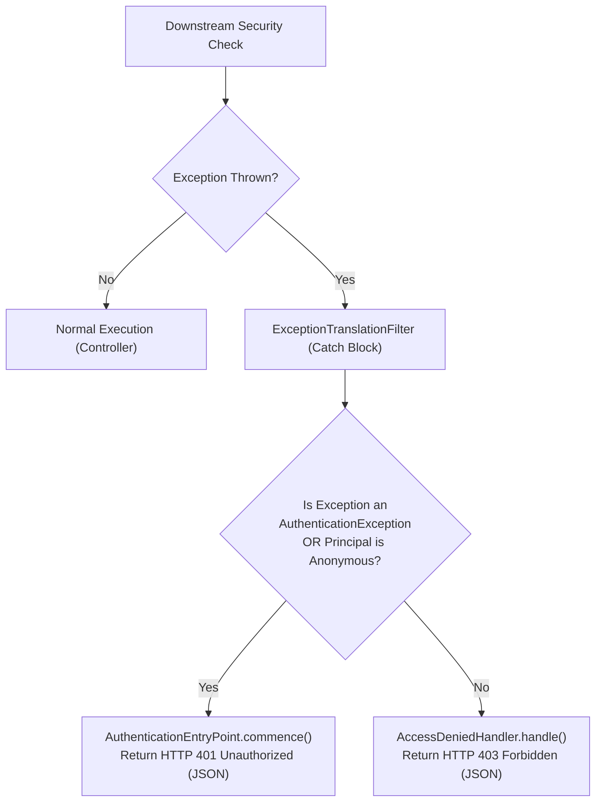

# Module 16: Exception Handling & Security Events

---

## 1. Definition

Security exception handling in Spring Security governs how the application responds when an unauthenticated caller attempts to access a protected resource (**Authentication Exception**) or an authenticated caller lacks sufficient permissions (**Access Denied Exception**).

The framework routes these occurrences through two primary SPIs:
1. **`AuthenticationEntryPoint`**: Generates the response when an unauthenticated user attempts access (HTTP **401 Unauthorized**).
2. **`AccessDeniedHandler`**: Generates the response when an authenticated user lacks required privileges (HTTP **403 Forbidden**).

---

## 2. Why It Exists

By default:
* Spring Security's browser configuration redirects unauthenticated requests to an HTML `/login` page and renders a generic white-label HTML 403 error page.
* In modern RESTful APIs and Single Page Applications, returning HTML error pages is a serious bug: the client application expects structured **JSON error responses** with precise status codes, timestamps, and error messages.

Custom exception handling guarantees that your API emits clean, standardized JSON responses according to RFC 7807 (Problem Details).

---

## 3. Internal Working

### The `ExceptionTranslationFilter`
Exception handling is coordinated by the **`ExceptionTranslationFilter`**, positioned immediately before the `AuthorizationFilter` in the security chain:

```
Incoming Request
      │
      ▼
[ ExceptionTranslationFilter ]  <──────────────────────────────────────────┐
      │                                                                   │
      ▼                                                                   │
[ AuthorizationFilter ] ──> Throws AuthenticationException / AccessDeniedException
```

### The Catch Logic
When an exception bubbles up from `AuthorizationFilter` or other downstream components:
1. If the exception is an **`AuthenticationException`** (or if the user is anonymous):
   * `ExceptionTranslationFilter` launches the **`AuthenticationEntryPoint`**.
   * It starts the authentication flow (e.g., sending HTTP 401 with `WWW-Authenticate` or returning custom JSON).
2. If the exception is an **`AccessDeniedException`**:
   * If the user is fully authenticated, it invokes the **`AccessDeniedHandler`** (HTTP 403).
   * If the user was anonymous, it treats it as an authentication failure and invokes `AuthenticationEntryPoint` instead!

---

## 4. Architecture and Flow Diagram

### Exception Translation Flowchart



---

## 5. Important Classes and Interfaces

| Class / Interface | Responsibility |
|---|---|
| `ExceptionTranslationFilter` | Catches `AuthenticationException` and `AccessDeniedException` in the filter chain. |
| `AuthenticationEntryPoint` | Handles unauthenticated user challenges (HTTP 401). |
| `AccessDeniedHandler` | Handles unauthorized access attempts by authenticated users (HTTP 403). |
| `AuthenticationException` | Abstract root of all authentication errors (`BadCredentialsException`, `LockedException`). |
| `AccessDeniedException` | Thrown when an authenticated principal lacks required authority. |

---

## 6. Practical Code Examples

### 1. Custom JSON `AuthenticationEntryPoint` (401 Handler)
```java
package com.example.security.exception;

import com.fasterxml.jackson.databind.ObjectMapper;
import jakarta.servlet.http.HttpServletRequest;
import jakarta.servlet.http.HttpServletResponse;
import org.springframework.http.MediaType;
import org.springframework.security.core.AuthenticationException;
import org.springframework.security.web.AuthenticationEntryPoint;
import org.springframework.stereotype.Component;

import java.io.IOException;
import java.time.Instant;
import java.util.HashMap;
import java.util.Map;

@Component
public class CustomAuthenticationEntryPoint implements AuthenticationEntryPoint {

    private final ObjectMapper objectMapper = new ObjectMapper();

    @Override
    public void commence(HttpServletRequest request,
                         HttpServletResponse response,
                         AuthenticationException authException) throws IOException {
        
        response.setContentType(MediaType.APPLICATION_JSON_VALUE);
        response.setStatus(HttpServletResponse.SC_UNAUTHORIZED);

        Map<String, Object> body = new HashMap<>();
        body.put("timestamp", Instant.now().toString());
        body.put("status", HttpServletResponse.SC_UNAUTHORIZED);
        body.put("error", "Unauthorized");
        body.put("message", "Full authentication is required to access this resource: " + authException.getMessage());
        body.put("path", request.getRequestURI());

        objectMapper.writeValue(response.getOutputStream(), body);
    }
}
```

### 2. Custom JSON `AccessDeniedHandler` (403 Handler)
```java
package com.example.security.exception;

import com.fasterxml.jackson.databind.ObjectMapper;
import jakarta.servlet.http.HttpServletRequest;
import jakarta.servlet.http.HttpServletResponse;
import org.springframework.http.MediaType;
import org.springframework.security.access.AccessDeniedException;
import org.springframework.security.web.access.AccessDeniedHandler;
import org.springframework.stereotype.Component;

import java.io.IOException;
import java.time.Instant;
import java.util.HashMap;
import java.util.Map;

@Component
public class CustomAccessDeniedHandler implements AccessDeniedHandler {

    private final ObjectMapper objectMapper = new ObjectMapper();

    @Override
    public void handle(HttpServletRequest request,
                       HttpServletResponse response,
                       AccessDeniedException accessDeniedException) throws IOException {
        
        response.setContentType(MediaType.APPLICATION_JSON_VALUE);
        response.setStatus(HttpServletResponse.SC_FORBIDDEN);

        Map<String, Object> body = new HashMap<>();
        body.put("timestamp", Instant.now().toString());
        body.put("status", HttpServletResponse.SC_FORBIDDEN);
        body.put("error", "Forbidden");
        body.put("message", "You do not have the required permissions to access this endpoint.");
        body.put("path", request.getRequestURI());

        objectMapper.writeValue(response.getOutputStream(), body);
    }
}
```

### 3. Registering Handlers in `SecurityFilterChain`
```java
package com.example.security.config;

import com.example.security.exception.CustomAccessDeniedHandler;
import com.example.security.exception.CustomAuthenticationEntryPoint;
import org.springframework.context.annotation.Bean;
import org.springframework.context.annotation.Configuration;
import org.springframework.security.config.annotation.web.builders.HttpSecurity;
import org.springframework.security.config.annotation.web.configuration.EnableWebSecurity;
import org.springframework.security.web.SecurityFilterChain;

@Configuration
@EnableWebSecurity
public class ExceptionHandlingConfig {

    private final CustomAuthenticationEntryPoint authenticationEntryPoint;
    private final CustomAccessDeniedHandler accessDeniedHandler;

    public ExceptionHandlingConfig(CustomAuthenticationEntryPoint authenticationEntryPoint,
                                   CustomAccessDeniedHandler accessDeniedHandler) {
        this.authenticationEntryPoint = authenticationEntryPoint;
        this.accessDeniedHandler = accessDeniedHandler;
    }

    @Bean
    public SecurityFilterChain securityFilterChain(HttpSecurity http) throws Exception {
        http
            .csrf(csrf -> csrf.disable())
            .authorizeHttpRequests(auth -> auth
                .requestMatchers("/api/public/**").permitAll()
                .requestMatchers("/api/admin/**").hasRole("ADMIN")
                .anyRequest().authenticated()
            )
            // Register custom exception handling handlers
            .exceptionHandling(exceptions -> exceptions
                .authenticationEntryPoint(this.authenticationEntryPoint)
                .accessDeniedHandler(this.accessDeniedHandler)
            );

        return http.build();
    }
}
```

---

## 7. Line-by-Line Explanation

1. `implements AuthenticationEntryPoint`:
   * Provides the `commence()` method invoked whenever an unauthenticated request attempts to access an endpoint protected by `authenticated()` or `hasRole()`.
2. `implements AccessDeniedHandler`:
   * Provides the `handle()` method invoked when a user has a valid authenticated session/token, but lacks the specific role (e.g., standard `USER` calling `/api/admin/dashboard`).
3. `objectMapper.writeValue(response.getOutputStream(), body)`:
   * Writes the structured JSON payload directly to the raw servlet output stream without needing Spring MVC controllers.

---

## 8. Real-World Use Cases

* **Mobile App Backend Contracts:** Mobile applications crash or misbehave if an API returns HTML instead of JSON. Custom entry points guarantee predictable error envelopes across all network failures.
* **Audit Trailing:** Logging security rejections inside the `AccessDeniedHandler` to identify potential brute force or privilege escalation attempts.

---

## 9. Common Mistakes

1. **Trying to catch Filter Exceptions with `@ControllerAdvice`:** Security filter exceptions happen **before** `DispatcherServlet` is reached. A standard Spring `@ExceptionHandler` or `@ControllerAdvice` **cannot catch** exceptions thrown inside `SecurityFilterChain`. You must use `AuthenticationEntryPoint` and `AccessDeniedHandler`.
2. **Confusing 401 and 403:**
   * 401 means *"I don't know who you are (Authenticate yourself)"*.
   * 403 means *"I know who you are, but you are not allowed in"*.

---

## 10. Interview Questions & Detailed Answers

### Q1: Why doesn't `@RestControllerAdvice` catch `AccessDeniedException` thrown by the `AuthorizationFilter`?
**Answer:**
`@RestControllerAdvice` operates inside Spring MVC (`DispatcherServlet`). Security filters execute at the Servlet container boundary **before** the request reaches `DispatcherServlet`. If `AuthorizationFilter` rejects a request, execution never reaches `DispatcherServlet`, so `@ControllerAdvice` is never invoked. 
*(Note: If method security `@PreAuthorize` throws an `AccessDeniedException` inside a controller, `@RestControllerAdvice` can catch it unless intercepted by the AOP security advisor).*

### Q2: What happens if an unauthenticated user triggers an `AccessDeniedException`?
**Answer:**
`ExceptionTranslationFilter` checks whether the current user is an anonymous user via `AuthenticationTrustResolver.isAnonymous(authentication)`. Even though an `AccessDeniedException` was thrown, because the user has not yet authenticated, Spring Security routes the request to the **`AuthenticationEntryPoint` (401)** rather than the `AccessDeniedHandler` (403), challenging the user to log in first.

---

## 11. Quick Revision Notes

* **401 Unauthorized:** Handled by `AuthenticationEntryPoint` (Missing / invalid credentials).
* **403 Forbidden:** Handled by `AccessDeniedHandler` (Authenticated user, insufficient role).
* **Filter Layer Catch:** Managed by `ExceptionTranslationFilter`.
* **Not in `@ControllerAdvice`:** Filter-level security exceptions must be handled via Spring Security config.
