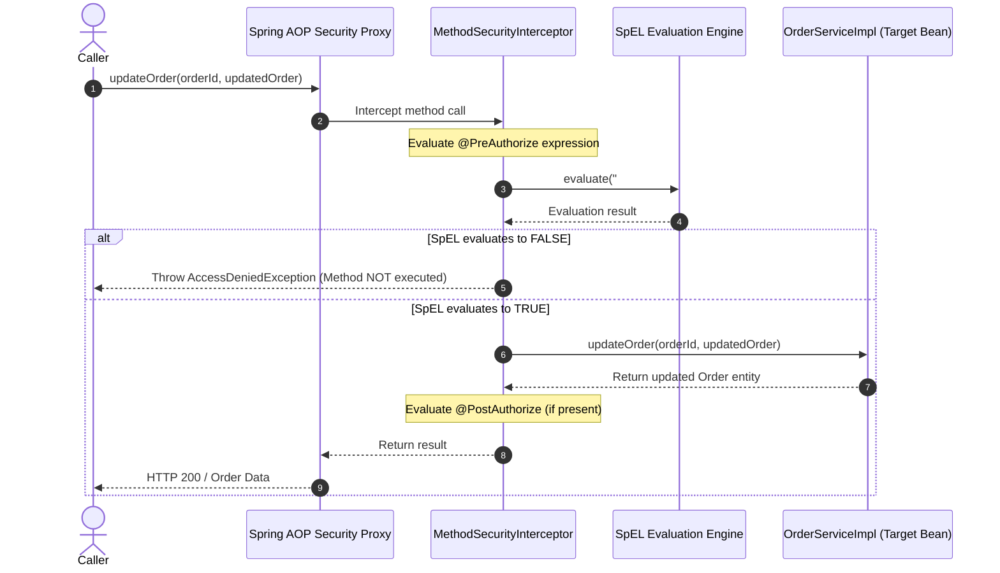

# Module 17: Method-Level Security

---

## 1. Definition

**Method-Level Security** provides fine-grained, declarative access control on individual Spring bean methods (in `@Service`, `@Repository`, or `@Controller` components) using Java annotations and the **Spring Expression Language (SpEL)**.

In Spring Security 6+, method security is enabled via **`@EnableMethodSecurity`** (which supersedes the legacy `@EnableGlobalMethodSecurity`).

---

## 2. Why It Exists

URL-based authorization (configured in `SecurityFilterChain`) provides coarse-grained perimeter security. However:
1. **Defense in Depth:** If a developer accidentally exposes an endpoint or makes a mistake in URL matching rules, method security ensures that the underlying business logic remains locked.
2. **Contextual / Object-Level Permissions:** URL rules cannot easily enforce rules like: *"A user can only update an Order if they are the owner of that specific Order."* Method security evaluates method arguments, return values, and entity IDs dynamically at runtime.
3. **Non-Web Triggers:** Business services can be called from message queues (Kafka, RabbitMQ), CLI runners, or scheduled tasks where no HTTP URL exists. Method security secures methods regardless of how they are invoked.

---

## 3. Internal Working

Method-level security is powered by **Spring AOP (Aspect-Oriented Programming)**:
1. When `@EnableMethodSecurity` is declared, Spring registers an AOP Method Interceptor (`AuthorizationManagerBeforeMethodInterceptor`).
2. Any Spring Bean method annotated with `@PreAuthorize`, `@PostAuthorize`, `@Secured`, or `@RolesAllowed` is wrapped by a dynamic proxy.
3. **`@PreAuthorize`:** Executes **before** the method executes. It parses the SpEL expression. If evaluation returns `false`, an `AccessDeniedException` is thrown immediately, and the target method never runs.
4. **`@PostAuthorize`:** Allows the method to execute first, then inspects the method's return value (via the built-in SpEL variable `returnObject`). If evaluation returns `false`, it throws `AccessDeniedException`, preventing the caller from receiving the data.
5. **`@PreFilter` / `@PostFilter`:** Filters collections before or after method execution based on SpEL criteria.

---

## 4. Architecture and Flow Diagram

### Method Security AOP Proxy Interception



---

## 5. Important Classes and Annotations

| Annotation / Class | Responsibility |
|---|---|
| `@EnableMethodSecurity` | Enables method security annotations in Spring Boot 3+. |
| `@PreAuthorize("SpEL")` | Evaluates permission before method invocation. Most popular and flexible. |
| `@PostAuthorize("SpEL")` | Evaluates permission after method execution; can inspect `returnObject`. |
| `@PreFilter` | Filters incoming Collection/Array parameters before method execution. |
| `@PostFilter` | Filters returned Collection/Array outputs based on SpEL evaluation. |
| `@Secured("ROLE_X")` | Legacy simple role check (does not support SpEL). |
| `@RolesAllowed("ROLE_X")` | JSR-250 Java standard annotation. |

---

## 6. Practical Code Examples

### 1. Activating Method Security
```java
package com.example.security.config;

import org.springframework.context.annotation.Configuration;
import org.springframework.security.config.annotation.method.configuration.EnableMethodSecurity;

@Configuration
@EnableMethodSecurity(
        prePostEnabled = true, // Enables @PreAuthorize, @PostAuthorize, @PreFilter, @PostFilter (Default: true)
        securedEnabled = true, // Enables legacy @Secured
        jsr250Enabled = true   // Enables standard @RolesAllowed
)
public class MethodSecurityConfig {
}
```

### 2. Business Service Demonstrating Pre/Post Authorization
```java
package com.example.security.service;

import com.example.security.domain.Order;
import org.springframework.security.access.prepost.PostAuthorize;
import org.springframework.security.access.prepost.PreAuthorize;
import org.springframework.stereotype.Service;

import java.util.List;

@Service
public class OrderService {

    // 1. Role-based check before execution
    @PreAuthorize("hasRole('ADMIN')")
    public void purgeAllOrders() {
        // Only users with ROLE_ADMIN can execute this method
    }

    // 2. Complex business authorization checking method arguments
    // Allowed if user has 'ROLE_MANAGER' OR if they own the order being modified
    @PreAuthorize("hasRole('MANAGER') or #order.ownerUsername == authentication.name")
    public void updateOrder(Order order) {
        // Business update logic
    }

    // 3. Post-execution verification inspecting returned object
    // Fetches the order from database first, but only returns it if the caller is the owner
    @PostAuthorize("returnObject.ownerUsername == authentication.name or hasRole('ADMIN')")
    public Order getOrderById(Long orderId) {
        // Simulated DB lookup
        return new Order(orderId, "john_doe", 150.00);
    }

    // 4. Custom security evaluation calling a custom Spring Bean
    @PreAuthorize("@orderSecurityEvaluator.canAccessOrder(#orderId)")
    public void cancelOrder(Long orderId) {
        // Business cancellation logic
    }
}
```

### 3. Custom SpEL Security Evaluator Bean
For complex business authorization rules, avoid giant SpEL strings by delegating to a dedicated Spring bean:

```java
package com.example.security.evaluator;

import org.springframework.security.core.Authentication;
import org.springframework.security.core.context.SecurityContextHolder;
import org.springframework.stereotype.Component;

@Component("orderSecurityEvaluator")
public class OrderSecurityEvaluator {

    public boolean canAccessOrder(Long orderId) {
        Authentication auth = SecurityContextHolder.getContext().getAuthentication();
        if (auth == null || !auth.isAuthenticated()) {
            return false;
        }

        // Custom domain logic (e.g. check tenant boundaries, database ownership)
        String currentUsername = auth.getName();
        return "admin".equals(currentUsername) || (orderId != null && orderId % 2 == 0);
    }
}
```

---

## 7. Line-by-Line Explanation

1. `@EnableMethodSecurity`:
   * Activates Spring AOP post-processors for method security.
2. `@PreAuthorize("hasRole('MANAGER') or #order.ownerUsername == authentication.name")`:
   * `#order`: Refers to the method parameter named `order`.
   * `authentication`: Injected SpEL variable referencing `SecurityContextHolder.getContext().getAuthentication()`.
   * Evaluated **prior** to entering the method.
3. `@PostAuthorize("returnObject.ownerUsername == authentication.name")`:
   * `returnObject`: Built-in SpEL variable referencing the value returned by `getOrderById()`. If the caller is not `"john_doe"`, Spring Security throws `AccessDeniedException` and discards the return value.
4. `@PreAuthorize("@orderSecurityEvaluator.canAccessOrder(#orderId)")`:
   * SpEL syntax `@beanName.methodName()` allows invoking any Spring bean method for authorization decisions.

---

## 8. Real-World Use Cases

* **Multi-Tenant Ownership Verification:** Enforcing that users cannot query or mutate records belonging to a different tenant ID, even if they guess the database primary key in the URL.
* **Sensitive Salary Masking:** A service method fetches employee records, but `@PostAuthorize` ensures only HR personnel can inspect the salary attribute.

---

## 9. Common Mistakes

1. **Calling Annotated Methods from the Same Class (Self-Invocation):**
   ```java
   @Service
   public class MyService {
       public void methodA() {
           methodB(); // Direct Java this.methodB() bypasses Spring AOP proxy! Security check NEVER runs!
       }

       @PreAuthorize("hasRole('ADMIN')")
       public void methodB() { ... }
   }
   ```
2. **Side Effects in `@PostAuthorize`:** Using `@PostAuthorize` on methods that perform mutations (e.g., database writes). The method **will execute** and alter the database; only the return value will be blocked from reaching the caller! Use `@PreAuthorize` for state modifications.

---

## 10. Interview Questions & Detailed Answers

### Q1: What is the difference between `@PreAuthorize` and `@PostAuthorize`?
**Answer:**
* `@PreAuthorize` runs **before** method invocation. It inspects parameters and authorities. If evaluation fails, the method is never invoked. Ideal for mutations and general access control.
* `@PostAuthorize` runs **after** the method executes. It can inspect the `returnObject`. If evaluation fails, it throws `AccessDeniedException`, preventing the caller from receiving the returned data. It should only be used on read-only queries to prevent mutations from persisting when access is denied.

### Q2: Why does method security fail when a method calls another secured method in the same class?
**Answer:**
Spring Method Security relies on **Spring AOP proxies**. When an external bean calls `service.securedMethod()`, the invocation passes through the proxy, executing the security interceptor. However, when a method within `ServiceA` calls another method on `ServiceA` (`this.securedMethod()`), the call is a direct internal JVM call that bypasses the proxy entirely, causing the security annotations to be ignored.

---

## 11. Quick Revision Notes

* **Activation:** `@EnableMethodSecurity` in Spring Boot 3+.
* **Most Used:** `@PreAuthorize("SpEL")`.
* **Parameter Access:** `#paramName` in SpEL.
* **Return Object Access:** `returnObject` in `@PostAuthorize`.
* **Delegate to Beans:** `@beanName.methodName(#param)`.
* **Self-Invocation Trap:** Calling a secured method from within the same class bypasses AOP proxies.
