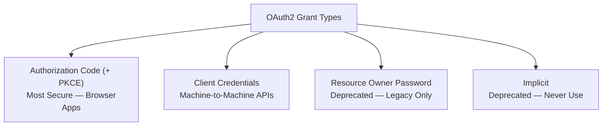
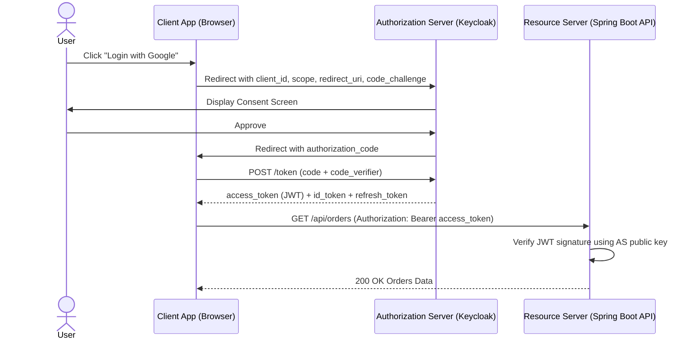
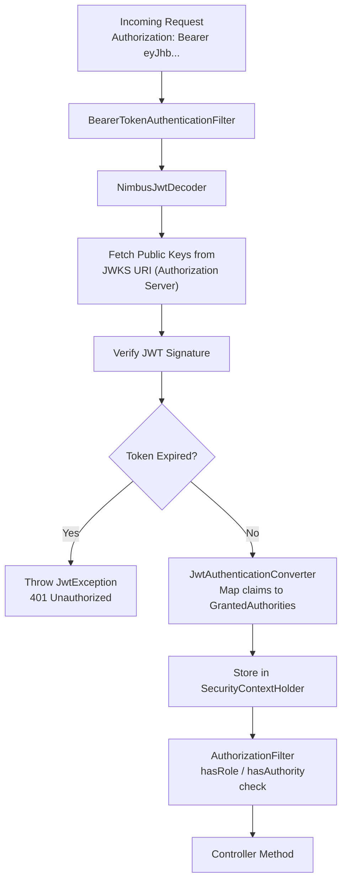

# Module 18: OAuth2 & Resource Server

---

## 1. Definition

**OAuth2** is an authorization framework (RFC 6749) that allows a third-party application to obtain limited access to an HTTP service on behalf of a resource owner. It is the backbone behind "Login with Google", "Login with GitHub", and enterprise SSO systems.

**OpenID Connect (OIDC)** is a thin identity layer built on top of OAuth2 that adds user identity information (via an `id_token`) to the standard access token flow.

---

## 2. Key OAuth2 Roles

| Role | Description | Example |
|---|---|---|
| **Resource Owner** | The user who owns the protected data | End-User |
| **Client** | The application requesting access | Your Spring Boot App |
| **Authorization Server** | Issues tokens after user consent | Keycloak, Auth0, Okta, Google |
| **Resource Server** | Hosts the protected APIs | Your Spring Boot REST API |

---

## 3. Grant Types



**Use these today:**
- **Authorization Code + PKCE** — for SPAs, mobile, and web apps
- **Client Credentials** — for microservice-to-microservice calls

---

## 4. Authorization Code + PKCE Flow



---

## 5. Spring Boot as OAuth2 Resource Server

A **Resource Server** validates incoming JWT access tokens using the Authorization Server's public key (fetched from its JWKS URI) and enforces authorization rules.

### Maven Dependency

```xml
<dependency>
    <groupId>org.springframework.boot</groupId>
    <artifactId>spring-boot-starter-oauth2-resource-server</artifactId>
</dependency>
```

### `application.properties` Configuration

```properties
# URI from your Authorization Server exposing its public signing keys
spring.security.oauth2.resourceserver.jwt.jwk-set-uri=https://your-keycloak:8080/realms/myrealm/protocol/openid-connect/certs

# OR for self-signed / static public key (testing):
# spring.security.oauth2.resourceserver.jwt.public-key-location=classpath:public.pem
```

### Security Configuration

```java
package com.example.security.config;

import org.springframework.context.annotation.Bean;
import org.springframework.context.annotation.Configuration;
import org.springframework.security.config.annotation.web.builders.HttpSecurity;
import org.springframework.security.config.annotation.web.configuration.EnableWebSecurity;
import org.springframework.security.config.http.SessionCreationPolicy;
import org.springframework.security.oauth2.server.resource.authentication.JwtAuthenticationConverter;
import org.springframework.security.oauth2.server.resource.authentication.JwtGrantedAuthoritiesConverter;
import org.springframework.security.web.SecurityFilterChain;

@Configuration
@EnableWebSecurity
public class ResourceServerConfig {

    @Bean
    public SecurityFilterChain resourceServerFilterChain(HttpSecurity http) throws Exception {
        http
            .csrf(csrf -> csrf.disable())
            .sessionManagement(s -> s.sessionCreationPolicy(SessionCreationPolicy.STATELESS))
            .authorizeHttpRequests(auth -> auth
                .requestMatchers("/api/public/**").permitAll()
                .requestMatchers("/api/admin/**").hasRole("ADMIN")
                .anyRequest().authenticated()
            )
            // Enable JWT-based Resource Server support
            .oauth2ResourceServer(oauth2 -> oauth2
                .jwt(jwt -> jwt.jwtAuthenticationConverter(jwtAuthenticationConverter()))
            );

        return http.build();
    }

    /**
     * Extracts roles from a custom JWT claim (e.g., Keycloak uses "realm_access.roles")
     * and maps them to Spring Security GrantedAuthority with ROLE_ prefix.
     */
    @Bean
    public JwtAuthenticationConverter jwtAuthenticationConverter() {
        JwtGrantedAuthoritiesConverter grantedAuthoritiesConverter = new JwtGrantedAuthoritiesConverter();
        // The claim name in your JWT containing the list of roles
        grantedAuthoritiesConverter.setAuthoritiesClaimName("roles");
        grantedAuthoritiesConverter.setAuthorityPrefix("ROLE_");

        JwtAuthenticationConverter jwtAuthenticationConverter = new JwtAuthenticationConverter();
        jwtAuthenticationConverter.setJwtGrantedAuthoritiesConverter(grantedAuthoritiesConverter);
        return jwtAuthenticationConverter;
    }
}
```

---

## 6. How JWT Validation Works in Resource Server



---

## 7. Extracting Claims from JWT in Controllers

```java
package com.example.security.controller;

import org.springframework.security.core.annotation.AuthenticationPrincipal;
import org.springframework.security.oauth2.jwt.Jwt;
import org.springframework.web.bind.annotation.GetMapping;
import org.springframework.web.bind.annotation.RequestMapping;
import org.springframework.web.bind.annotation.RestController;

import java.util.Map;

@RestController
@RequestMapping("/api/v1/profile")
public class ProfileController {

    @GetMapping
    public Map<String, Object> getProfile(@AuthenticationPrincipal Jwt jwt) {
        return Map.of(
            "subject",   jwt.getSubject(),
            "email",     jwt.getClaimAsString("email"),
            "username",  jwt.getClaimAsString("preferred_username"),
            "roles",     jwt.getClaimAsStringList("roles"),
            "issued_at", jwt.getIssuedAt().toString(),
            "expires_at",jwt.getExpiresAt().toString()
        );
    }
}
```

---

## 8. Real-World Use Cases

- **Enterprise SSO via Keycloak:** Internal systems authenticate via Keycloak (OIDC). Every Spring microservice acts as a resource server validating Keycloak-issued JWTs.
- **B2B Client Credentials:** Partner services authenticate using `client_id + client_secret` via Client Credentials Grant to fetch machine-readable data APIs.

---

## 9. Common Mistakes

1. **Wrong Claims Claim Name:** Keycloak places roles under `realm_access.roles`, not `roles`. Always inspect your JWT structure with [jwt.io](https://jwt.io) before configuring `setAuthoritiesClaimName()`.
2. **Network Connectivity to JWKS URI:** If the resource server cannot reach the authorization server's JWKS endpoint at startup, initialization fails. Ensure firewall rules and DNS are correct.

---

## 10. Interview Questions

**Q: What is the difference between OAuth2 and OpenID Connect (OIDC)?**
OAuth2 is an authorization framework — it grants access tokens scoped to specific resources. It says *"you may read calendar data"* but tells nothing about who the user is. OIDC adds an `id_token` (a JWT containing user identity claims like `email`, `name`, `sub`) on top of OAuth2, allowing the client to establish the user's identity.

**Q: Why is Authorization Code + PKCE preferred over Implicit Grant?**
The Implicit Grant returned the access token in the redirect URL fragment, exposing it in browser history, referrer headers, and proxy logs. PKCE (Proof Key for Code Exchange) replaces this with a server-side token exchange using a cryptographic code challenge-verifier pair that cannot be intercepted or replayed.

---

## 11. Quick Revision Notes

- **Resource Server:** Validates JWT signatures; does not issue tokens.
- **JWKS URI:** Public endpoint of Authorization Server providing signing public keys.
- **`JwtAuthenticationConverter`:** Maps JWT claims to Spring `GrantedAuthority`.
- **`@AuthenticationPrincipal Jwt`:** Inject the parsed JWT object directly into controller methods.
- **Stateless:** Always set `SessionCreationPolicy.STATELESS` for OAuth2 resource servers.
