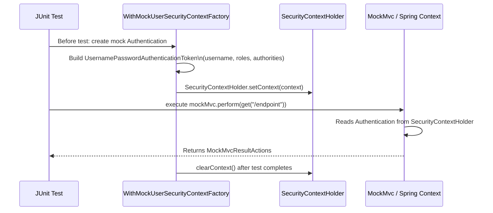

# Module 19: Security Testing

---

## 1. Definition

Spring Security provides first-class testing support via the **`spring-security-test`** library, allowing you to write unit and integration tests that simulate authenticated users, roles, and authentication flows without spinning up a real web server.

---

## 2. Why It Exists

Security is only valuable if it is verifiable. Without dedicated test support:
- You cannot assert that an endpoint correctly returns HTTP 403 for the wrong role.
- You cannot test method-level `@PreAuthorize` expressions without real user sessions.
- Writing authentication setup code for every test case leads to duplicated, fragile test infrastructure.

---

## 3. Key Test Annotations

| Annotation | Usage |
|---|---|
| `@WithMockUser` | Creates a mock `Authentication` token with given username, roles, and authorities. |
| `@WithUserDetails("username")` | Loads a real `UserDetails` from the application's `UserDetailsService`. |
| `@WithAnonymousUser` | Forces the security context to contain an anonymous authentication (unauthenticated). |
| `SecurityMockMvcRequestPostProcessors.csrf()` | Provides a valid CSRF token in MockMvc requests. |
| `SecurityMockMvcRequestPostProcessors.httpBasic(u, p)` | Sends HTTP Basic credentials in MockMvc requests. |

---

## 4. Maven Test Dependencies

```xml
<dependency>
    <groupId>org.springframework.boot</groupId>
    <artifactId>spring-boot-starter-test</artifactId>
    <scope>test</scope>
</dependency>
<dependency>
    <groupId>org.springframework.security</groupId>
    <artifactId>spring-security-test</artifactId>
    <scope>test</scope>
</dependency>
```

---

## 5. MockMvc Integration Tests

```java
package com.example.security;

import org.junit.jupiter.api.DisplayName;
import org.junit.jupiter.api.Test;
import org.springframework.beans.factory.annotation.Autowired;
import org.springframework.boot.test.autoconfigure.web.servlet.AutoConfigureMockMvc;
import org.springframework.boot.test.context.SpringBootTest;
import org.springframework.security.test.context.support.WithMockUser;
import org.springframework.test.web.servlet.MockMvc;

import static org.springframework.security.test.web.servlet.request.SecurityMockMvcRequestPostProcessors.csrf;
import static org.springframework.security.test.web.servlet.request.SecurityMockMvcRequestPostProcessors.httpBasic;
import static org.springframework.test.web.servlet.request.MockMvcRequestBuilders.*;
import static org.springframework.test.web.servlet.result.MockMvcResultMatchers.*;

@SpringBootTest
@AutoConfigureMockMvc
class SecurityIntegrationTest {

    @Autowired
    private MockMvc mockMvc;

    @Test
    @DisplayName("Public endpoint should return 200 without authentication")
    void publicEndpointShouldBeAccessibleWithoutAuth() throws Exception {
        mockMvc.perform(get("/api/v1/public/ping"))
               .andExpect(status().isOk());
    }

    @Test
    @DisplayName("Protected endpoint should return 401 when unauthenticated")
    void protectedEndpointShouldReturn401WithoutAuth() throws Exception {
        mockMvc.perform(get("/api/v1/user/me"))
               .andExpect(status().isUnauthorized());
    }

    @Test
    @DisplayName("Protected endpoint should return 200 when authenticated as USER")
    @WithMockUser(username = "john_doe", roles = {"USER"})
    void protectedEndpointShouldReturn200WithValidUser() throws Exception {
        mockMvc.perform(get("/api/v1/user/me"))
               .andExpect(status().isOk());
    }

    @Test
    @DisplayName("Admin endpoint should return 403 when user has ROLE_USER only")
    @WithMockUser(username = "regular_user", roles = {"USER"})
    void adminEndpointShouldReturn403ForNonAdmin() throws Exception {
        mockMvc.perform(get("/api/admin/dashboard"))
               .andExpect(status().isForbidden());
    }

    @Test
    @DisplayName("Admin endpoint should return 200 for ADMIN role")
    @WithMockUser(username = "admin_user", roles = {"ADMIN"})
    void adminEndpointShouldReturn200ForAdmin() throws Exception {
        mockMvc.perform(get("/api/admin/dashboard"))
               .andExpect(status().isOk());
    }

    @Test
    @DisplayName("HTTP Basic authentication should succeed with correct credentials")
    void httpBasicLoginShouldSucceedWithValidCredentials() throws Exception {
        mockMvc.perform(get("/api/v1/user/me")
                       .with(httpBasic("user", "password123")))
               .andExpect(status().isOk());
    }

    @Test
    @DisplayName("POST with CSRF token should succeed for authenticated user")
    @WithMockUser(roles = {"USER"})
    void postRequestWithCsrfShouldSucceed() throws Exception {
        mockMvc.perform(post("/api/v1/orders")
                       .with(csrf())
                       .contentType("application/json")
                       .content("{\"productId\": 1, \"quantity\": 2}"))
               .andExpect(status().isCreated());
    }

    @Test
    @DisplayName("POST without CSRF token should return 403 Forbidden")
    @WithMockUser(roles = {"USER"})
    void postRequestWithoutCsrfShouldReturn403() throws Exception {
        mockMvc.perform(post("/api/v1/orders")
                       .contentType("application/json")
                       .content("{\"productId\": 1}"))
               .andExpect(status().isForbidden());
    }
}
```

---

## 6. Testing Method-Level Security

```java
package com.example.security;

import com.example.security.service.OrderService;
import org.junit.jupiter.api.Test;
import org.springframework.beans.factory.annotation.Autowired;
import org.springframework.boot.test.context.SpringBootTest;
import org.springframework.security.access.AccessDeniedException;
import org.springframework.security.test.context.support.WithMockUser;

import static org.assertj.core.api.Assertions.assertThatThrownBy;

@SpringBootTest
class MethodSecurityTest {

    @Autowired
    private OrderService orderService;

    @Test
    @WithMockUser(roles = {"USER"})
    void regularUserShouldNotCallAdminOnlyMethod() {
        // Expect AccessDeniedException since ROLE_USER lacks ROLE_ADMIN
        assertThatThrownBy(() -> orderService.purgeAllOrders())
            .isInstanceOf(AccessDeniedException.class);
    }

    @Test
    @WithMockUser(username = "admin", roles = {"ADMIN"})
    void adminShouldSuccessfullyCallAdminOnlyMethod() {
        // Should not throw any exception
        orderService.purgeAllOrders();
    }
}
```

---

## 7. Architecture: How `@WithMockUser` Works



---

## 8. Common Mistakes

1. **Forgetting `@AutoConfigureMockMvc`:** Spring Boot does not auto-configure MockMvc without this annotation. Tests will fail with a `NullPointerException` on `@Autowired MockMvc`.
2. **Testing CSRF on Stateless APIs:** If CSRF is disabled in your security config, adding `.with(csrf())` has no effect. Test the correct chain for the correct request path.
3. **`@WithMockUser` does not load from Database:** `@WithMockUser` creates a fake in-memory `Authentication`. If your business logic calls `SecurityContextHolder.getContext().getAuthentication().getPrincipal()` and expects a real `UserDetails` from the database (e.g., to get entity IDs), use `@WithUserDetails("username")` instead.

---

## 9. Interview Questions

**Q: What is the difference between `@WithMockUser` and `@WithUserDetails`?**
`@WithMockUser` creates a synthetic `Authentication` token from scratch using the specified `username` and `roles` parameters. The `UserDetailsService` is never invoked. `@WithUserDetails("username")` calls the actual `UserDetailsService.loadUserByUsername("username")` to retrieve a real `UserDetails` from the application's configured user store (database, LDAP, etc.), making it more suitable for integration tests that depend on real authority/permission structures.

---

## 10. Quick Revision Notes

- **`@WithMockUser`** — fast, synthetic, no DB hit; use in unit-style tests.
- **`@WithUserDetails`** — calls real `UserDetailsService`; use in full integration tests.
- **`csrf()`** — supply valid CSRF token to MockMvc POST/PUT/DELETE requests.
- **`httpBasic(u, p)`** — post HTTP Basic credentials directly in MockMvc request.
- **Method Security Tests** — inject service bean directly; `@WithMockUser` populates `SecurityContextHolder` for method-level annotation evaluation.
