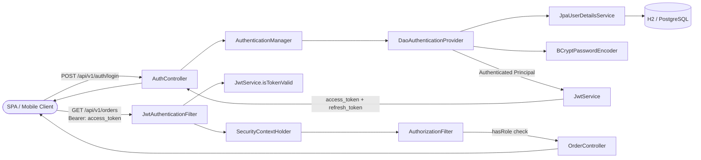

# Module 22: End-to-End Implementation Blueprint

---

## Overview

This module connects every concept from the documentation series into a single coherent Spring Boot application blueprint. The application demonstrates:
- JPA-backed user/role management
- BCrypt password encoding
- Custom `UserDetailsService`
- JWT access + refresh token authentication
- Role-based authorization (URL + method level)
- Custom 401/403 JSON error responses
- CORS configuration for SPA clients

---

## Project Structure

```
src/main/java/com/example/security/
├── SecurityBasicsApplication.java
├── config/
│   ├── ApplicationConfig.java          (Beans: UserDetailsService, PasswordEncoder, AuthenticationManager)
│   ├── SecurityFilterChainConfig.java  (SecurityFilterChain, CORS, CSRF, Session)
│   └── JwtConfig.java                  (JWT secret, expiry constants)
├── domain/
│   ├── AppUser.java                    (JPA Entity + implements UserDetails)
│   └── AppRole.java                    (Enum with permission sets)
├── repository/
│   └── UserRepository.java             (Spring Data JPA)
├── jwt/
│   ├── JwtService.java                 (Token generation + validation)
│   └── JwtAuthenticationFilter.java    (OncePerRequestFilter reads Bearer token)
├── controller/
│   ├── AuthController.java             (POST /api/v1/auth/login, /refresh)
│   ├── UserController.java             (GET /api/v1/user/me)
│   └── AdminController.java            (GET /api/v1/admin/*)
├── service/
│   ├── AuthService.java                (Calls AuthenticationManager, issues JWT)
│   └── UserService.java                (User management business logic)
├── exception/
│   ├── CustomAuthenticationEntryPoint.java
│   └── CustomAccessDeniedHandler.java
└── dto/
    ├── LoginRequest.java
    └── AuthResponse.java
```

---

## 1. `pom.xml` — Full Dependency Set

```xml
<?xml version="1.0" encoding="UTF-8"?>
<project xmlns="http://maven.apache.org/POM/4.0.0"
         xmlns:xsi="http://www.w3.org/2001/XMLSchema-instance"
         xsi:schemaLocation="http://maven.apache.org/POM/4.0.0 https://maven.apache.org/xsd/maven-4.0.0.xsd">
    <modelVersion>4.0.0</modelVersion>
    <parent>
        <groupId>org.springframework.boot</groupId>
        <artifactId>spring-boot-starter-parent</artifactId>
        <version>3.3.5</version>
    </parent>
    <groupId>com.example</groupId>
    <artifactId>spring-security-masterclass</artifactId>
    <version>0.0.1-SNAPSHOT</version>
    <properties>
        <java.version>17</java.version>
    </properties>
    <dependencies>
        <dependency>
            <groupId>org.springframework.boot</groupId>
            <artifactId>spring-boot-starter-web</artifactId>
        </dependency>
        <dependency>
            <groupId>org.springframework.boot</groupId>
            <artifactId>spring-boot-starter-security</artifactId>
        </dependency>
        <dependency>
            <groupId>org.springframework.boot</groupId>
            <artifactId>spring-boot-starter-data-jpa</artifactId>
        </dependency>
        <dependency>
            <groupId>com.h2database</groupId>
            <artifactId>h2</artifactId>
            <scope>runtime</scope>
        </dependency>
        <!-- JJWT Library -->
        <dependency>
            <groupId>io.jsonwebtoken</groupId>
            <artifactId>jjwt-api</artifactId>
            <version>0.12.6</version>
        </dependency>
        <dependency>
            <groupId>io.jsonwebtoken</groupId>
            <artifactId>jjwt-impl</artifactId>
            <version>0.12.6</version>
            <scope>runtime</scope>
        </dependency>
        <dependency>
            <groupId>io.jsonwebtoken</groupId>
            <artifactId>jjwt-jackson</artifactId>
            <version>0.12.6</version>
            <scope>runtime</scope>
        </dependency>
        <dependency>
            <groupId>org.springframework.boot</groupId>
            <artifactId>spring-boot-starter-test</artifactId>
            <scope>test</scope>
        </dependency>
        <dependency>
            <groupId>org.springframework.security</groupId>
            <artifactId>spring-security-test</artifactId>
            <scope>test</scope>
        </dependency>
    </dependencies>
    <build>
        <plugins>
            <plugin>
                <groupId>org.springframework.boot</groupId>
                <artifactId>spring-boot-maven-plugin</artifactId>
            </plugin>
        </plugins>
    </build>
</project>
```

---

## 2. Central Bean Configuration

```java
package com.example.security.config;

import com.example.security.repository.UserRepository;
import org.springframework.context.annotation.Bean;
import org.springframework.context.annotation.Configuration;
import org.springframework.security.authentication.AuthenticationManager;
import org.springframework.security.authentication.dao.DaoAuthenticationProvider;
import org.springframework.security.config.annotation.authentication.configuration.AuthenticationConfiguration;
import org.springframework.security.core.userdetails.UserDetailsService;
import org.springframework.security.core.userdetails.UsernameNotFoundException;
import org.springframework.security.crypto.factory.PasswordEncoderFactories;
import org.springframework.security.crypto.password.PasswordEncoder;

@Configuration
public class ApplicationConfig {

    private final UserRepository userRepository;

    public ApplicationConfig(UserRepository userRepository) {
        this.userRepository = userRepository;
    }

    @Bean
    public UserDetailsService userDetailsService() {
        return username -> userRepository.findByUsername(username)
                .orElseThrow(() -> new UsernameNotFoundException("User not found: " + username));
    }

    @Bean
    public PasswordEncoder passwordEncoder() {
        return PasswordEncoderFactories.createDelegatingPasswordEncoder();
    }

    @Bean
    public DaoAuthenticationProvider authenticationProvider(UserDetailsService uds, PasswordEncoder pe) {
        DaoAuthenticationProvider provider = new DaoAuthenticationProvider();
        provider.setUserDetailsService(uds);
        provider.setPasswordEncoder(pe);
        return provider;
    }

    @Bean
    public AuthenticationManager authenticationManager(AuthenticationConfiguration config) throws Exception {
        return config.getAuthenticationManager();
    }
}
```

---

## 3. Security Filter Chain Configuration

```java
package com.example.security.config;

import com.example.security.exception.CustomAccessDeniedHandler;
import com.example.security.exception.CustomAuthenticationEntryPoint;
import com.example.security.jwt.JwtAuthenticationFilter;
import org.springframework.context.annotation.Bean;
import org.springframework.context.annotation.Configuration;
import org.springframework.security.config.annotation.method.configuration.EnableMethodSecurity;
import org.springframework.security.config.annotation.web.builders.HttpSecurity;
import org.springframework.security.config.annotation.web.configuration.EnableWebSecurity;
import org.springframework.security.config.http.SessionCreationPolicy;
import org.springframework.security.web.SecurityFilterChain;
import org.springframework.security.web.authentication.UsernamePasswordAuthenticationFilter;
import org.springframework.web.cors.CorsConfiguration;
import org.springframework.web.cors.CorsConfigurationSource;
import org.springframework.web.cors.UrlBasedCorsConfigurationSource;

import java.util.List;

@Configuration
@EnableWebSecurity
@EnableMethodSecurity
public class SecurityFilterChainConfig {

    private final JwtAuthenticationFilter jwtAuthFilter;
    private final CustomAuthenticationEntryPoint authEntryPoint;
    private final CustomAccessDeniedHandler accessDeniedHandler;

    public SecurityFilterChainConfig(JwtAuthenticationFilter jwtAuthFilter,
                                     CustomAuthenticationEntryPoint authEntryPoint,
                                     CustomAccessDeniedHandler accessDeniedHandler) {
        this.jwtAuthFilter = jwtAuthFilter;
        this.authEntryPoint = authEntryPoint;
        this.accessDeniedHandler = accessDeniedHandler;
    }

    @Bean
    public SecurityFilterChain securityFilterChain(HttpSecurity http) throws Exception {
        http
            .cors(cors -> cors.configurationSource(corsConfigurationSource()))
            .csrf(csrf -> csrf.disable())
            .sessionManagement(s -> s.sessionCreationPolicy(SessionCreationPolicy.STATELESS))
            .authorizeHttpRequests(auth -> auth
                .requestMatchers("/api/v1/auth/**", "/public/**").permitAll()
                .requestMatchers("/api/v1/admin/**").hasRole("ADMIN")
                .anyRequest().authenticated()
            )
            .exceptionHandling(ex -> ex
                .authenticationEntryPoint(authEntryPoint)
                .accessDeniedHandler(accessDeniedHandler)
            )
            .addFilterBefore(jwtAuthFilter, UsernamePasswordAuthenticationFilter.class);

        return http.build();
    }

    @Bean
    public CorsConfigurationSource corsConfigurationSource() {
        CorsConfiguration config = new CorsConfiguration();
        config.setAllowedOrigins(List.of("http://localhost:3000", "https://myfrontend.com"));
        config.setAllowedMethods(List.of("GET", "POST", "PUT", "DELETE", "OPTIONS"));
        config.setAllowedHeaders(List.of("Authorization", "Content-Type"));
        config.setAllowCredentials(true);

        UrlBasedCorsConfigurationSource source = new UrlBasedCorsConfigurationSource();
        source.registerCorsConfiguration("/**", config);
        return source;
    }
}
```

---

## 4. Auth Controller

```java
package com.example.security.controller;

import com.example.security.dto.AuthResponse;
import com.example.security.dto.LoginRequest;
import com.example.security.jwt.JwtService;
import org.springframework.http.ResponseEntity;
import org.springframework.security.authentication.AuthenticationManager;
import org.springframework.security.authentication.UsernamePasswordAuthenticationToken;
import org.springframework.security.core.Authentication;
import org.springframework.security.core.userdetails.UserDetails;
import org.springframework.web.bind.annotation.*;

@RestController
@RequestMapping("/api/v1/auth")
public class AuthController {

    private final AuthenticationManager authenticationManager;
    private final JwtService jwtService;

    public AuthController(AuthenticationManager authenticationManager, JwtService jwtService) {
        this.authenticationManager = authenticationManager;
        this.jwtService = jwtService;
    }

    @PostMapping("/login")
    public ResponseEntity<AuthResponse> login(@RequestBody LoginRequest request) {
        Authentication auth = authenticationManager.authenticate(
            new UsernamePasswordAuthenticationToken(request.getUsername(), request.getPassword())
        );
        UserDetails user = (UserDetails) auth.getPrincipal();
        String accessToken = jwtService.generateAccessToken(user);
        String refreshToken = jwtService.generateRefreshToken(user);
        return ResponseEntity.ok(new AuthResponse(accessToken, refreshToken));
    }
}
```

---

## 5. Component Connection Overview



---

## 6. `application.properties` — Complete Setup

```properties
server.port=8080

# H2 In-Memory DB (for development)
spring.datasource.url=jdbc:h2:mem:securitydb
spring.datasource.driver-class-name=org.h2.Driver
spring.h2.console.enabled=true

spring.jpa.hibernate.ddl-auto=create-drop
spring.jpa.show-sql=true

# Spring Security DEBUG logging to see active filter chain
logging.level.org.springframework.security=DEBUG

# Suppress error detail leakage in responses
server.error.include-stacktrace=never
server.error.include-message=never
```

---

## 7. What to Build — Incremental Learning Checklist

```
Phase 1: Foundation (Modules 01-03)
  [ ] Add spring-boot-starter-security dependency and observe default behavior.
  [ ] Enable DEBUG logging and inspect the printed filter chain in startup logs.
  [ ] Add a custom SecurityFilterChain bean and define basic permitAll/authenticated rules.

Phase 2: Core Authentication (Modules 04-08)
  [ ] Create AppUser JPA entity implementing UserDetails.
  [ ] Implement JpaUserDetailsService.
  [ ] Wire DaoAuthenticationProvider with BCryptPasswordEncoder.
  [ ] Seed a test user in CommandLineRunner with encoded password.

Phase 3: JWT Layer (Modules 09-12)
  [ ] Add JJWT dependency.
  [ ] Implement JwtService (generateAccessToken, isTokenValid, extractUsername).
  [ ] Implement JwtAuthenticationFilter extending OncePerRequestFilter.
  [ ] Add POST /api/v1/auth/login endpoint returning JWT tokens.
  [ ] Configure SessionCreationPolicy.STATELESS and disable CSRF.

Phase 4: Authorization & Method Security (Modules 13, 17)
  [ ] Define AppRole enum with granular permissions per role.
  [ ] Configure role-based URL rules in SecurityFilterChain.
  [ ] Add @EnableMethodSecurity and annotate service methods with @PreAuthorize.

Phase 5: Hardening (Modules 15, 16, 20)
  [ ] Implement CustomAuthenticationEntryPoint (JSON 401 responses).
  [ ] Implement CustomAccessDeniedHandler (JSON 403 responses).
  [ ] Configure CORS allowing the frontend dev origin.
  [ ] Add security headers (HSTS, CSP, X-Frame-Options: DENY).

Phase 6: Testing (Module 19)
  [ ] Write MockMvc tests using @WithMockUser for each endpoint + expected status.
  [ ] Write tests verifying CSRF rejection on stateful endpoints.
  [ ] Write method security tests verifying AccessDeniedException is thrown.
```
